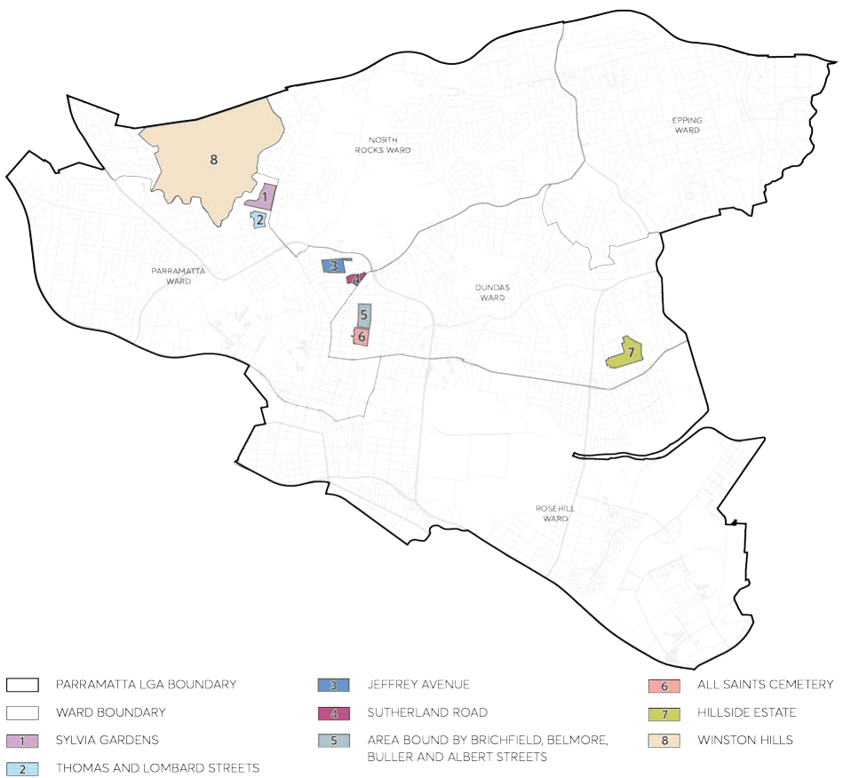

### 8.4 SPECIAL CHARACTER AREAS

Special Character Areas are well defined precincts that have been identified as having a special character and level of residential amenity that should be preserved. These areas have developed over a short period and retain a consistency of design, materials, and scale. Special Character Areas can be attributed to built form and also to subdivision pattern.

This Part of this DCP is to be read in conjunction with other Parts of the Parramatta DCP 2023 and the Parramatta Local Environmental Plan (LEP) 2023. If there is any inconsistency between this Part of this DCP and other Parts of the Parramatta DCP 2023, this Section of this DCP will prevail.

> [Picture on page 531: a picture, saved as a picture (images/part-08-centres-precincts-special-character-areas-specific-page-531-11.gif, 150 dpi).]

Figure 8.4.1 – Special Character Areas

CENTRES, PRECINCTS, SPECIAL CHARACTER AREAS & SPECIFIC SITES

SPECIAL CHARACTER AREAS

Objectives

O.01 Ensure development within each Special Character Area is compatible with the identified character and reinforces the special attributes and qualities of the area.

O.02 Ensure development maintains the level of residential amenity currently enjoyed and positively contributes to the distinctive characteristics of each area.

CENTRES, PRECINCTS, SPECIAL CHARACTER AREAS & SPECIFIC SITES

SPECIAL CHARACTER AREAS

| 8.4 | SPECIAL CHARACTER AREAS .................................................................................................... 528 8.4.1 SYLVIA GARDENS ......................................................................................................................... 531 8.4.2 THOMAS AND LOMBARD STREETS ....................................................................................... 533 8.4.3 JEFFERY AVENUE ........................................................................................................................ 535 8.4.4 SUTHERLAND ROAD .................................................................................................................. 537 8.4.5 AREA BOUNDED BY BRICKFIELD, BELMORE, BULLER AND ALBERT STREETS ....... 539 8.4.6 ALL SAINTS CEMETERY .............................................................................................................. 541 8.4.7 HILLSIDE ESTATE ......................................................................................................................... 547 8.4.8 WINSTON HILLS .......................................................................................................................... 550 |
|---|---|

CENTRES, PRECINCTS, SPECIAL CHARACTER AREAS & SPECIFIC SITES

SPECIAL CHARACTER AREAS
