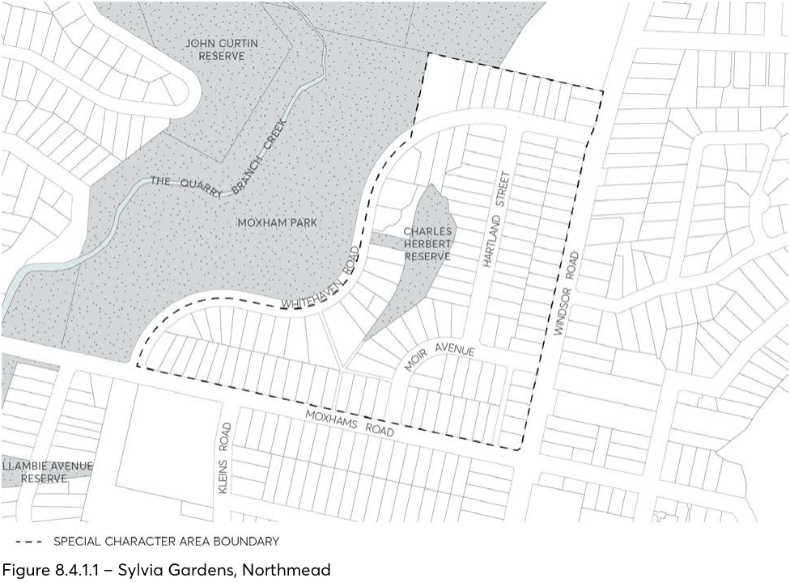

#### 8.4.1 SYLVIA GARDENS

> [Picture on page 534: a picture, saved as a picture (images/part-08-centres-precincts-special-character-areas-specific-page-534-4.gif, 150 dpi).]

Figure 8.4.1.1 – Sylvia Gardens, Northmead
