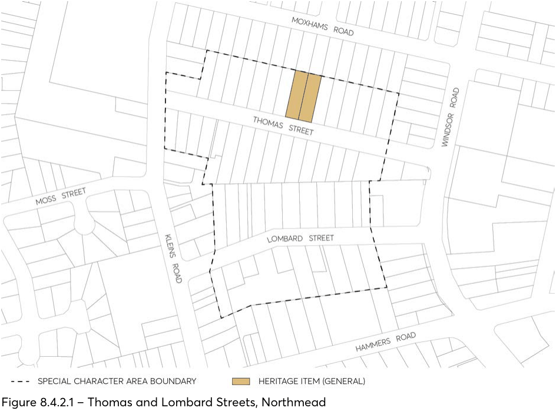

#### 8.4.2 THOMAS AND LOMBARD STREETS

> [Picture on page 536: a picture, saved as a picture (images/part-08-centres-precincts-special-character-areas-specific-page-536-4.gif, 150 dpi).]

Figure 8.4.2.1 – Thomas and Lombard Streets, Northmead
