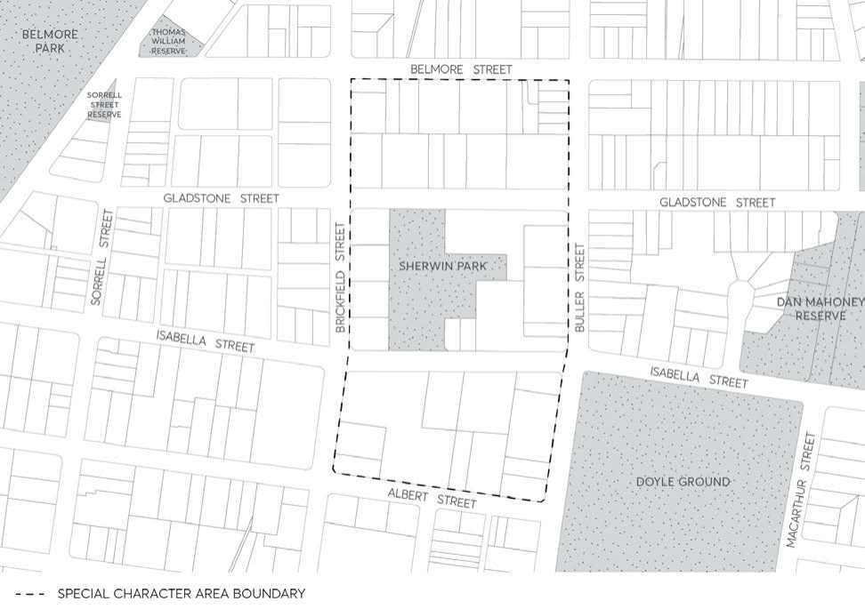

#### 8.4.5 AREA BOUNDED BY BRICKFIELD, BELMORE, BULLER AND ALBERT

#### STREETS

> [Picture on page 542: a picture, saved as a picture (images/part-08-centres-precincts-special-character-areas-specific-page-542-5.gif, 150 dpi).]

Figure 8.4.5.1 - Area bounded by Brickfield, Belmore, Buller and Albert Streets North Parramatta
