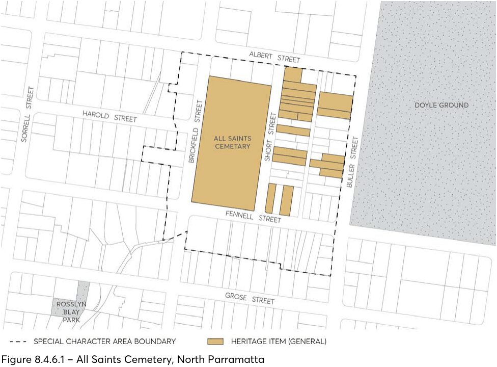

#### 8.4.6 ALL SAINTS CEMETERY

> [Picture on page 544: a picture, saved as a picture (images/part-08-centres-precincts-special-character-areas-specific-page-544-4.gif, 150 dpi).]

Figure 8.4.6.1 – All Saints Cemetery, North Parramatta
