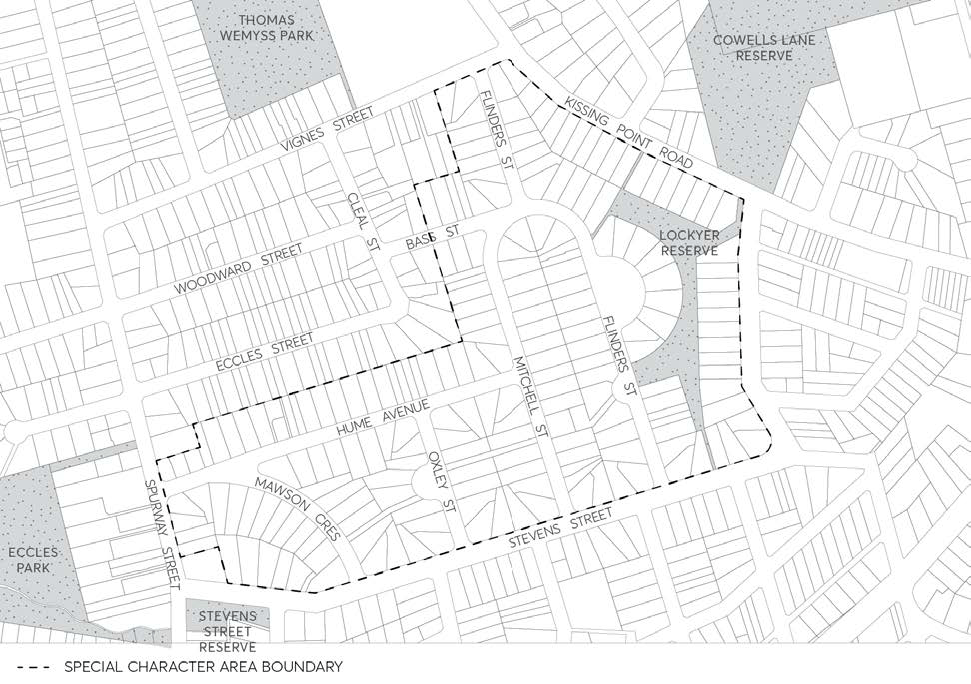

#### 8.4.7 HILLSIDE ESTATE

#### 8.4.7.1 DISTINCTIVE CHARACTER STATEMENT

This land was acquired by the firm of John Bridge Ltd who engaged land surveyors Lockie, Gannon, Worley and Campbell to design this subdivision, with its distinctive curvilinear layout. The Housing Commission acquired the estate in 1945. The estate with a variety of double-fronted and triple-fronted single storey brick houses with hipped or gabled roofs. The majority of houses have light tan or brown mottled bricks. Some houses have common bricks or mottled cream bricks, some of which have been painted or rendered. Some houses have been divided into two single person units for older people with minor changes to insert a second front door with a protective brick screen, while maintaining the architectural character of the building.

The allotments originally had low arris rail fences painted white. Most properties have no front fences while a few properties have low, open metal fences. The open space and pathway/drainage system has been grassed but remains open with few plantings.

> [Picture on page 550: a picture, saved as a picture (images/part-08-centres-precincts-special-character-areas-specific-page-550-16.gif, 150 dpi).]

Figure 8.4.7.1 – Hillside Estate, Ermington
