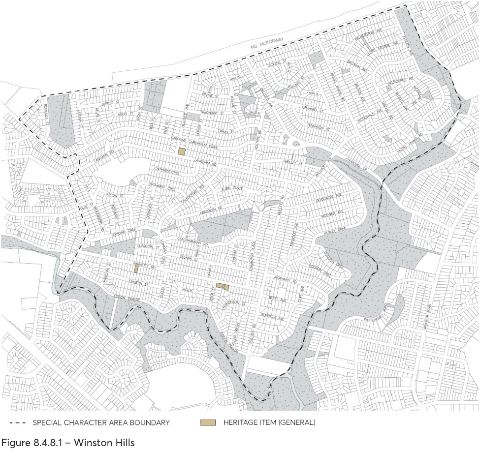

#### 8.4.8 WINSTON HILLS

> [Picture on page 553: a picture, saved as a picture (images/part-08-centres-precincts-special-character-areas-specific-page-553-4.gif, 150 dpi).]

Figure 8.4.8.1 – Winston Hills
