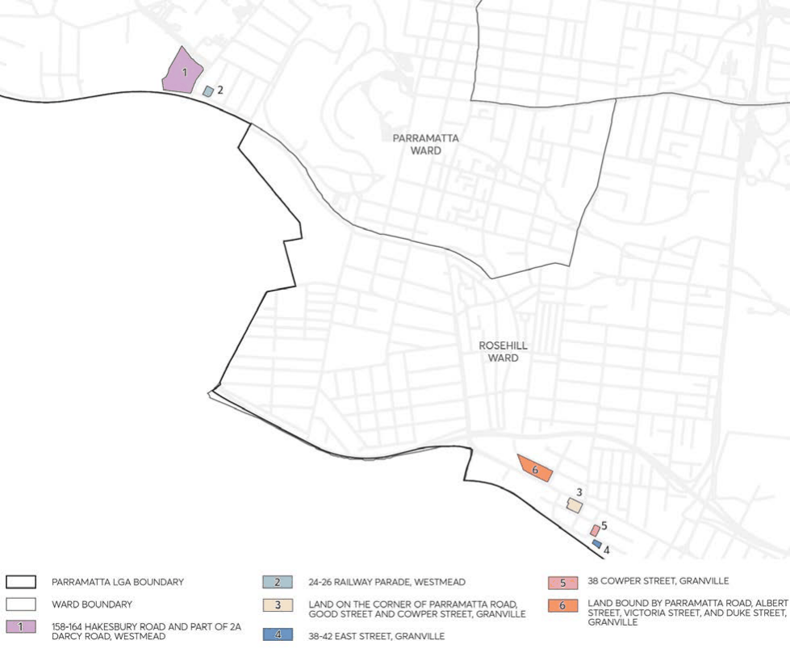
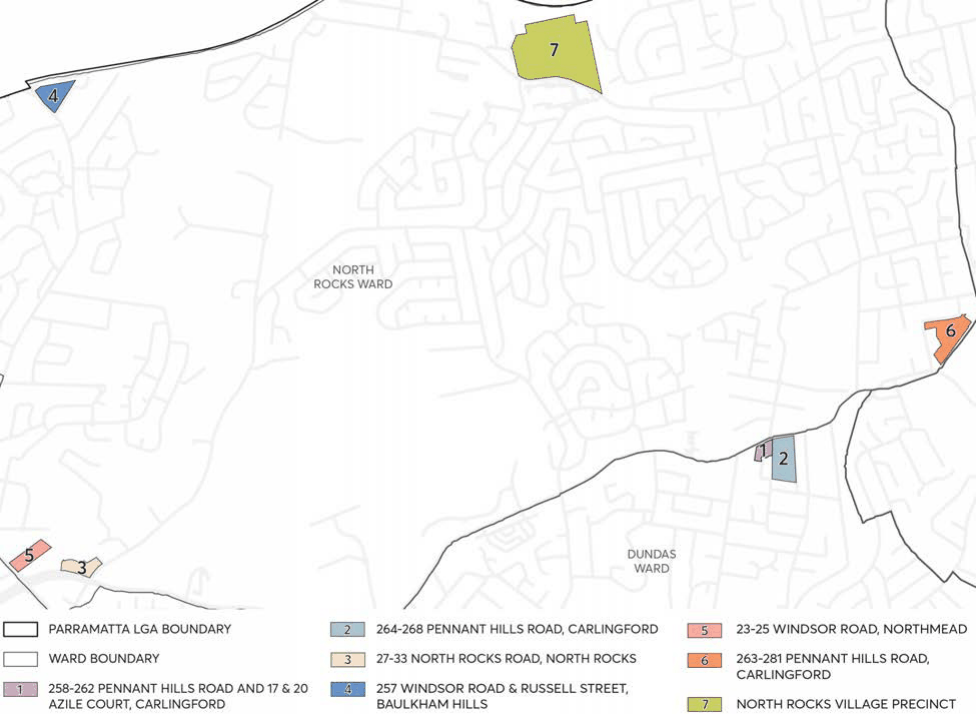

### 8.5 SPECIFIC SITES

This Section contains development controls for specific sites within the City, as identified in Figure

8.5.1 and Figure 8.5.2.

This Part of this DCP is to be read in conjunction with other Parts of the Parramatta DCP 2023 and the Parramatta Local Environmental Plan (LEP) 2023. If there is any inconsistency between this Part of the DCP and other Parts of the Parramatta DCP 2023, this Section of this Part will prevail.

> [Picture on page 555: a picture, saved as a picture (images/part-08-centres-precincts-special-character-areas-specific-page-555-8.gif, 150 dpi).]

Figure 8.5.1 – Specific sites within the Parramatta Ward and Rosehill Ward

CENTRES, PRECINCTS, SPECIAL CHARACTER AREAS & SPECIFIC SITES

> [Picture on page 556: a picture, saved as a picture (images/part-08-centres-precincts-special-character-areas-specific-page-556-2.gif, 150 dpi).]

Figure 8.5.2 – Specific sites within the Dundas Ward and North Rocks Ward

CENTRES, PRECINCTS, SPECIAL CHARACTER AREAS & SPECIFIC SITES

| 8.5 | SPECIFIC SITES ............................................................................................................................... 552 PARRAMATTA WARD ................................................................................................................................... 555 |  |
|---|---|---|
|  | 8.5.1 | 158-164 HAWKESBURY ROAD AND PART OF 2A DARCY ROAD, WESTMEAD ......... 555 |
|  | 8.5.2 | 24-26 RAILWAY PARADE, WESTMEAD ................................................................................. 572 |
|  | ROSEHILL WARD ........................................................................................................................................... 579 |  |
|  | 8.5.3 | LAND ON THE CORNER OF PARRAMATTA ROAD, GOOD STREET AND COWPER |
|  |  | STREET, GRANVILLE ................................................................................................................... 579 |
|  | 8.5.4 | 38-42 EAST STREET, GRANVILLE ............................................................................................ 593 |
|  | 8.5.5 | 38 COWPER STREET, GRANVILLE ......................................................................................... 600 |
|  | 8.5.6 | LAND BOUND BY PARRAMATTA ROAD, ALBERT STREET, VICTORIA STREET, AND |
|  |  | DUKE STREET, GRANVILLE .......................................................................................................604 |
|  | DUNDAS WARD ............................................................................................................................................. 616 |  |
|  | 8.5.7 | 258-262 PENNANT HILLS ROAD AND 17 & 20 AZILE COURT, CARLINGFORD ......... 616 |
|  | 8.5.8 | 264-268 PENNANT HILLS ROAD, CARLINGFORD .............................................................. 621 |
|  | NORTH ROCKS WARD ................................................................................................................................ 635 |  |
|  | 8.5.9 | 27-33 NORTH ROCKS ROAD, NORTH ROCKS .................................................................... 635 |
|  | 8.5.10 | 257 WINDSOR ROAD AND RUSSELL STREET, BAULKHAM HILLS ................................ 657 |
|  | 8.5.11 | 23-25 WINDSOR ROAD, NORTHMEAD ................................................................................. 677 |
|  | 8.5.12 | 263-281 PENNANT HILLS ROAD, CARLINGFORD ............................................................. 690 |
|  | 8.5.13 | NORTH ROCKS VILLAGE PRECINCT ......................................................................................722 |
|  | 8.5.14 | LAND IDENTIFIED WITH ADDITIONAL MATTERS FOR CONSIDERATION ................. 747 |

PARRAMATTA WARD

#### PARRAMATTA WARD

8.5.1 158-164 HAWKESBURY ROAD AND PART OF 2A DARCY ROAD,

#### WESTMEAD
