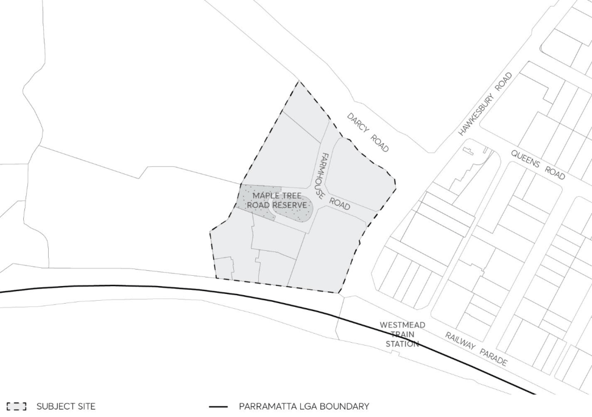

#### 8.5.1.1 DESIRED FUTURE CHARACTER

The site known as the University of Western Sydney (UWS) Westmead, comprises 158-164 Hawkesbury Road and part of 2A Darcy Road, Westmead. It is a four-hectare site located immediately north-west of Westmead Railway Station and within the Westmead Precinct, two kilometres west of the Parramatta City Centre.

The future mixed use character of the site complement the medical and research facilities of the precinct. The land uses for the site include: retail; commercial (i.e. medical support services, specialist rooms; medical professional associations etc); residential (i.e. serviced apartments, seniors living, key workers accommodation and residential flat buildings); open space and civic functions (i.e. plaza); and community facilities such as child care centres.

Future built form are designed to appropriately respond to the existing siting, scale, form and character of buildings of heritage significance, as well as provide appropriate heights and setbacks to street frontages to improve the quality of the public realm within the site.

Height is distributed across the site having regard for orientation, overshadowing, the scale of retained heritage buildings and views/vistas to Parramatta Park to the east. Built form fronting Hawkesbury and Darcy Roads locate active uses on the ground floor to increase the vibrancy of the Westmead Precinct as a whole.

The built form includes taller, slender “statement” buildings located along the railway line to enable a strong visual relationship between the precinct and the City Centre. Taller buildings are located within the south western corner of the site and reduce visual bulk, provide architectural modulation, reduce overshadowing, and encourage dual aspect apartments for enhanced access to sunlight and breeze.

The building form to the north and east are lower in height to optimise solar access to private and public open space and allow view corridors to the heritage buildings.

The strategic location of this site in relation to Westmead Station and adjacent to the T-Way lends itself to the creation of a transit oriented development which allows for greater intensity of uses to optimise the advantage of available transport infrastructure and minimise the reliance on vehicles.

NOTE: Development must comply with the objectives, principles and controls set out below and any relevant objectives, principles and controls in other relevant Parts of this DCP.

158-164 HAWKESBURY ROAD AND PART OF 2A DARCY ROAD, WESTMEAD

> [Picture on page 559: a picture, saved as a picture (images/part-08-centres-precincts-special-character-areas-specific-page-559-2.gif, 150 dpi).]

Figure 8.5.1.1.1 –Land application map

Objectives

In addition to general objectives listed in Section 8.2.1 – Westmead Local Centre of this DCP, specific objectives for this special area are identified below. O.01 Delivery of mixed use development that supports and meets the needs of the Westmead Precinct.

O.02 Ensure the built from features articulation and an attractive composition of building elements with a strong relationship between buildings and the streetscape.

O.03 Ensure the future built form is responsive to the existing siting, scale, form and character of heritage items.

O.04 Provide appropriate provision of and high-quality public domain elements, including internal streets, footpaths, open space and public square for the benefit of the existing and future community.

O.05 Ensure building height is distributed across the site having regard for orientation, overshadowing, heritage buildings and views/vistas.

O.06 Provide active ground floor uses along Hawkesbury Road and Darcy Road to increase the safety, use and interest of the street.

O.07 Provide a visual and physical connection throughout the site for a high level of surveillance and safety.

158-164 HAWKESBURY ROAD AND PART OF 2A DARCY ROAD, WESTMEAD

O.08 Accommodate generated traffic and the mitigation of traffic effects, and the promotion of public transport to the site.

Subdivision O.09 Ensure subdivision of the site reflects the road and public domain layout and is sensitive to the location of heritage buildings.

Control

C.01 Any subdivision of the site should ensure that the following occurs:

• Subdivision should reflect the road and public domain layout in Figure 8.5.1.2.1.

• All heritage buildings are located within a single allotment (and single ownership), where possible. If heritage buildings are located on separate allotments then measures should be put in place to ensure that the former relationships between them are interpreted.

• Subdivision boundaries should not extend across the footprint of heritage buildings or separate significant plantings and landscape features.

• Subdivision boundaries should be located to retain as much as possible of the immediate setting of each of the heritage buildings in the same allotment as the building.
