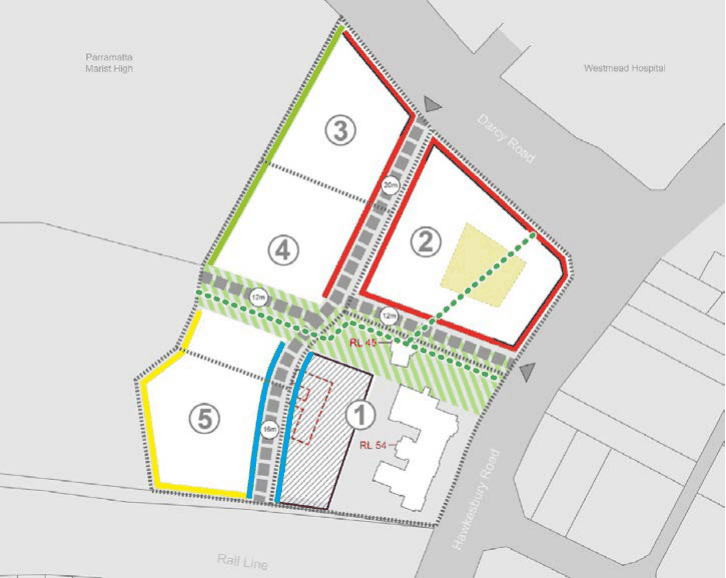
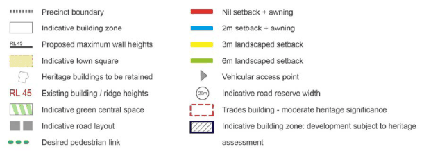

#### 8.5.1.2 BUILDING FORM & MASSING

Objectives

O.01 Ensure that buildings are compatible with the desired future character of the area in terms of building bulk and scale as demonstrated in Figure 8.5.1.2.1 and 8.5.1.3.1.

O.02 Ensure that new buildings reflect and recognise the exiting and proposed street and infrastructure pattern.

O.03 Ensure that new development responds well to the topography of the land. O.04 Ensure that new development is sympathetic to heritage items and surrounding properties. O.05 Ensure that development does not unreasonably diminish sunlight to neighbouring properties and within the development site.

Controls

Building Height

C.01 High-quality urban built form should be provided for all buildings. C.02 Variable building heights should be developed to ensure positive and cohesive relationships with other buildings both on the site and off the site.

C.03 Building heights should provide a transition in built form and land use intensity within the site.

158-164 HAWKESBURY ROAD AND PART OF 2A DARCY ROAD, WESTMEAD

C.04 Sunlight access should be provided to key areas of the public domain and further overshadowing of parks and community places are avoided or limited.

C.05 Development is to be designed and sited to minimise the extent of shadows that it casts on adjoining properties.

C.06 Development must have regard to the potential views/vistas from and to Parramatta Park. C.07 The maximum height of development for the site is established by the Parramatta LEP 2023. C.08 The site sections in Figure 8.5.1.5.2 to 8.5.1.5.3 demonstrate the maximum permitted tower and podium heights of each building.

C.09 Specific building height controls are provided as follows:

• For buildings within Precinct 2, street wall height fronting Hawkesbury Road will be limited to a maximum height of 14-16 metres (4 storeys) and street wall height fronting Darcy Road will be limited to a range of between 16 metres (4 storeys) at Hawkesbury Road rising to 27 metres (7-8 storeys);

• For buildings within Precinct 3, street wall height fronting Darcy Road will be limited to a maximum of 29 metres (8-9 storeys).

Floor Space Ratio

C.10 The maximum floor space ratio of development including the minimum non- residential floor space for the site is established by the Parramatta LEP 2023.

C.11 There should be a suitable mix and balance between residential and non-residential uses. C.12 The intensity of activity from the site is to be limited to the location where its impact is minimised.

Design

C.13 Buildings should be designed to create streetscapes that are characterised by:

• clearly defined edges and corners, and

• architectural treatments that are interesting and relate to the design and human scale of existing buildings.

C.14 Development is to establish an appropriate scale and transition to heritage buildings that does not visually overwhelm them.

C.15 Activated frontages must be located at ground level, especially along the footpaths of infrastructure and open spaces.

C.16 Built form should define and contain the street corridors, street corners and open spaces on the

site. Consider appropriate proportion (building heights), in particular towards Hawkesbury and Darcy Roads.

C.17 Appropriate solar access must be provided to other buildings and/or public open space within the site.

C.18 The slope across the site should be utilised to reduce potential bulky built form, thereby minimising its visual impact on streetscapes and surrounding public domain.

C.19 A strong visual address must be provided to Hawkesbury Road and Westmead Station.

158-164 HAWKESBURY ROAD AND PART OF 2A DARCY ROAD, WESTMEAD

C.20 Any buildings fronting the railway line are to provide adequate amenity with regard to noise and vibration.

C.21 A continuous street edge and articulated facades must be maintained throughout the site. NOTE: Any Development Applications for residential flat buildings on the site shall respond to the requirements of the State Environmental Planning Policy 65 – Design Quality of Residential Flat Development.

> [Picture on page 562: a picture, saved as a picture (images/part-08-centres-precincts-special-character-areas-specific-page-562-8.gif, 150 dpi).]

> [Picture on page 562: a picture, saved as a picture (images/part-08-centres-precincts-special-character-areas-specific-page-562-9.gif, 150 dpi).]

Figure 8.5.1.2.1 – Built Form Control
