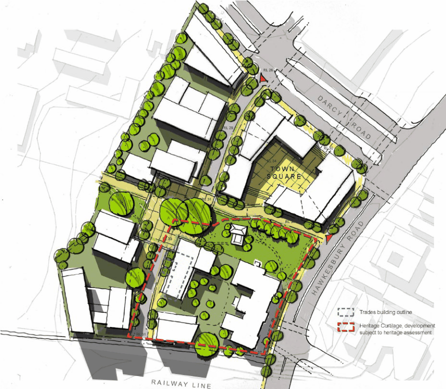
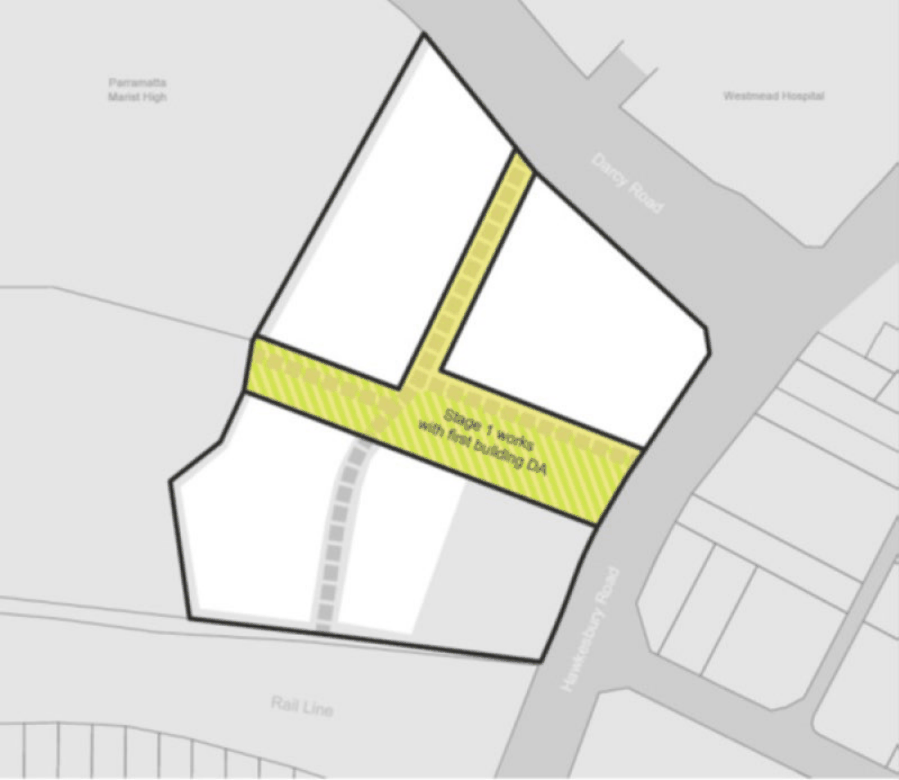

#### 8.5.1.3 PUBLIC DOMAIN AND INDICATIVE LAYOUT

Objectives

O.01 Provide an open space network and site layout that enhances the existing and future built form. O.02 Provide an open space network that facilities pedestrian access/circulation and which creates a sequence of spaces across the site.

O.03 Create opportunity for the enlivening of existing commercial streets, to create a safe environment, whilst minimising impacts on residential and pedestrian amenity.

158-164 HAWKESBURY ROAD AND PART OF 2A DARCY ROAD, WESTMEAD

Controls

Open Space C.01 The portion of the public domain as indicated in Figure 8.5.1.3.2 must be provided at the time of the first Development Application (DA) for a building. That DA must detail by submission and subsequent conditions of consent the timing, phasing, extent (streets, trees, footpaths, street furniture etc) and management of that public domain.

C.02 The provision of public domain shall satisfy the provision of Crime Pretention through Environmental Design and be provided generally in accordance with Figure 8.5.1.2.1.

C.03 Landscaped areas shall constitute a minimum of 40% (including deep soil) of the site area. C.04 Deep soil landscape area shall constitute a minimum of 30% of the site area. C.05 No car parking will be permitted in areas designated as landscaped areas. C.06 Landscaped area may include roof gardens. C.07 The public domain as indicated in Figure 8.5.1.2.1 is to be incorporated into future development and subdivision of the site, including the open space, pedestrian linkages, internal private roads and footpaths.

C.08 The orientation of the public domain should provide good solar access and views and vistas internally and externally of the site.

C.09 A range of outdoor spaces shall be provided. Larger and smaller spaces and wider footpaths should be provided to enable a range of activities.

C.10 All street furniture, landscaping works, utilities and equipment shall contribute to the community’s enjoyment of the public domain, but not impede pedestrian movement and safety nor visual quality.

C.11 Pedestrian surfaces shall be designed to be safe for all users, clearly identified and constructed from materials that provide consistency and continuity of streetscape.

C.12 There shall be an increase in native vegetation in the public domain spaces provided. C.13 Level changes shall be avoided and cluttering of street furniture minimised to allow easy and unhindered access.

C.14 All open space shall reflect the principles of ‘Safer by Design’ by minimising dead ends, high walls, dense planting and ensuring casual surveillance of public domain from both residential and non-residential uses.

C.15 Landscaping should ensure safety and security, and the perception of safety and security, with clear sight lines and minimal opportunities for concealment.

C.16 Street trees should be provided on all new streets to Council’s specifications. C.17 Landscaping should retain mature stands of trees (e.g. large figs and tallowwoods) where these contribute to area character and a canopied skyline.

C.18 The town square shall have a strong street address and presence on Hawkesbury Road. This includes prominent entrance locations, pedestrian access and visual connectivity.

158-164 HAWKESBURY ROAD AND PART OF 2A DARCY ROAD, WESTMEAD

> [Picture on page 564: a picture, saved as a picture (images/part-08-centres-precincts-special-character-areas-specific-page-564-2.gif, 150 dpi).]

Figure 8.5.1.3.1 – Indicative Concept Plan

158-164 HAWKESBURY ROAD AND PART OF 2A DARCY ROAD, WESTMEAD

> [Picture on page 565: a picture, saved as a picture (images/part-08-centres-precincts-special-character-areas-specific-page-565-2.gif, 150 dpi).]

Figure 8.5.1.3.2 – Public Domain Works to be provided at the time of the first Development Application
