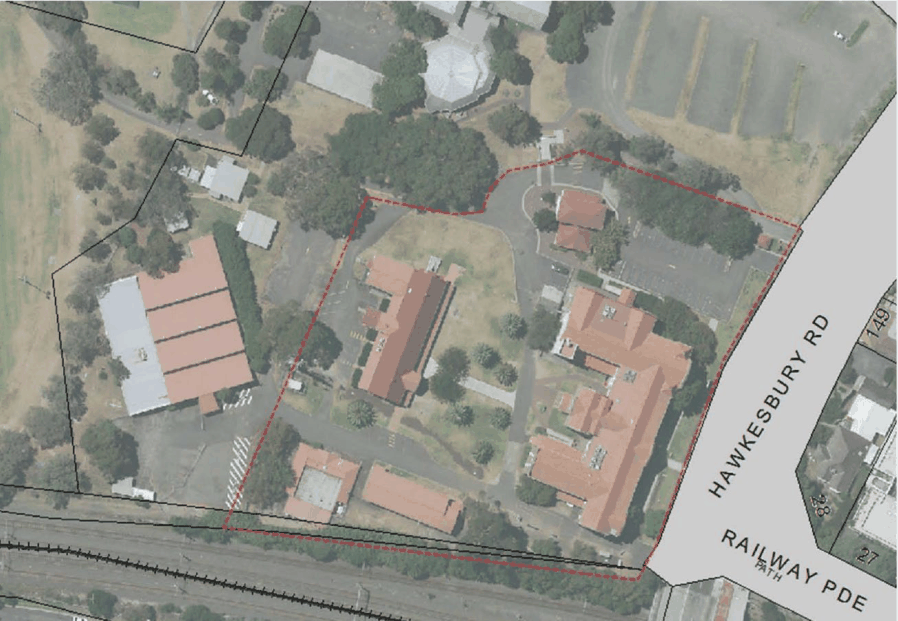

#### 8.5.1.4 HERITAGE

Objectives

O.01 Ensure appropriate management of the heritage significance of the site. O.02 Retain and reinforce the buildings of heritage significance and their settings indicated in Figure 8.5.1.4.1.

O.03 Ensure development is compatible with the heritage significance and character of the site.

Controls

General

C.01 New development must:

158-164 HAWKESBURY ROAD AND PART OF 2A DARCY ROAD, WESTMEAD

• Be based on a detailed understanding of the heritage significance of the site and its key built and landscape elements, in particular the setbacks and curtilage of buildings of heritage significance;

• Incorporate meaningful interpretation of the heritage significance of the place;

• Include appropriate recording of changes to the site and to its significant built and landscape elements; and

• New development must also include an assessment of the potential impacts (both positive and adverse) on the heritage significance of the site and its key built and landscape elements.

Adaptive Re-Use

C.02 Sensitive adaptive re-use of the heritage buildings is encouraged.

• New uses should be compatible with the heritage significance of the place and be undertaken in accordance with best-practice guidelines including New Uses for Heritage Places: guidelines for the adaptation of historic buildings and sites, prepared by the Heritage Council of NSW and RAIA (now Australian Institute of Architects) in 2008.

• The original/early external form and architectural detailing must be retained and enhanced. Any intrusive elements or additions should be removed.

• Original/early internal spaces and features should be retained, conserved and meaningfully incorporated into their adaptive re-use, wherever possible.

• Changes should meet legislated protection , access and safety requirements should be subservient to the primary architectural features of the buildings .

• New additions should be:

b) located consistent with the original design principles for each building-they should generally be located to the rear and not adversely impact views of the principal elevations;

c) subservient in terms of scale, bulk and massing-they should not visually dominate the existing building or adjacent significant buildings;

d) designed to allow an ongoing appreciation of the heritage buildings as separate structures within a cultural landscape and continue to allow an understanding of their former functional and visual relationships;

e) of contemporary architectural character, detailing and materials and should not be imitations of the existing building; and

f) of an architectural quality (detailing , design and materiality) that is either equal to or greater than that of the existing building:

158-164 HAWKESBURY ROAD AND PART OF 2A DARCY ROAD, WESTMEAD

> [Picture on page 567: a picture, saved as a picture (images/part-08-centres-precincts-special-character-areas-specific-page-567-2.gif, 150 dpi).]

Figure 8.5.1.4.1 – Ariel View Demonstrating the Curtilage of the Buildings of Heritage Significance

New Buildings C.03 New buildings should be consistent with best-practice guidelines including Design in Context; guidelines for infill development in the historic environment, prepared by the NSW Heritage Office (now Heritage Branch, Office of Environment and Heritage) and RAIA (now Australian Institute of Architects) in 2005. NOTE: The guidelines identify a number of design criteria for successful infill design that should be taken into consideration when constructing new buildings on the site. They are- character, scale, form, siting, materials and colour and detailing. Consistency with the guidelines is of particular importance when considering infill development within the vicinity of the heritage buildings on the site (i.e. within the identified heritage curtilage) or within their immediate vicinity.

158-164 HAWKESBURY ROAD AND PART OF 2A DARCY ROAD, WESTMEAD
