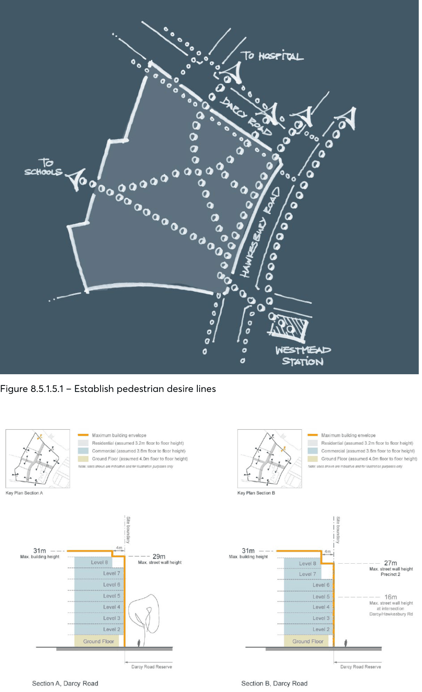
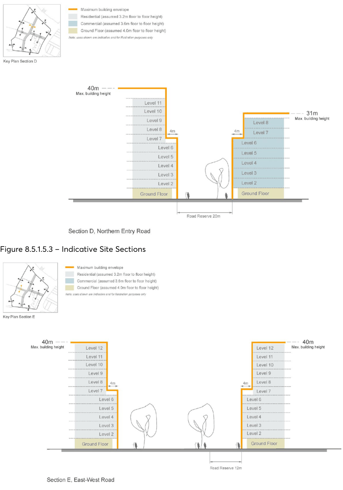
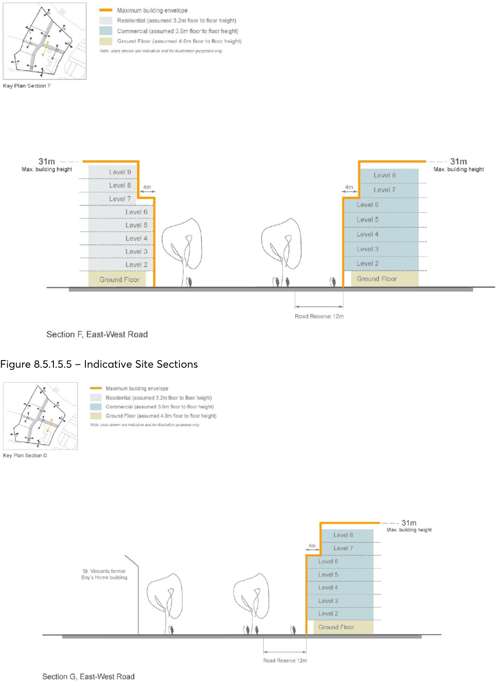
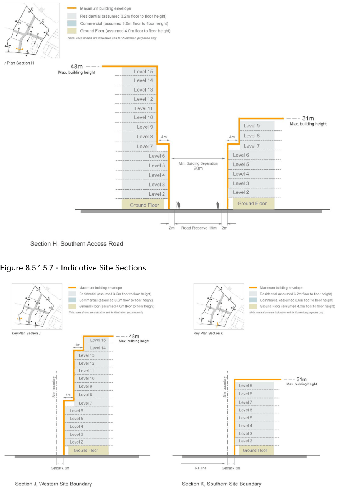
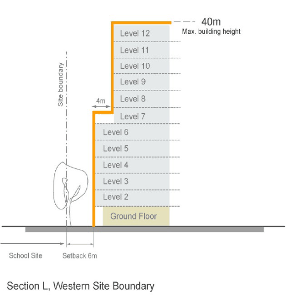

#### 8.5.1.5 TRAFFIC & TRANSPORT

Objectives

C.01 Encourage commuting by public transport in order to reduce the number of motor vehicles travelling through and to the site, and to improve overall environmental quality and pedestrian amenity.

C.02 Encourage the use of bicycles as an environmentally beneficial form of transport and an alternative to the use of private motor vehicles.

C.03 Encourage non-car trips by providing a maximum provision of car parking associated with each use.

Controls

C.04 The development of the site must demonstrate a mode split of 35% public transport to 65% private transport.

C.05 Buildings should be designed with car parking at the basement level. C.06 The site development must provide secure bicycle parking and links to the existing cycle network.

C.07 Pedestrian and vehicle conflict should be minimised with limited vehicle crossings in the public domain.

C.08 New vehicular links within the site should be provided generally as shown in Figure 8.5.1.2.1. C.09 Encourage and where possible improve pedestrian links as shown in Figures 8.5.1.5.1. C.10 A Travel Plan must be provided and include:

• Targets - This typically includes the reduction of single occupant car trips to the site for the journey to work and the reduction of business travel particularly single occupant car trips.

• Travel data - An initial estimate of the number of trips to the site by mode is required. Travel Plans require an annual travel survey to estimate the change in travel behaviour to and from the site and a review of the measures.

• Measures - a list of specific tools or actions to achieve the target.

C.11 Car parking provided in connection with a use must not result in exceeding the maximum as identified in Table 8.5.1.5.1.

C.12 A detailed traffic model and analysis must be provided.

158-164 HAWKESBURY ROAD AND PART OF 2A DARCY ROAD, WESTMEAD

Table 8.5.1.5.1 - Car parking requirements

| Proposed use of building | Maximum number of parking spaces |
|---|---|
| Child care centres | A maximum of 1 parking space to be provided for every 4 child care places |
| Commercial | A maximum of 1 parking space to be provided for every 100m² of gross floor area |
| Health consulting rooms | A maximum of 1 parking space to be provided for every 300m² of gross floor area |
| Hostels and nursing homes | A maximum of 1 parking space to be provided for every 10 beds plus 1 parking space to be provided for every 2 employees plus 1 parking space to be provided that is suitable for an ambulance |
| Hotel accommodation | A maximum of 1 parking space to be provided for every 5 hotel units plus 1 parking space to be provided for every 3 employees |
| Residential flat buildings: studio apartments | A maximum of 0.6 spaces to be provided for every apartment |
| Residential flat buildings: 1, 2 and 3 bedrooms | A maximum of 1 parking space to be provided for every dwelling plus 1 parking space to be provided for every 5 dwellings for visitors |
| Restaurants | A maximum of 1 parking space to be provided for every 10m² of gross floor area or 1 parking space to be provided for every 4-seats (whichever is the lesser) |
| Seniors housing | A maximum of 1 parking space to be provided for every 10 dwellings plus 1 parking space to be provided for every 10 dwellings for visitors |
| Shops/retail | A maximum of 1 parking space to be provided for every 30m² of gross floor area |

Bicycle Parking C.13 Bicycle parking must be provided in accordance with Part 6 – Traffic and Transport of this DCP. Streets C.14 Streets are required to satisfy the requirements of the Australian Standards with respect to the width and form of streets and footpaths.

Alternative Means of Transport C.15 Pedestrian links and facilities for non-car modes of transport must be provided.

158-164 HAWKESBURY ROAD AND PART OF 2A DARCY ROAD, WESTMEAD

> [Picture on page 570: a picture, saved as a picture (images/part-08-centres-precincts-special-character-areas-specific-page-570-2.gif, 150 dpi).]

Figure 8.5.1.5.1 – Establish pedestrian desire lines

158-164 HAWKESBURY ROAD AND PART OF 2A DARCY ROAD, WESTMEAD

Figure 8.5.1.5.2 – Indicative Site Sections

> [Picture on page 571: a picture, saved as a picture (images/part-08-centres-precincts-special-character-areas-specific-page-571-3.gif, 150 dpi).]

Figure 8.5.1.5.3 – Indicative Site Sections

Figure 8.5.1.5.4 – Indicative Site Sections

158-164 HAWKESBURY ROAD AND PART OF 2A DARCY ROAD, WESTMEAD

> [Picture on page 572: a picture, saved as a picture (images/part-08-centres-precincts-special-character-areas-specific-page-572-2.gif, 150 dpi).]

Figure 8.5.1.5.5 – Indicative Site Sections

Figure 8.5.1.5.6 – Indicative Site Sections

158-164 HAWKESBURY ROAD AND PART OF 2A DARCY ROAD, WESTMEAD

> [Picture on page 573: a picture, saved as a picture (images/part-08-centres-precincts-special-character-areas-specific-page-573-2.gif, 150 dpi).]

Figure 8.5.1.5.7 - Indicative Site Sections

Figure 8.5.1.5.8 - Indicative Site Sections

158-164 HAWKESBURY ROAD AND PART OF 2A DARCY ROAD, WESTMEAD

> [Picture on page 574: a picture, saved as a picture (images/part-08-centres-precincts-special-character-areas-specific-page-574-2.gif, 150 dpi).]

Figure 8.5.1.5.8 - Indicative Site Sections

24-26 RAILWAY PARADE, WESTMEAD
