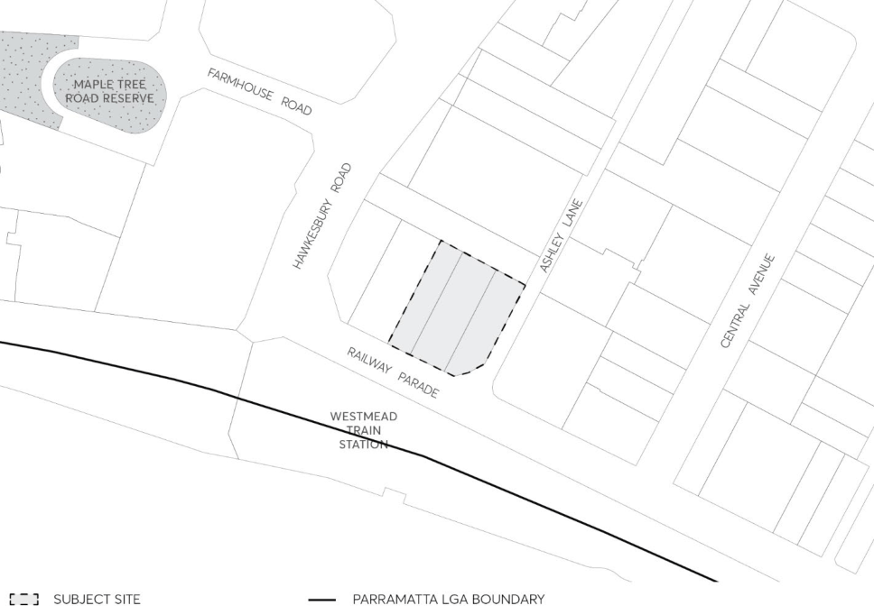

#### 8.5.2 24-26 RAILWAY PARADE, WESTMEAD

This Section applies to land at 24-26 Railway Parade, Westmead. The DCP details the desired future character for the site as part of the greater Westmead precinct. It provides site-specific objectives and controls to achieve development that is consistent with the desired future character. The controls are further illustrated in Figures 8.5.2.1.1 to 8.5.2.2.4. Figure 8.5.2.2.2 provides an indicative Master Plan for the site.

> [Picture on page 575: a picture, saved as a picture (images/part-08-centres-precincts-special-character-areas-specific-page-575-8.gif, 150 dpi).]

Figure 8.5.2.1 – Land application map
