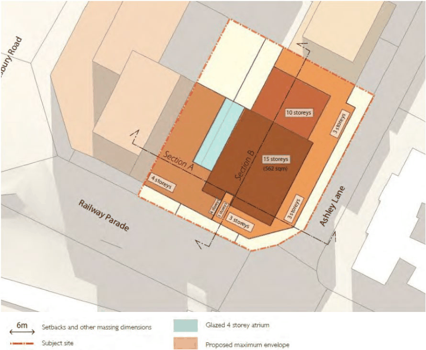

#### 8.5.2.1 DESIRED FUTURE CHARACTER

The site is known as 24-26 Railway Parade, Westmead. The site has an area of 2,512m² with a frontage of 42 metres to Railway Parade and 53 metre to Ashley Lane. The site is immediately north of Westmead Railway Station and within the Westmead Town Centre. The location of the site supports the greater intensity of uses to optimise the available transport services in order the minimise dependence on private vehicles.

The mixed use character of development complements the Town Centre. The mix of land uses includes shops, a tavern, commercial offices, and medical suites in the podium with short term accommodation and residential uses in the tower.

24-26 RAILWAY PARADE, WESTMEAD

The building form is stepped in plan and elevation to reduce bulk and scale, provide architectural modulation, and minimum overshadowing. A 3-4 level podium setback from the street frontages allow widening of the footpath to improve the quality of the public domain surrounding the site. The tower up to a height of 15 storeys is to be set further back to respect the existing development character whilst also recognising the need for increased height.

The tower marks the Darcy Road termination, and complements the gateway to Westmead Precinct with development of a similar scale on the UWS site to the west.

A double storey high pedestrian link provides public pedestrian access from the Railway Station via Railway Parade through to a landscaped courtyard open space, and allows for a potential link to Hawkesbury Road and beyond to Westmead Hospital. Active uses are provided to the edges of the pedestrian link and public open space, the street edge to Railway Parade, and at the corner of Railway Parade and Ashley Lane. Active uses are include shops, building entries and commercial uses.

Development must comply with the objectives and controls set out below and any other relevant objectives and controls of this DCP.

Objectives

Site Objectives O.01 Respond to the role of Westmead as a Specialised Centre under the Metropolitan Strategy for Sydney 2036.

O.02 Provide a mix of uses that support the role of Westmead Town Centre and Westmead Hospital Precinct.

O.03 Strengthen the built form relationship with the western edge of the Parramatta City Centre. O.04 Revitalise the Westmead Town Centre. O.05 Recognise the southern gateway and transport hub of Westmead through built form emphasis. O.06 Encourage high-quality built form outcomes and achieve design excellence. O.07 Activate the block edges to Railway Parade with appropriate uses. O.08 Integrate new built form with recent new development in the subject block. O.09 Minimise any adverse impacts on the amenity of adjoining uses in particular residential apartments.

O.10 Achieve a safe and vibrant station precinct and public domain. Building Form and Massing O.11 Achieve a sense of transition in use and form to the residential neighbourhoods to the east and north.

O.12 Maintain the landscape vistas from Old Government House and its heritage significance. O.13 Respond sensitively to the scale, proportions and form of the heritage Old Boys Home on Hawkesbury Road through the streetscape response of any new development.

24-26 RAILWAY PARADE, WESTMEAD

O.14 High-quality urban built form should be provided for all buildings. O.15 Variable building heights should be developed to ensure positive and cohesive relationships with surrounding built form.

O.16 Development is to be designed and sited to minimise the extent of shadows that it casts on surrounding properties.

O.17 Development is to minimise areas of blank walls. Where unavoidable, blank walls are to be treated with high-quality materials and articulated to create visual interest.

Controls

Maximum building heights C.01 Maximum height of 15 storeys at the corner of Railway Parade and Ashley Lane. C.02 Maximum height of 10 storey to the rear of the site along Ashley Lane. C.03 Maximum height of 4 storeys to south west of the site on Railway Parade.

> [Picture on page 577: a picture, saved as a picture (images/part-08-centres-precincts-special-character-areas-specific-page-577-14.gif, 150 dpi).]

Figure 8.5.2.1.1 – Built form controls – Storeys

Street frontage heights C.04 Maximum 3 storey height facing Ashley Lane. C.05 Maximum 4 storey height facing Railway Parade with transition to 3 storeys in 1/3 of the facade length towards the laneway (east).

Building setbacks

24-26 RAILWAY PARADE, WESTMEAD

C.06 Minimum 3 metre setback to Railway Parade to widen the existing footpaths. C.07 Minimum 3 metre setback to Ashley Lane to allow for a wider footpath along the laneway. Building setbacks above maximum street frontage heights C.08 Minimum 6 metres to Ashley Lane C.09 Minimum 6 metres to Railway Parade.
