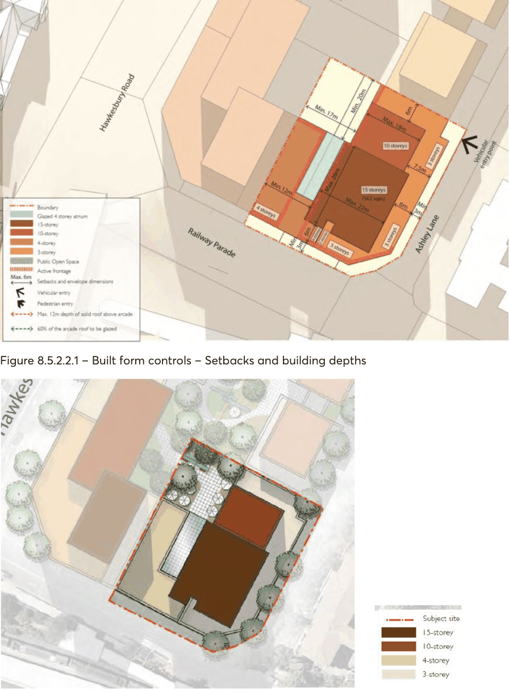
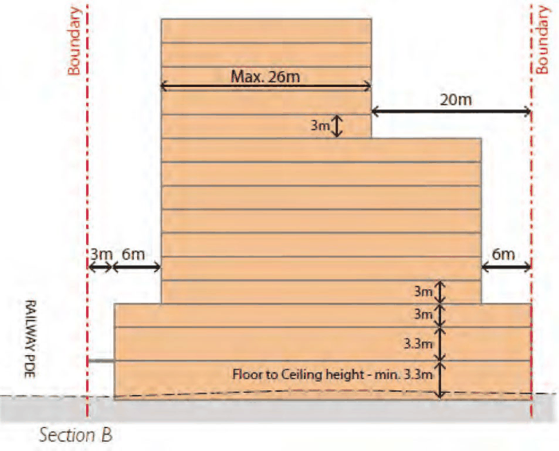
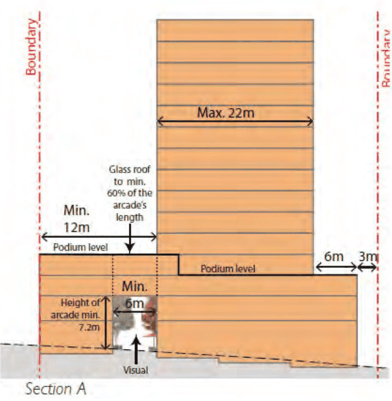

#### 8.5.2.2 PUBLIC DOMAIN AND LANDSCAPING

Objectives

O.01 Encourage street level pedestrian movement networks and recognise the existing desire lines between the station and hospital uses.

O.02 Improve the landscape character and quality of the public domain of Westmead in particular Railway Parade and Hawkesbury Road.

Controls

Publicly accessible open space C.01 A minimum area of 350m² with minimum dimensions in accordance with Figure 8.5.2.2.1 of this DCP.

C.02 Solar access of minimum 2 hours between the hours of 10:00am and 3:00pm on June 22nd to at least 50% of the public open space area.

C.03 A double storey through-site pedestrian link with a minimum width of 6 metres. Open space C.04 Activated on all edges with the proposed development (minimum 90% of active edges minimum).

C.05 A high-quality urban space including landscaping, art works and areas for dining and passive recreation.

Pedestrian link C.06 Activated on all edges within the proposed development (minimum 90% to be active edges). C.07 Maximum depth of building covering the link is to be 12 metres. C.08 The link is to have a glazed roof to optimise solar access as illustrated in Figures 8.5.2.1.1, 8.5.2.2.1, 8.5.2.2.2 and 8.5.2.2.4.

24-26 RAILWAY PARADE, WESTMEAD

> [Picture on page 579: a picture, saved as a picture (images/part-08-centres-precincts-special-character-areas-specific-page-579-2.gif, 150 dpi).]

Figure 8.5.2.2.1 – Built form controls – Setbacks and building depths

Figure 8.5.2.2.2 – Indicative Master Plan

24-26 RAILWAY PARADE, WESTMEAD

> [Picture on page 580: a picture, saved as a picture (images/part-08-centres-precincts-special-character-areas-specific-page-580-2.gif, 150 dpi).]

Figure 8.5.2.2.3 – North-South Section of Site Building Envelope

> [Picture on page 580: a picture, saved as a picture (images/part-08-centres-precincts-special-character-areas-specific-page-580-4.gif, 150 dpi).]

Figure 8.5.2.2.4 – East-West Section of Site Building Envelope

24-26 RAILWAY PARADE, WESTMEAD
