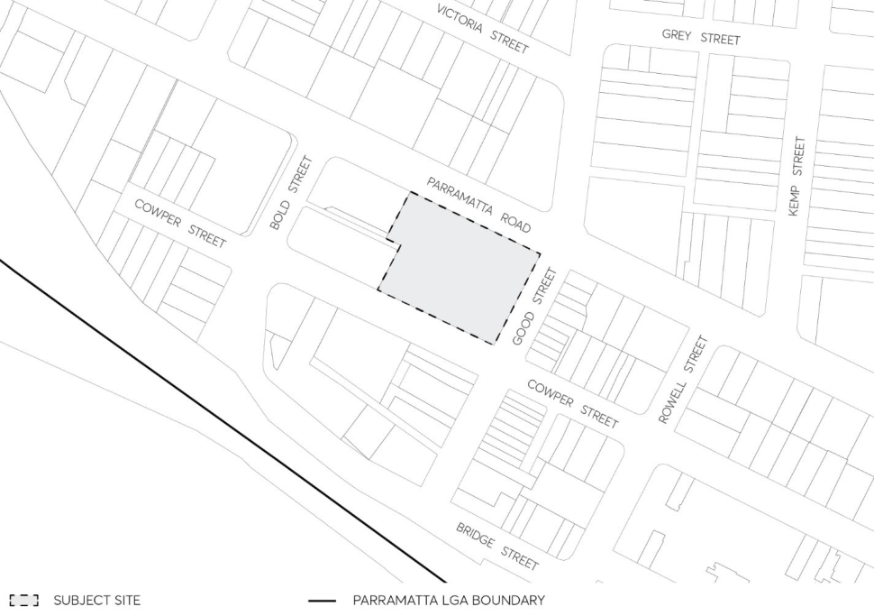

#### 8.5.3 LAND ON THE CORNER OF PARRAMATTA ROAD, GOOD STREET AND

#### COWPER STREET, GRANVILLE

This Section applies to a 5,150m² land parcel in Granville that has frontage to Parramatta Road, Good Street and Cowper Street, as shown in Figure 8.5.3.1. The site comprises 15 individual land parcels as follows:

Lot 1 DP 604204, Lot 1 DP 76041, Lot 1 DP 998948, Lot 1 DP 783581, Lot 1 DP 979437 Section A, Lot 2 DP 979437 Section A, Lot 7 DP 979437 Section A, Lot 1 DP 1075357, Lot 2 DP 1075357, Lot 3 DP 1075357, Lot 4 DP 1075357, Lot 5 DP 1075357, Lot 6 DP 1075357, Lot 12, DP 575064, and Lot 1 DP 721626.

> [Picture on page 582: a picture, saved as a picture (images/part-08-centres-precincts-special-character-areas-specific-page-582-11.gif, 150 dpi).]

Figure 8.5.3.1 - Land application map

This Section is to be read in conjunction with other Parts of this DCP and the Parramatta Local Environmental Plan (LEP) 2023. It establishes principles, objectives and controls to be interpreted during preparation and assessment of Development Applications and supports the objectives of the LEP.
