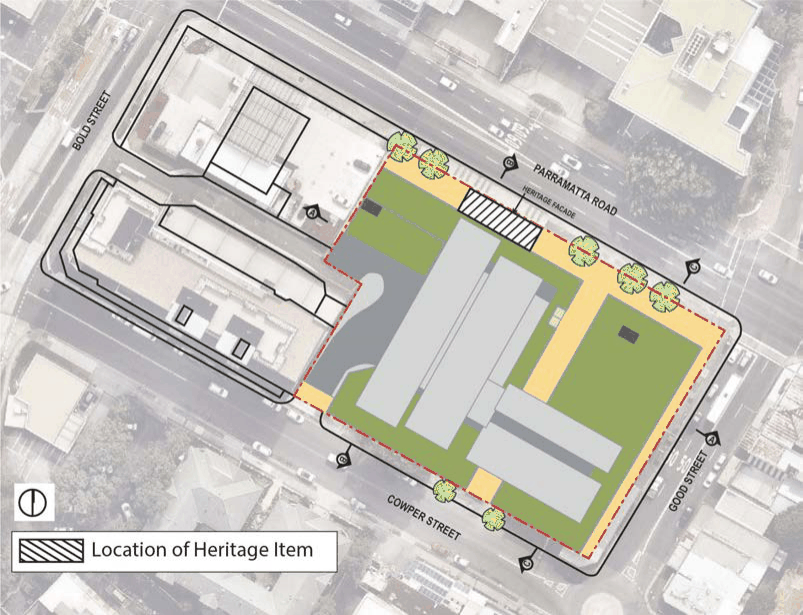

#### 8.5.3.1 DESIRED FUTURE CHARACTER

The location of the site is consistent with the State Government policies for a renewed Parramatta Road Corridor, and is well located in relation to the Parramatta City Centre.

SPECIFIC SITES LAND ON THE CORNER OF PARRAMATTA ROAD, GOOD STREET AND COWPER STREET, GRANVILLE

The mixed use character of development complements the Granville Town Centre and provide a positive design statement, appropriately marking the connection of the town centre main street (Good Street) with Parramatta Road. The mix of land uses includes ground floor retail, commercial offices, residential apartments, public spaces and thoroughfare, and the retention of heritage.

The following key design principles are to be incorporated into the future design:

• Respond to the generally orthogonal east-west north-south street pattern;

• Reinforce the Good Street precinct as the primary local retail destination, a primary pedestrian and vehicular connection across Parramatta Road to the north as well as being a primary pedestrian route to Granville Station;

• Minimise residential noise exposure from Parramatta Road;

• Provide a finer grain pedestrian network; and

• Retain the original extent of the front heritage façade of “The Barn” – 138 Parramatta Road through its deconstruction and reconstruction in line with the 6 metre setback proposed to Parramatta Road (subject to approval though the Development Application process) to prevent the item’s total loss should road widening be required by RMS as a result of the Granville Precinct Wide Traffic Study.

Built form comprises of a podium edge to the three streets with recessed tower forms. The podium comprises of 3-4 storeys and includes the façade retention of the heritage property known as “The Barn” that fronts Parramatta Road after the façade is setback 6 metres from the Parramatta Road edge to prevent its future loss should the land along Parramatta Road be required for road widening.

Large consolidated sites result in a loss of grain and character at street level. The street wall, separate from tower forms above, are designed as the architectural component of the development that defines and imparts fine grain and character to the street. Principles to be incorporate in the design of the street wall include:

• Maximising the setback of higher tower forms in order to differentiate the street wall as a separate architectural element, which can be distinct and different in character from the higher tower elements;

• The street wall should be designed to provide a well-modulated pedestrian experience at street level. A smaller, more detailed scale should be used in its articulation;

• The design of the street wall should have regard to the traditional narrow subdivision plan and reflect this in its composition and articulation; and

• Ground floor facades should be rich in variation and detail. Many doors and vertical relief in the facades intensify the walking experience, with awnings included and integrated in the design in order to provide adequate pedestrian shelter

A low scale to Good Street is provided through the podium, with residential exposure to Parramatta Road minimised within the podium. A maximum height of 82 metres (25 storeys), excluding plant and lift overrun, is adhered to for the majority of the site.

SPECIFIC SITES LAND ON THE CORNER OF PARRAMATTA ROAD, GOOD STREET AND COWPER STREET, GRANVILLE

The north to south through site pedestrian link is generally open, with the exception of any opening that pass beneath the tower(s) above. Double sided active retail uses fronting Good Street and the pedestrian through site link are required.

Development is to comply with the objectives and controls set out below and any other relevant objectives and controls of this DCP.

The proposed reference design concept for the site is shown in Figure 8.5.3.1.1. As seen in the legend of the Figures, the hatched land along Parramatta Road represents the location of the Heritage Item which subject to Development Application approval is proposed to be relocated

in line with the 6 metre setback to Parramatta Road to prevent its future removal should the land be required for road widening in the future as a result of the Granville Precinct Wide Traffic Study.

> [Picture on page 584: a picture, saved as a picture (images/part-08-centres-precincts-special-character-areas-specific-page-584-12.gif, 150 dpi).]

Figure 8.5.3.1.1 - Reference design for the site

Objectives

O.01 Provide a mix of uses that support the role of the Granville Town Centre. O.02 Revitalise the northern end of Granville Town Centre. O.03 Encourage high-quality built form outcomes and achieve design excellence. O.04 Create an attractive and safe urban street environment for pedestrian and retail, community activities in the surrounding streets.

SPECIFIC SITES LAND ON THE CORNER OF PARRAMATTA ROAD, GOOD STREET AND COWPER STREET, GRANVILLE

O.05 ‘Future proof’ the subject site by ensuring land is retained through setbacks for road widening along Parramatta Road and Good Street should it be required in the future, and have flexible controls to allow the land within the setbacks to either form part of the public domain or part of the road infrastructure.

O.06 Activate the block edges to Parramatta Road, Good Street and Cowper Street. O.07 Complete the laneway connection between Bold Street and Cowper Street. O.08 Minimise adverse impacts on the amenity of adjoining uses and that the built form be sympathetic to the Heritage Item.

O.09 Restore and conserve the front façade and associated portions of lateral walls of the Heritage Item “The Barn” through its deconstruction and reconstruction in line with the 6 metre setback proposed to Parramatta Road (subject to approval through the Development Application process) to prevent the item’s total loss should road widening be required by RMS as a result of the Granville Precinct Wide Traffic Study.

O.10 Provide the opportunity for the widening of the Parramatta Road corridor and permit deep soil planting between the site and Parramatta Road should the land form part of the public domain and not be required for road widening, which will be confirmed after the completion of the Granville Precinct Wide Traffic Study.

O.11 Provide a through site pedestrian link between Parramatta Road and Cowper Street. O.12 Incorporate up to 4,000m2 of non-residential uses into the proposal.
