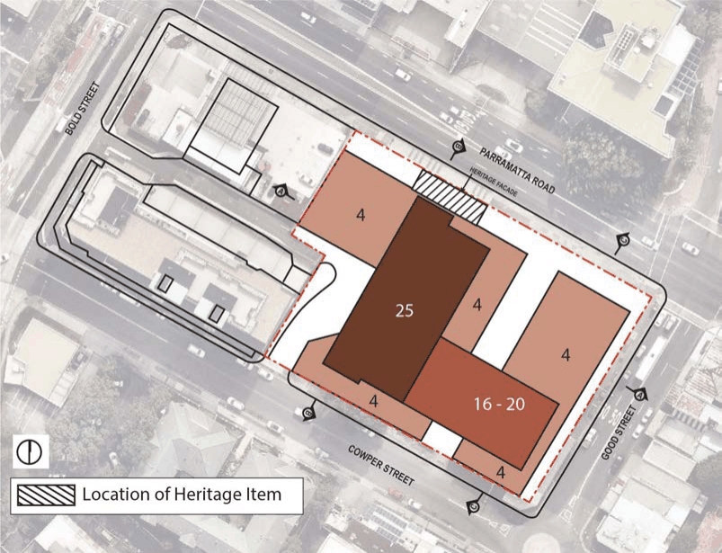
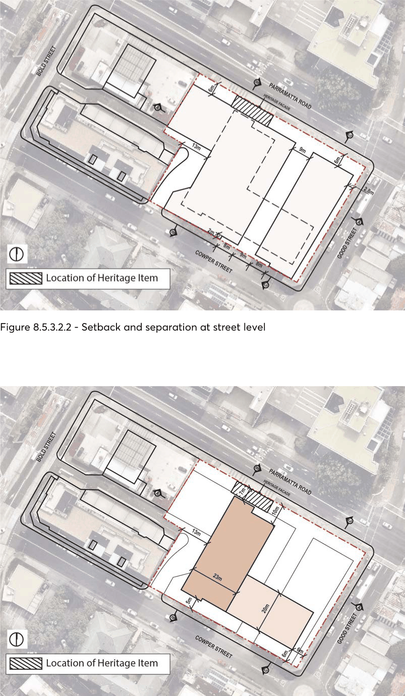

#### 8.5.3.2 BUILT FORM AND MASSING

Objectives O.01 Ensure that the built form sensitivity responds to the sites location in relation to the town centre, Parramatta Road and Good Street.

O.02 Set variable building heights to ensure positive and cohesive relationships with surrounding land and uses.

O.03 Design development to activate the three streets at its edges; O.04 Provide a through site link that is:

• Activated;

• Provides a positive urban environment;

• Open to the sky with no over-hanging building elements above except as shown in the diagrams;

• Located at natural ground level;

• Activated at ground level;

• Overlooked and suitably lit; and

• Named to Council approval and signed.

O.05 Ensure that the Heritage Item ‘The Barn’ retains its landmark status within the context of the new built form following approval for its relocation 6 metres from Parramatta Road.

SPECIFIC SITES LAND ON THE CORNER OF PARRAMATTA ROAD, GOOD STREET AND COWPER STREET, GRANVILLE

O.06 ‘Future proof’ the subject site by ensuring land is retained through setbacks for road widening along Parramatta Road and Good Street should it be required in the future; and have flexible controls to allow the land within the setbacks to either form part of the public domain or part of the road infrastructure.

Controls

Maximum building heights C.01 Maximum height of 82 metres (25 storeys) for the majority of the site. C.02 A maximum building height of 17 metres (4 storeys) fronting Good Street. C.03 The maximum number of storeys is indicated in Figure 8.5.3.2.1. Note: A range in the number of storeys is shown in Figure 8.5.3.2.1 for the eastern component of the tower. This is to provide an option for distributing the gross floor area permitted under the Parramatta LEP 2023. The height of this part of the building is to be explored as part of the Design Excellence competition process, but consideration should be given to maintaining the difference in height between the towers.

> [Picture on page 586: a picture, saved as a picture (images/part-08-centres-precincts-special-character-areas-specific-page-586-16.gif, 150 dpi).]

Figure 8.5.3.2.1 - Maximum number of storeys

Shared frontage heights C.04 4 storey podium fronting Good Street. C.05 Retention of “The Barn” façade and exposed portions of side walls, and their incorporation into a podium building fronting Parramatta Road.

SPECIFIC SITES LAND ON THE CORNER OF PARRAMATTA ROAD, GOOD STREET AND COWPER STREET, GRANVILLE

Building setbacks C.06 The setbacks and separations at street level are shown in Figure 8.5.3.2.2. C.07 The setbacks are to ‘future proof’ the land for road widening along Good Street and Parramatta Road should additional road infrastructure be required by the RMS. This is to be determined as part of a precinct wide traffic study in Granville to accommodate for the anticipated growth proposed under the Parramatta Road Urban Transformation Strategy;

C.08 As shown in Figure 8.5.3.2.2, a 2.8 metre setback to Good Street and a 6 metre setback to Parramatta Road (inclusive of the land that includes “The Barn” Heritage Item which may be relocated in line with the 6 metre setback subject to Council consent) are to be retained and dedicated for Council to ‘future proof’ the subject site should it be required for road widening. The land will form part of the public domain until it is confirmed that it is needed for road infrastructure. The Heritage Item façade is proposed to form part of the future building design, and subject to approval will be setback 6 metres from Parramatta Road to ensure its retention if the land is required for road widening in the future.

C.09 The setbacks to the tower above the podium are shown in Figure 8.5.3.2.3. C.10 The Development Application and the Design Excellence processes will explore the most appropriate methodology to relocate the heritage façade in line with the proposed 6 metre setback to Parramatta Road. Council’s Heritage Advisor will be involved in these processes to ensure the façade is deconstructed and reconstructed in the most appropriate way in order to retain the integrity of the item as part of the future design of the overall building.

Building envelopes and massing C.11 Figure 8.5.3.4.2, 8.5.3.4.3 and 8.5.3.4.4 at the end of this section comprise three sections that provide form and massing guidance for tower location.

C.12 The Design Excellence process will also explore variations to the massing and building envelopes to accommodate the gross floor area permitted under the Parramatta LEP 2023 if it is considered to deliver a better built form outcome than proposed under this Site Specific DCP.

SPECIFIC SITES LAND ON THE CORNER OF PARRAMATTA ROAD, GOOD STREET AND COWPER STREET, GRANVILLE

> [Picture on page 588: a picture, saved as a picture (images/part-08-centres-precincts-special-character-areas-specific-page-588-2.gif, 150 dpi).]

Figure 8.5.3.2.2 - Setback and separation at street level

Figure 8.5.3.2.3 - Tower setbacks

SPECIFIC SITES LAND ON THE CORNER OF PARRAMATTA ROAD, GOOD STREET AND COWPER STREET, GRANVILLE
