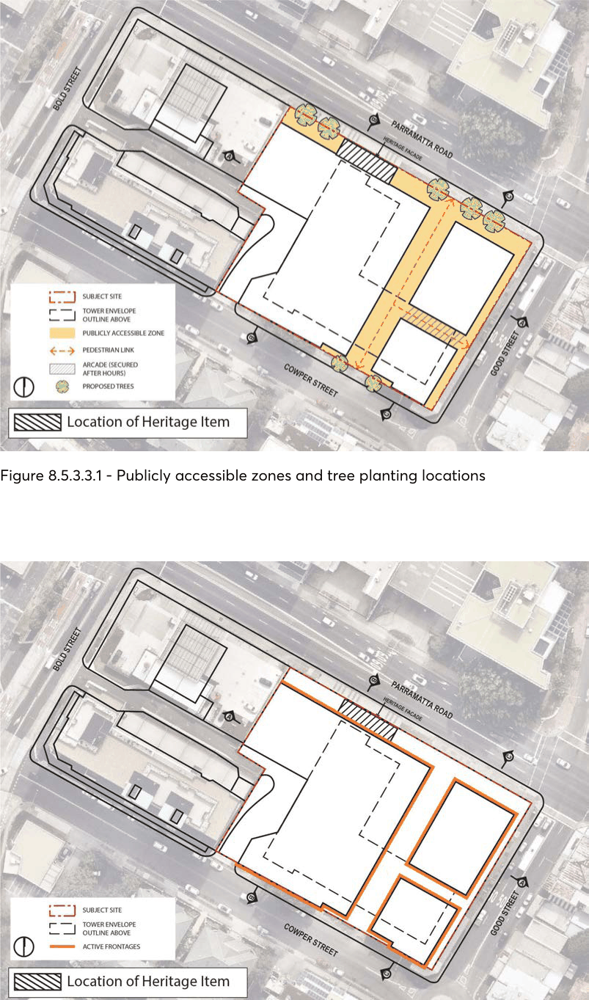
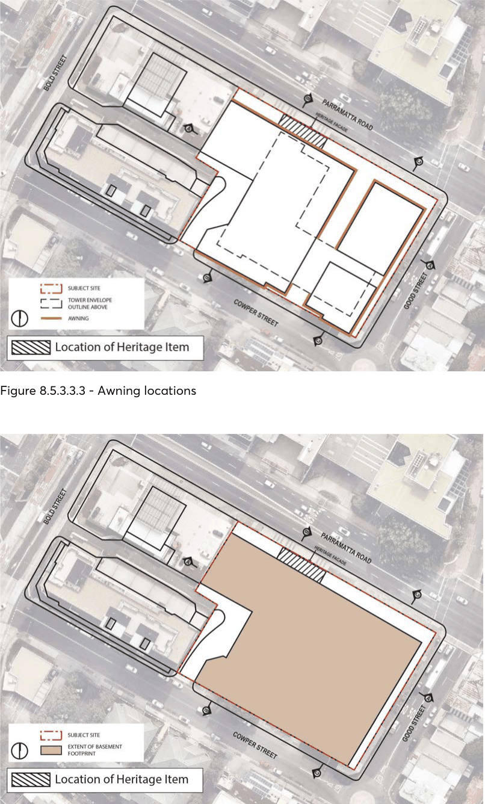
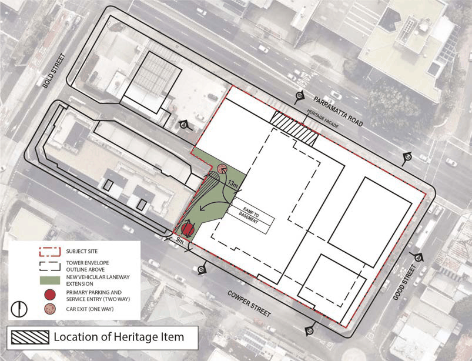
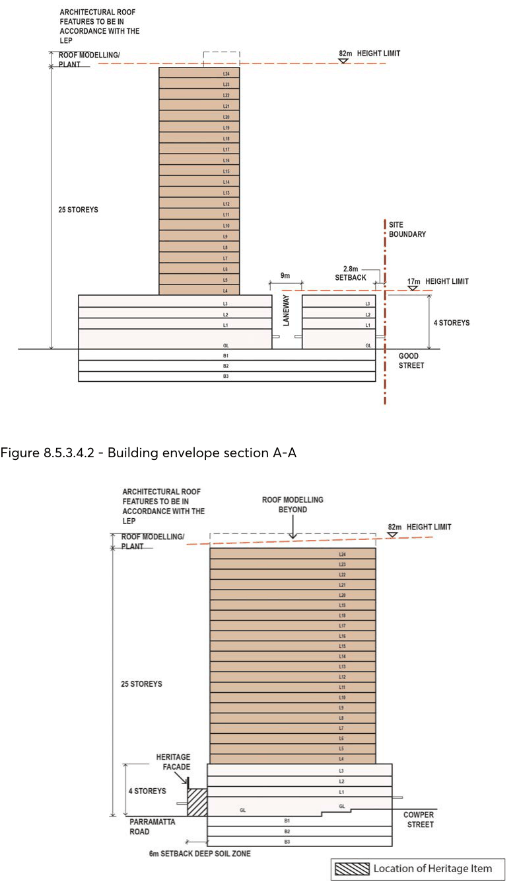
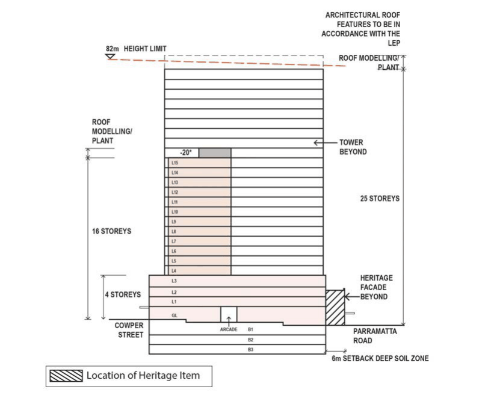

#### 8.5.3.3 PUBLIC DOMAIN AND LANDSCAPING

Objectives O.01 Encourage street level pedestrian networks. O.02 Activate the pedestrian laneway. O.03 Improve the public domain amenity and quality in Good Street and Cowper Street. O.04 Create a safe retail environment along Parramatta Road by providing a proper landscape screening between the road and building interface.

Controls

C.01 The north-south pedestrian laneway is to have dimensions and location generally in accordance with Figures 8.5.3.2.2 & 8.5.3.3.1.

C.02 Where the laneway passes below any tower a three to four storey opening for the pedestrian laneway is to be achieved.

C.03 The pedestrian laneway is to be activated at ground level generally in accordance with Figure 8.5.3.3.2.

C.04 Street frontage awnings are to be provided along active frontages to provide shade and shelter in accordance with Figure 8.5.3.3.3.

C.05 The extent of the basement is to be generally in accordance with Figure 8.5.3.3.4. C.06 Landscaping plan is to be prepared by a suitably qualified landscape architect with heritage experience to ensure that the historic significance and views of the “The Barn” Heritage Item are retained.

C.07 Reconstruct and upgrade the footpath pavement and provide comfortable and high-quality street furniture, street lighting as specified by Council during the development.

C.08 Awnings are to provide comfort and weather protection to the pedestrian, but not to create conflicts with street tree planting that might be required in the location.

C.09 Provide a continuous landscape ship along the building frontage on Parramatta Road, which allows large canopy trees and combination shrub and groundcover plantings. If confirmed by RMS that the land within the 6 metre setback along Parramatta Road is needed for road widening as a result of a Precinct Wide Traffic Study in Granville, then this area will be landscaped in the interim until the land is used for road widening.

SPECIFIC SITES LAND ON THE CORNER OF PARRAMATTA ROAD, GOOD STREET AND COWPER STREET, GRANVILLE

> [Picture on page 590: a picture, saved as a picture (images/part-08-centres-precincts-special-character-areas-specific-page-590-2.gif, 150 dpi).]

Figure 8.5.3.3.1 - Publicly accessible zones and tree planting locations

Figure 8.5.3.3.2 - Active frontages

SPECIFIC SITES LAND ON THE CORNER OF PARRAMATTA ROAD, GOOD STREET AND COWPER STREET, GRANVILLE

> [Picture on page 591: a picture, saved as a picture (images/part-08-centres-precincts-special-character-areas-specific-page-591-2.gif, 150 dpi).]

Figure 8.5.3.3.3 - Awning locations

Figure 8.5.3.3.4 - Basement plan

SPECIFIC SITES LAND ON THE CORNER OF PARRAMATTA ROAD, GOOD STREET AND COWPER STREET, GRANVILLE

Objectives O.01 Buildings should be designed with car parking at the basement level. O.02 Pedestrian and vehicle conflict should be minimised. O.03 The site is to provide the completion of the vehicular laneway from Bold Street to Cowper Street.

O.04 Buildings should be designed using high-quality materials for sections of vehicle access ways visible from the public domain.

Controls

C.01 All vehicle access is to be form the laneway that connects Bold and Cowper Streets. Vehicular access and servicing is to be generally in accordance with Figure 8.5.3.4.1.

C.02 High-quality design and materials are to be used for the security shutters into the car park and loading areas.

C.03 Services, service access points, and garbage collection points are not to be located on Parramatta Road, Good Street or Cowper Street, and are to be located off the laneway, consistent with Figure 8.5.3.4.1.

C.04 A small splay (corner cut-off setback with the sise yet to be designed as part of the DA process) is required on the corner of Good Street and Parramatta Road to ensure large vehicle movements should an additional left turning lane from Good Street into Parramatta Road be required.

C.05 A detailed traffic model and assessment and an active transport (pedestrian and cyclist) management plan must be provided with a Development Application.

C.06 Car parking and bicycle parking is to be provided to the rates set out below:

Table 8.5.3.4.1- Parking Rates

| Residential (maximum car parking rate per dwelling) |  |
|---|---|
| Studio | 0.6 spaces |
| 1 bedroom | 0.9 spaces |
| 2 bedroom | 1.2 spaces |
| 3 or more bedroom | 1.5 spaces |
| Visitors | 0.2 per dwelling |
| Accessible Parking Spaces | 1 space per adaptable/accessible apartment |
| Car Share Spaces | A minimum of 1 car share space. If a car share provider is not obtained, then the car share space is to be used as a visitor parking space |
| Motorcycle Parking | 1 space for every 25 parking spaces |
| Bicycle Parking | 1 space per dwelling & 1 visitor space per 10 dwellings |

SPECIFIC SITES LAND ON THE CORNER OF PARRAMATTA ROAD, GOOD STREET AND COWPER STREET, GRANVILLE

| Retail and Commercial |  |
|---|---|
| Retail | Maximum of 1 space per 50m² of GFA |
| Commercial | Maximum of 1 space per 70m² of GFA |
| Accessible Parking Spaces | Minimum of 1% of all spaces to be readily accessible spaces designed in accordance with the Australian Standards |
| Motorcycle Parking | 1 space for every 25 onsite car parking spaces |
| Bicycle Parking Spaces | Bicycle Parking Spaces |
| Retail | Employee: 1 per 250m² GFA Visitor: 2 spaces + 1 per 100m² |
| Commercial | Employee: 1 per 150m² GFA Visitor: 1 per 400m² GFA |

> [Picture on page 593: a picture, saved as a picture (images/part-08-centres-precincts-special-character-areas-specific-page-593-3.gif, 150 dpi).]

Figure 8.5.3.4.1 - Vehicular access and servicing

SPECIFIC SITES LAND ON THE CORNER OF PARRAMATTA ROAD, GOOD STREET AND COWPER STREET, GRANVILLE

> [Picture on page 594: a picture, saved as a picture (images/part-08-centres-precincts-special-character-areas-specific-page-594-2.gif, 150 dpi).]

Figure 8.5.3.4.2 - Building envelope section A-A

Figure 8.5.3.4.3 - Building envelope section B-B

SPECIFIC SITES LAND ON THE CORNER OF PARRAMATTA ROAD, GOOD STREET AND COWPER STREET, GRANVILLE

> [Picture on page 595: a picture, saved as a picture (images/part-08-centres-precincts-special-character-areas-specific-page-595-2.gif, 150 dpi).]

Figure 8.5.3.4.4 - Building envelope section C-C (*final height of tower to be determined through the Design Excellence process)

38-42 EAST STREET, GRANVILLE
