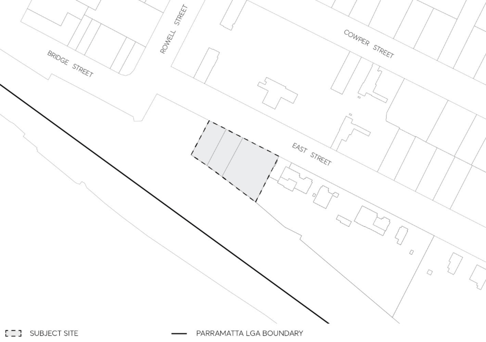

#### 8.5.4 38-42 EAST STREET, GRANVILLE

This Section applies to land at 38-42 East Street, Granville legally known as Lot 1 DP 1009146, Lot 1 DP 195784 and Lot 1 DP 996285 as illustrated in Figure 8.5.4.1. The yield for the site comprises a floor space ratio of 6:1.

> [Picture on page 596: a picture, saved as a picture (images/part-08-centres-precincts-special-character-areas-specific-page-596-6.gif, 150 dpi).]

Figure 8.5.4.1 - Land application map

This Part of this DCP is to be read in conjunction with other Parts of the Parramatta DCP 2023 and the Parramatta Local Environmental Plan (LEP) 2023. If there is any inconsistency between this Part of the DCP and other parts of the Parramatta DCP 2023, this Part of this DCP will prevail.

This DCP establishes objectives and controls to be interpreted during preparation and assessment of Development Applications and supports the objectives of the LEP.
