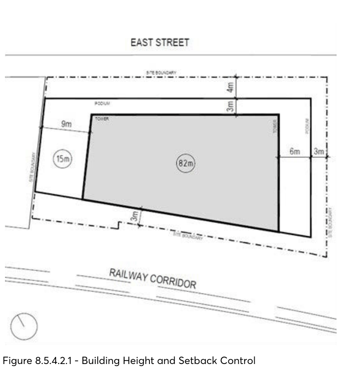

#### 8.5.4.2 BUILT FORM AND MASSING

Objectives

O.01 Ensure that the built form appropriately responds to the desired future context at street level and the wider precinct.

O.02 Ensure the future development adds visual interest and diversity to the local skyline. O.03 Ensure urban design outcomes demonstrated in the Planning Proposal are achieved. O.04 Tower form should appear as tall and slender. O.05 Podium form should exhibit fine grain character and appropriate scale.

38-42 EAST STREET, GRANVILLE

Controls

C.01 Maximum building heights shall be in accordance with Figure 8.5.4.2.1. C.02 Building setbacks shall be in accordance with Figure 8.5.4.2.1.

> [Picture on page 598: a picture, saved as a picture (images/part-08-centres-precincts-special-character-areas-specific-page-598-5.gif, 150 dpi).]

Figure 8.5.4.2.1 - Building Height and Setback Control
