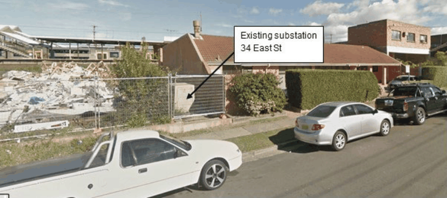

#### 8.5.4.6 SUBSTATIONS

Objectives

O.01 Design new substations within building footprints, minimising impacts on public domain. O.02 Relocate existing padmount substation (see Figure 8.5.4.6.1) located in the north eastern corner of the site within a new substation enclosure to maximise the open space and activation of the pocket park subject to design consultation with Endeavour Energy.

38-42 EAST STREET, GRANVILLE

Controls

C.01 Substations are to be provided within buildings, not within the street, open spaces or setbacks, and are to be designed to ensure protection of residents from Electro Magnetic Radiation (EMR) emissions.

C.02 Development Application shall include consultation with Endeavour Energy to relocate existing padmount substation.

> [Picture on page 601: a picture, saved as a picture (images/part-08-centres-precincts-special-character-areas-specific-page-601-8.gif, 150 dpi).]

Figure 8.5.4.6.1 - Existing padmount substation at 38 East Street, Granville
