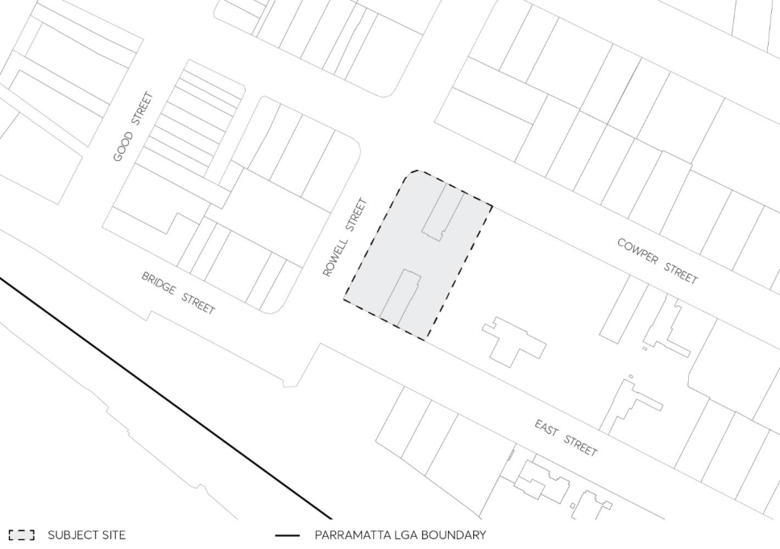

#### 8.5.5 38 COWPER STREET, GRANVILLE

This Section applies to part of the site at 14-38 Cowper Street, 5-5A Rowell Street and 21-41 East Street, Granville, which is legally known as Lot 50 DP 1238546 as illustrated in Figure 8.5.5.1 below.

This DCP sets relevant development controls for the form and character of tower Building C above the approved podium and adjacent to two approved towers on the site.

> [Picture on page 603: a picture, saved as a picture (images/part-08-centres-precincts-special-character-areas-specific-page-603-7.gif, 150 dpi).]

Figure 8.5.5.1 - Land application map

This Part of this DCP is to be read in conjunction with other parts of the Parramatta DCP and the Parramatta Local Environmental Plan 2023 (PLEP 2023).

If there is any inconsistency between this Part of this DCP and other parts of the Parramatta DCP 2023, this Part of this DCP will prevail.

This DCP establishes objectives and controls to be interpreted during preparation and assessment of Development Applications and supports the objectives of the LEP.

38 COWPER STREET, GRANVILLE
