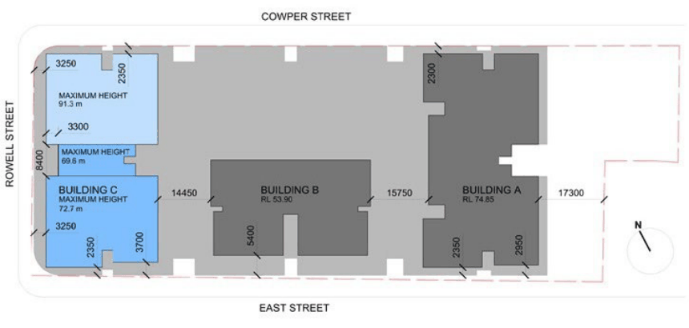
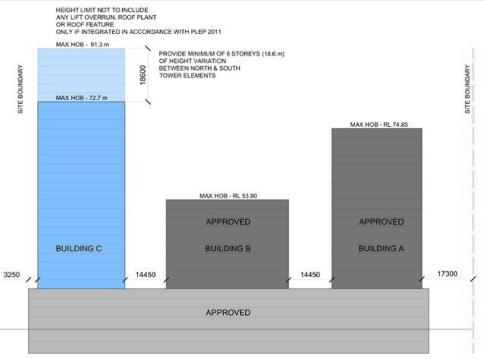
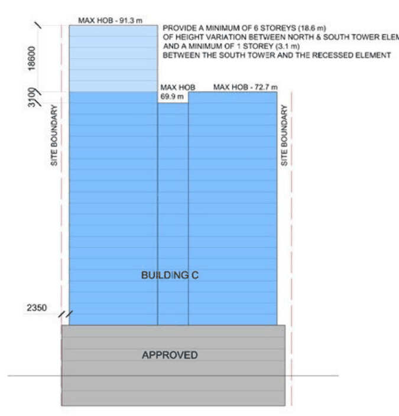

#### 8.5.5.1 BUILT FORM

The residential tower (Building C) that is the subject of this DCP forms part of a large, long development (some 57 metres), in which two other towers (Buildings A and B) as well as an extensive podium have received development consent.

The objectives of this DCP are to inject a measure of variety and diversity in the built form and character of the project and at the same time to modulate and articulate the subject tower to mitigate its length. To this end, a Design Excellence competition is included in the process and the built form controls are formulated to achieve these objectives.

Objectives

O.01 Achieve a variety and diversity in the built expression of the project. O.02 Incorporate a range of difference heights to the local skyline. O.03 Break down the perceived length of the tower into two nominally separate buildings. O.04 Provide variation to what would otherwise be the symmetry and uniformity of height of Buildings A and C.

Controls

C.01 Any future Development Application seeking to increase the height of Building C must not be approved unless it has been subject to a Design Excellence competition and has been granted Design Excellence in accordance with Clause 6.13 of the PLEP 2023.

C.02 The envelope of Building C must be consistent with Figure 8.5.5.1.1, Figure 8.5.5.1.2 and Figure 8.5.5.1.3.

C.03 Setbacks must be measured perpendicular to the street wall face to the outer faces of the building.

> [Picture on page 604: a picture, saved as a picture (images/part-08-centres-precincts-special-character-areas-specific-page-604-24.gif, 150 dpi).]

Figure 8.5.5.1.1 - Building C Envelope, Heights and Setbacks

38 COWPER STREET, GRANVILLE

> [Picture on page 605: a picture, saved as a picture (images/part-08-centres-precincts-special-character-areas-specific-page-605-2.gif, 150 dpi).]

Figure 8.5.5.1.2 - Elevation from East Street

38 COWPER STREET, GRANVILLE

> [Picture on page 606: a picture, saved as a picture (images/part-08-centres-precincts-special-character-areas-specific-page-606-2.gif, 150 dpi).]

Figure 8.5.5.1.3 - Elevation from Rowell Street

LAND BOUND BY PARRAMATTA ROAD, ALBERT STREET, VICTORIA STREET, AND DUKE STREET,

GRANVILLE
