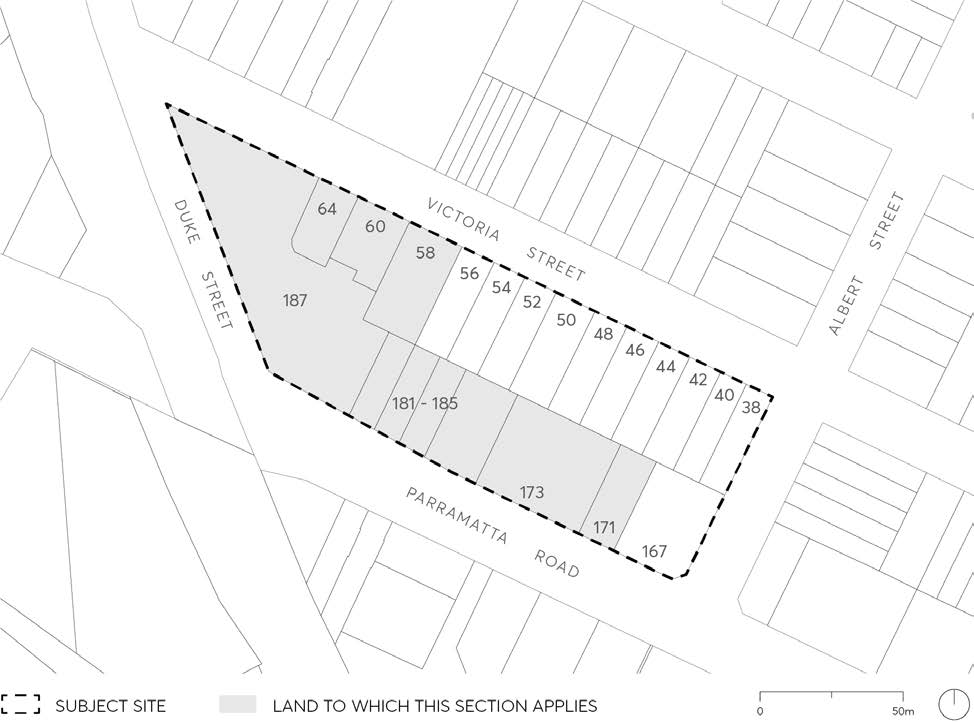

#### 8.5.6 LAND BOUND BY PARRAMATTA ROAD, ALBERT STREET, VICTORIA

#### STREET, AND DUKE STREET, GRANVILLE

This Section applies to 10 individual allotments that form part of the street block bounded by Parramatta Road, Albert Street, Victoria Street and Duke Street in Granville (Figure 8.5.6.1).

The 10 individual allotments that this section applies to are as follows: Lot 1 in DP 615141, Lot 1 in DP 504298, Lot 2 in DP 89526, Lot 1 in DP 79102, Lot 1 in DP 79624, Lot 1 in DP 89526, Lot 1 in DP 81084, Lot X in DP 163366, Lot A in DP 160406, Lot 58 in DP 869379.

Objectives and Controls in this Section relating to the remaining allotments that form part of this street block will apply to these allotments following a separate application to enact these provisions. This section therefore does not apply to: SP 47170, Lot 1 in DP 13530, Lot 2 in DP 13530, Lot 3 in DP 13530, Lot 4 in DP 13530, Lot 5 in DP 13530, Lot 6 in DP 13530, Lot 7 in DP 13530, Lot 8 in DP 13530, Lot 1 in DP 744840 and Lot B in DP 151899.

> [Picture on page 607: a picture, saved as a picture (images/part-08-centres-precincts-special-character-areas-specific-page-607-15.gif, 150 dpi).]

Figure 8.5.6.1 – Land application map (the 10 individual allotments this Section applies to is highlighted grey)

LAND BOUND BY PARRAMATTA ROAD, ALBERT STREET, VICTORIA STREET, AND DUKE STREET,

GRANVILLE

This Section is to be read in conjunction with other Sections of the Parramatta DCP 2023 as well as Parramatta LEP 2023. If there is any inconsistency between this Section and other Sections of this DCP, this Section prevails.

This DCP establishes principles, objectives and controls to be interpreted during preparation and assessment of Development Applications and supports the objectives of the LEP.
