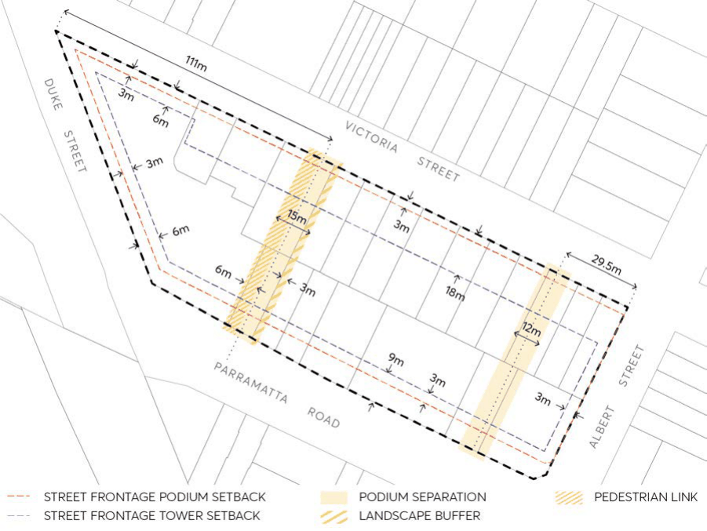

#### 8.5.6.2 BUILT FORM, SITING AND MASSING

Objectives

O.01 Retain land through setbacks for road widening along Parramatta Road should it be required in the future and have flexible controls to allow the land within the setbacks to either form part of the public domain and part of the road infrastructure.

O.02 Create a sense of visual separation between the podium and tower levels above through setbacks, modulation of building form and materials.

O.03 Establish building forms that are oriented appropriately to minimise overshadowing and maximise solar access to neighbouring properties, including those properties south of the site on Parramatta Road.

O.04 Provide appropriate building separation to ensure privacy, access to light and ventilation and a high-quality visual outlook for building occupants, and to increase views to sky and improve solar access at ground level.

O.05 Provide tower forms which appear as tall and slender. O.06 Provide appropriate transitions in scale and height to existing low density residential development along Victoria Street.

O.07 Ensure local infrastructure provision needs will be met.

Controls

Building height C.01 Maximum podium height of 4 storeys for the site. Setbacks C.02 Podium and tower setbacks to streets must be provided in accordance with Figure 8.5.6.2. C.03 Minimum 6 metre ‘Green Edge’ setback to Parramatta Road is required to provide wider footpaths and facilitate street tree planting. This setback may be reduced to the west of the through-site link to provide a consistent street wall with the rest of the block.

C.04 Minimum 3 metre tower setback from the podium edge to internal through-site links and publicly accessible open spaces.

LAND BOUND BY PARRAMATTA ROAD, ALBERT STREET, VICTORIA STREET, AND DUKE STREET,

GRANVILLE

C.05 Minimum 3 metre rear and side setback from the boundary, except along Victoria Street where a minimum 9 metre rear setback for development is required.

> [Picture on page 610: a picture, saved as a picture (images/part-08-centres-precincts-special-character-areas-specific-page-610-5.gif, 150 dpi).]

Figure 8.5.6.2 – Setbacks, through-site link, and view corridor locations

Building separation C.06 Minimum 12 metre building separation between buildings up to 4 storeys east of and including the through site link (Figure 8.5.6.2).

C.07 Minimum 24 metre building separation between buildings above 4 storeys east of and including the through site link.

C.08 A minimum 12 metre building separation between Victoria Street and Parramatta Road, as identified in Figure 8.5.6.2, should be provided between buildings as a view corridor.

C.09 A minimum 15 metre building separation between Victoria Street and Parramatta Road, as identified in Figure 8.5.6.2, should be provided between buildings at ground level. This corridor should include a minimum 6 metre pedestrian through-site link along the western edge, and a 3-metre landscape buffer along the eastern edge.

C.10 Equal distribution of building separation distances across independent lots as per the Apartment Design Guide may not be achievable due to site constraints. Development should align with the minimum setbacks and building separation controls in this Section to ensure equitable development potential across the site.

Building design C.11 A podium edge must be provided to all bounding roads.

LAND BOUND BY PARRAMATTA ROAD, ALBERT STREET, VICTORIA STREET, AND DUKE STREET,

GRANVILLE

C.12 A building break of minimum 3 metres wide x 3 metres deep is required after a length of 45m to provide necessary articulation to the podium.

C.13 Podiums should be modulated vertically in segments that relate to neighbouring fine grain subdivision patterns and reduce their bulk and perceived scale.

C.14 Any podium exceeding 60 metres along Victoria Street must provide a 20 metre x 20 metre north facing communal open space fronting Victoria Street. This communal open space area shall be located on deep soil unless it is demonstrated to Council officer’s satisfaction that 15% of the site area comprises deep soil (site area being the land subject of the application). Towers above this communal open space area should be set back a minimum 3 metres from the podium edge.

C.15 The podium on corner sites must incorporate a setback from the corner intersection for its full height, which may be splayed or curved.

C.16 Maximum tower length of 45 metres. C.17 Undercrofts or other interruptions of the podium which expose the underside of the tower and amplify its presence on the street are not permitted.

C.18 Tower forms above podium levels are to be designed and oriented to maximise solar access to neighbouring properties to the south of the site on Parramatta Road. This is to occur by orienting the narrow side of towers to the south where possible.

C.19 Buildings are to be designed to create clear visual articulation and distinction between the podium and tower levels.

C.20 Facades shall be designed with a variety of materials, textures, and articulation to produce a contemporary architectural response that creates a greater sense of depth and visual diversity.

C.21 Balconies facing Parramatta Road and the railway line may be screened and acoustically sealed in the form of winter gardens to provide protection from the road and rail noise.  Winter gardens are to be included in Gross Floor Area calculations.

C.22 Where protective measures are necessary to reduce noise impacts, these are to be designed in a visually attractive manner that provides a high degree of visual interest as viewed from a street, laneway, or public place.

C.23 Contributions towards the local infrastructure provision needs generated by the development shall be demonstrated.
