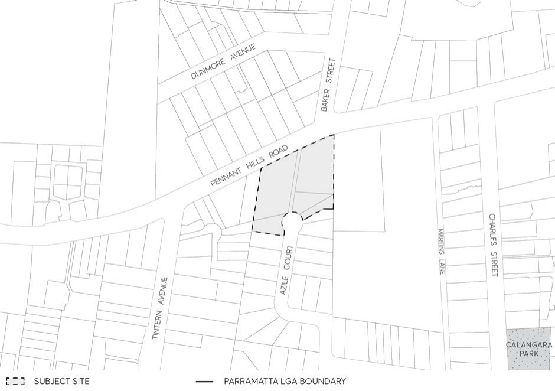

#### 8.5.6.5 TRAFFIC AND TRANSPORT

Objectives

O.01 Establish a fair and safe balance between pedestrian, cycling and vehicle movement. To enhance the perceived sense of safety of public spaces by facilitating passive surveillance.

O.02 Provide convenient, efficient, safe access and parking for vehicles, services (e.g., deliveries and waste), pedestrians and cyclists.

O.03 Minimise the visual impacts of vehicle access ways visible from the public domain. O.04 Minimise the impact on pedestrians of any internal driveway or vehicular entries.

Controls

C.01 Car parking and bicycle spaces are to be provided in accordance with the rates set out in Table 8.5.6.1.

C.02 A Traffic Impact Statement and ‘Green Travel Plan’ must be submitted as part of a Development Application.

C.03 No vehicle access or egress is permitted from Parramatta Road. Preference for vehicular access or egress is to be given to Victoria Street over Albert Street wherever possible.

LAND BOUND BY PARRAMATTA ROAD, ALBERT STREET, VICTORIA STREET, AND DUKE STREET,

GRANVILLE

C.04 Car parking is to be primarily provided in basement levels. Where Council is satisfied that above ground parking is justified, it may be provided in the podium west of the through-site link (see Figure 8.5.6.2 for location of through-site link).

C.05 Basement carparking may be provided subject to ensuring sufficient deep-soil landscaping. C.06 Basements are to be contained wholly within the building footprint, unless agreed otherwise by Council, to ensure sufficient deep soil landscaping.

C.07 A 6-metre-wide driveway off Victoria Street may be permissible to access parking and loading on the site. This driveway should be of a kerb and gutter arrangement and located directly east of the pedestrian through-site link identified in Figure 8.5.6.2.

C.08 Vehicular crossovers should be avoided where possible. Any crossover of the pedestrian link by vehicles to access parking and loading should be done via vehicular crossovers of a minimal width, with pedestrians having priority.

C.09 No open dive structures are permitted. Dive structures must be sleeved/contained within the building.

C.10 Footpaths shall be maintained as the priority movement, with the number of access points to car parking facilities (i.e., crossovers and driveways) minimised.

C.11 Vehicle access for residential, commercial, and retail uses shall be designed to minimise visibility from the public realm and adverse impact on pedestrian safety.

C.12 High quality design and materials are to be used for the security shutters into the car park and loading areas.

C.13 Reconstruction and realignment of the kerb and gutter is to occur along Victoria Street with the redevelopment of the site in the following manner:

a) two continuous 3.2m wide travel lanes and two 2.3m wide parking lanes (11m total carriageway width)

b) not include rolltop curbs. Table 8.5.6.1 – Car Parking and Bicycle Rates

| Car Parking and Bicycle Rates |  |
|---|---|
| Residential |  |
| Studio | Minimum 0.3 spaces |
| 1 bedroom | Minimum 0.5 spaces |
| 2 bedroom | Minimum 0.9 spaces |
| 3 or more bedroom | Minimum 1.2 spaces |
| Visitors | Minimum 0.1 per dwelling |
| Bicycle | Minimum 1 per dwelling & 1 visitor space per 10 dwellings |
| Accessible Parking Spaces | Minimum 1 space per adaptable/accessible apartment |
| Car Share Spaces | On-site parking can be reduced at a rate of 5 parking spaces per 1 car share space where an active car-sharing program is made available to residents and/or employees and where ride share or other organised carpooling initiatives are available on site. Additional car share should be provided at a rate of 1 space per 20 dwellings without parking and 1 space per 100 dwellings with parking. |
| Motorcycle Parking | Minimum 1 space per 25 car parking spaces. |

LAND BOUND BY PARRAMATTA ROAD, ALBERT STREET, VICTORIA STREET, AND DUKE STREET,

GRANVILLE

| Electric vehicle charge point | Minimum of 1 charge point to service the residential component of the building. |
|---|---|
| Retail and Commercial |  |
| Retail | Maximum of 1 space per 100m2 of GFA |
| Commercial | Maximum of 1 space per 150m2 of GFA |
| Accessible Parking Spaces | Minimum of 1% of all accessible spaces to be designed in accordance with the Australian Standards. |
| Motorcycle Parking | Minimum 1 space per every 25 onsite car parking spaces |
| Bicycle Parking – Retail | Employee: Minimum 1 per 250m2 GFA Visitor: Minimum 2 spaces + 1 per 100m2 GFA |
| Bicycle Parking – Commercial | Employee: Minimum 1 per 150m2 GFA Visitor: Minimum 1 per 400m2 GFA |
| Electric Vehicle Charge Point | Minimum of 1 charge point to service the non-residential component of the building. |

DUNDAS WARD

#### DUNDAS WARD

8.5.7 258-262 PENNANT HILLS ROAD AND 17 & 20 AZILE COURT,

#### CARLINGFORD

> [Picture on page 619: a picture, saved as a picture (images/part-08-centres-precincts-special-character-areas-specific-page-619-5.gif, 150 dpi).]

Figure 8.5.7.1 - Land application map
