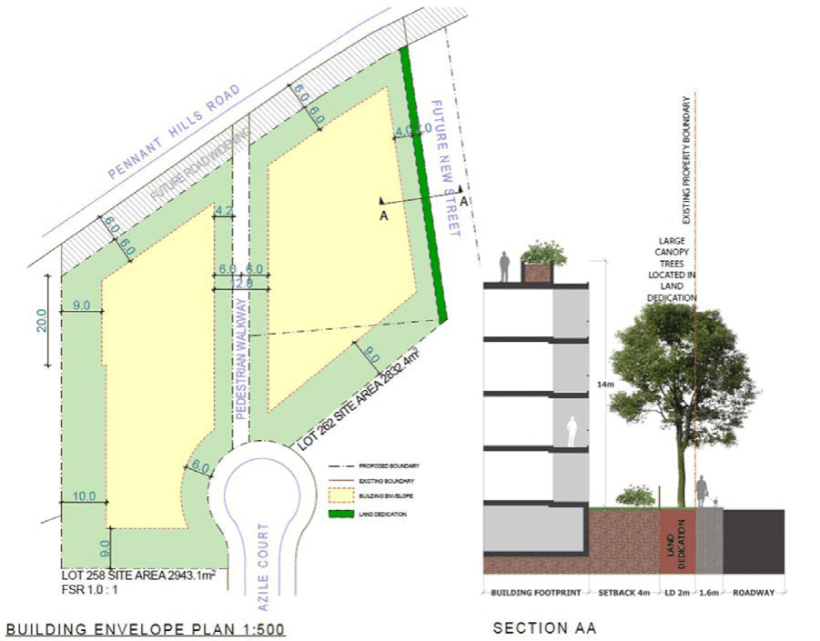

#### 8.5.7.2 BUILT FORM AND MASSING

Objectives

O.01 Ensure that the built form sensitively responds to the site’s location and topography. O.02 Ensure that the built form is a high-quality. O.03 Set variable building heights to ensure positive and cohesive relationships with surrounding land and uses.

O.04 Ensure that the built form and massing of development does not unjustly reduce solar access to habitable rooms and private open space on adjoining properties.

O.05 Design the development to activate the two streets at their interface and to ensure that the massing of development is not detrimental to the public domain and addresses the pedestrian through site link that enjoys passive surveillance and a safe urban environment.

Controls

C.01 Maximum Building Heights Building heights must be in accordance with Parramatta LEP 2023 Height of Buildings Map to respond to the context, to provide visual interest and to minimise and mitigate adverse

258-262 PENNANT HILLS ROAD AND 17 & 20 AZILE COURT, CARLINGFORD

overshadowing and privacy impact to adjoining properties and adjoining public domain and land uses.

C.02 Building Setbacks 6 metres to Pennant Hills Road, in addition to the road reservation.

• 6 metres to Baker Street extension.

• 9-10 metres to the western boundary to allow for tree root protection.

• 12 metres between buildings where the pedestrian walkway dissects the site.

• 9 metres to the southern boundaries to provide a transition to low density dwellings to the south.

C.03 Setbacks and the building envelope zone are illustrated in Figure 8.5.7.2.1.

> [Picture on page 621: a picture, saved as a picture (images/part-08-centres-precincts-special-character-areas-specific-page-621-11.gif, 150 dpi).]

Figure 8.5.7.2.1 - Building Envelope Plan
