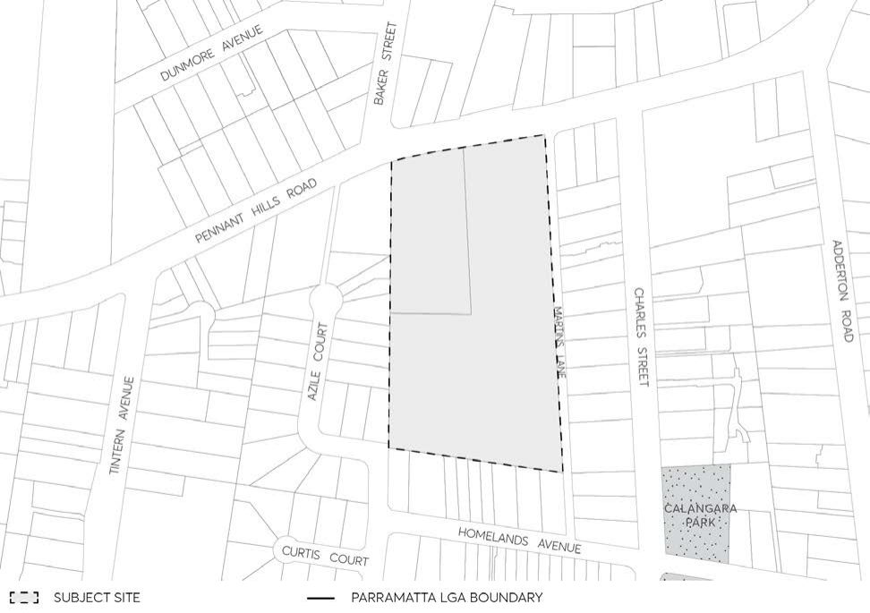

#### 8.5.8 264-268 PENNANT HILLS ROAD, CARLINGFORD

> [Picture on page 624: a picture, saved as a picture (images/part-08-centres-precincts-special-character-areas-specific-page-624-3.gif, 150 dpi).]

Figure 8.5.8.1 – Land application map
