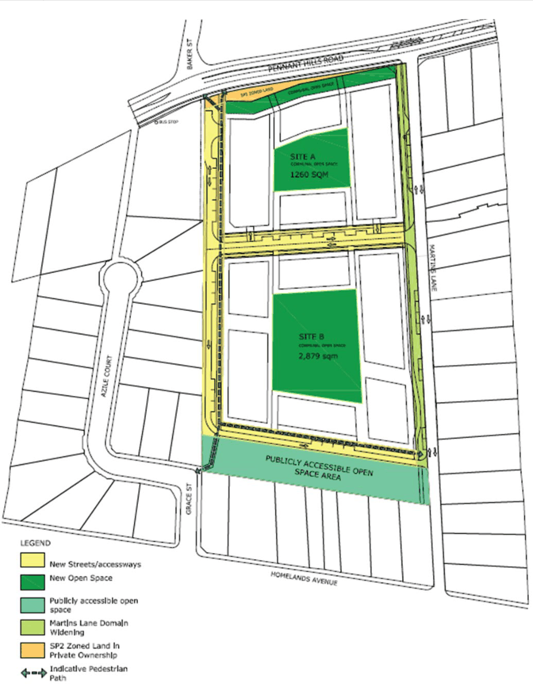
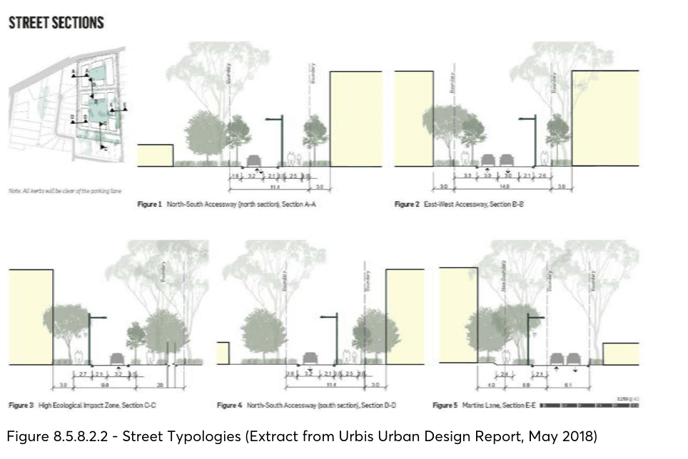

#### 8.5.8.2 PUBLIC DOMAIN

A street network appropriate for purpose is critical to ensure equity of access for all users and enhance permeability to and through the site. The street network will be required to provide frontage to buildings and create a public domain that prioritises pedestrian movement.

Objectives

O.01 Maintain neighbourhood amenity and appropriate residential character. O.02 Improve connectivity and permeability in the Precinct. O.03 Create a legible hierarchy of roads and integration with the broader road network. O.04 Implement the principles of Water Sensitive Urban Design (WSUD). O.05 Ensure the public domain is accessible, safe, and secure for all members of the community having regard to Crime Prevention through Environmental Design (CPTED) principles.

Controls

C.01 The site should have:

264-268 PENNANT HILLS ROAD, CARLINGFORD

• A north-south street along the western boundary of the site. This street will not allow for vehicle access at its northern edge and a turning bay will be provided.

• An east-west street to connect Martins Lane to the new north-south street mid-way through the site.

• An east-west accessway located along the northern edge of the high value ecological zone on the southern part of the site.

• A new pedestrian link from Grace Street/Azile Court connecting to the north-south street and publicly accessible open space area.

C.02 The site should be permeable and provide links to the wider area. C.03 Martins Lane is to have a widened verge so that the high-quality vegetation is retained. C.04 The areas of high and moderate ecological significance are to be protected and enhanced. C.05 Water Sensitive Urban Design (WSUD) principles should be implemented within the public domain areas.

C.06 New development should be designed and sited to appropriately integrate with and address streets and pedestrian links to provide activation and casual surveillance.

C.07 Fencing along the public domain should allow for casual surveillance. C.08 Options for public access to the high value ecological zone adjacent to the southern boundary of the site should be considered. There shall be no direct vehicular connection into the site from Pennant Hills Road.

C.09 Vehicular movements at the Pennant Hills Road/Martins Lane intersection will be left out (of Martins Lane) only.

C.10 The northern end of the carriageway of Martins Lane is to be widened to facilitate safer left hand turns out of this street.

C.11 Martins Lane public domain widened area must be dedicated to Council. C.12 Street typologies must be provided as detailed in Figure 8.5.8.2.1. C.13 Public access (24 hours a day, 7 days a week) is to be provided to the high value ecological zone to the southern boundary as identified in Figure 8.5.8.2.1.

C.14 A new public pedestrian connection is to be provided between Grace Street/Azile Court and Pennant Hills Road and to the publicly accessible open space area on the southern boundary of the site as shown in Figure 8.5.8.2.1.

C.15 All new streets/accessways as shown in Figure 8.5.8.2.1 below are to be publicly accessible 24 hours a day, 7 days a week.

C.16 No basement or sub-floor structures are to be located under new streets, accessways or publicly accessible open space.

264-268 PENNANT HILLS ROAD, CARLINGFORD

> [Picture on page 627: a picture, saved as a picture (images/part-08-centres-precincts-special-character-areas-specific-page-627-2.gif, 150 dpi).]

Figure 8.5.8.2.1 - Public Domain Plan for 264-268 Pennant Hills Road, Carlingford

264-268 PENNANT HILLS ROAD, CARLINGFORD

> [Picture on page 628: a picture, saved as a picture (images/part-08-centres-precincts-special-character-areas-specific-page-628-2.gif, 150 dpi).]

Figure 8.5.8.2.2 - Street Typologies (Extract from Urbis Urban Design Report, May 2018)

Note: The footpath along the western edge of Martins Lane (as shown in Section E-E) will be located so as to avoid trees to be retained.
