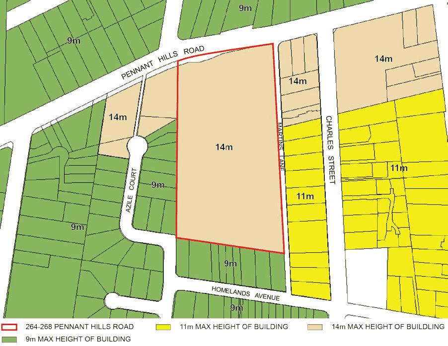

#### 8.5.8.3 HEIGHT OF BUILDINGS

Objectives O.01 Ensure heights of buildings respond appropriately to the surrounding context and setting. O.02 Organise buildings, streets and open space to respond to the topography and desired future character of the site.

O.03 Minimise the apparent density and visual impact of buildings when viewed from surrounding residential areas and the public domain.

O.04 Ensure that development does not unreasonably reduce solar access to neighbouring properties.

O.05 Create positive relationships with other buildings adjoining the site.

Controls

C.01 Building heights should provide a transition to the adjacent lower density residential areas to the south and west.

C.02 Building heights must be in accordance with Parramatta LEP 2023 Height of Buildings Map as shown below in Figure 8.5.8.3.1 to respond to the context, to provide visual interest and to minimise and mitigate adverse overshadowing and privacy impact to adjoining properties and adjoining public domain and land uses.

264-268 PENNANT HILLS ROAD, CARLINGFORD

C.03 When viewed from adjoining streets and adjacent properties the buildings on the site are to appear no higher than 4 storeys.

C.04 A minimum of 3 hours solar access is to be provided to the communal open space areas between 9:00am and 3:00pm on 21st June.

C.05 Overshadowing of community places and areas of high and moderate ecological significance is to be minimised.

C.06 Buildings should to be designed and sited to minimise overshadowing of adjoining properties consistent with the Apartment Design Guide.

> [Picture on page 629: a picture, saved as a picture (images/part-08-centres-precincts-special-character-areas-specific-page-629-10.gif, 150 dpi).]

Figure 8.5.8.3.1 - Extract from Parramatta LEP 2023 Height of Buildings LEP Map
