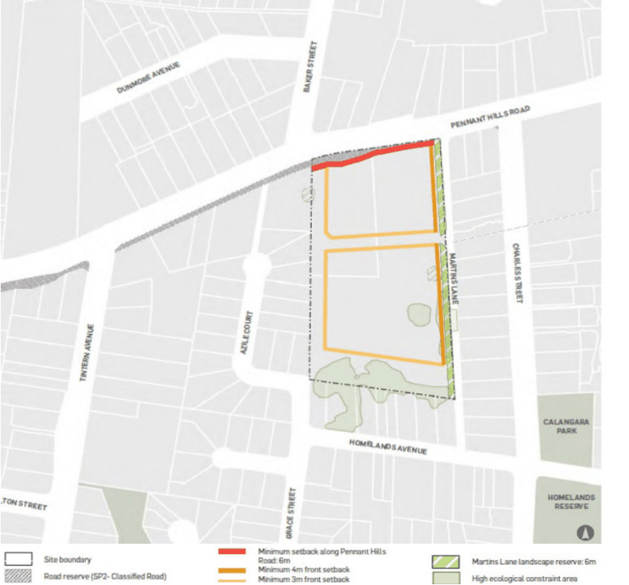

#### 8.5.8.4 SETBACKS

Objectives O.01 Provide:

• a generous interface with existing and proposed streets.

• an appropriate transition between higher density residential development and low density residential development on adjoining sites.

O.02 Allow adequate space to provide landscaping. O.03 Provide appropriate separations between buildings.

264-268 PENNANT HILLS ROAD, CARLINGFORD

Controls

C.01 Setbacks must be provided in accordance with Figure 8.5.8.4.1. C.02 Setbacks should create positive and cohesive relationships between buildings and between buildings and streets.

C.03 Generous setbacks should be provided to the street edges. C.04 Setbacks should minimise any potential negative impacts on adjoining properties. C.05 The setback on Pennant Hills Road is to allow dense landscaping to mitigate negative impacts. C.06 A minimum setback of 6m must be provided from the SP2 zoned land along Pennant Hills Road. C.07 Development must not occur within the setback areas except for soft landscaping, footpaths, fencing, driveways, retaining walls and essential infrastructure.

C.08 Ground floor apartments may have courtyards that extend up to 3m into the setback where they front a street or public pedestrian accessway.

C.09 An ecological assessment is to be submitted with development applications on land proximate to areas identified on the LEP Natural Resources – Biodiversity map as areas of high and medium ecological constraint to determine the appropriate setbacks between the built form and existing trees within these areas to ensure their protection and ongoing health.

> [Picture on page 630: a picture, saved as a picture (images/part-08-centres-precincts-special-character-areas-specific-page-630-18.gif, 150 dpi).]

Figure 8.5.8.4.1 – Site Setbacks for 264-268 Pennant Hills Road, Carlingford

264-268 PENNANT HILLS ROAD, CARLINGFORD
