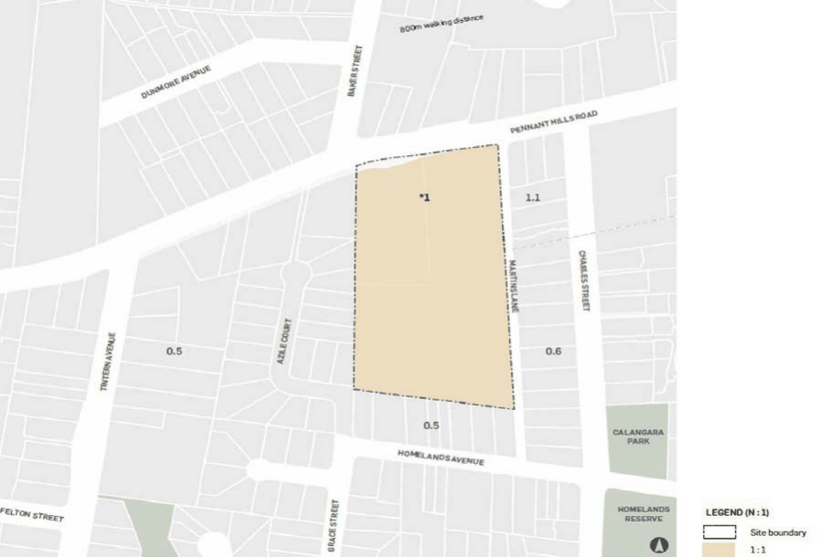

#### 8.5.8.5 FLOOR SPACE RATIO

Objectives

O.01 Ensure that the resulting population density is appropriate for the characteristics of the site, its immediate surrounds and LGA.

O.02 Encourage an overall built form and building layout which respond appropriately to the principles detailed in the overall objectives of this site specific DCP.

Controls

C.01 The following areas may be included as part of the site area for the purposes of calculating FSR:

• The widening of Martins Lane

• The north-south road

• The east-west roads

• The provision of any public pedestrian pathway

• The areas of high and moderate ecological value as mapped on the LEP Natural Resources

– Biodiversity map.

C.02 Floor space ratios must be in accordance with the FSR LEP map reproduced at Figure 8.5.8.4.2.

> [Picture on page 631: a picture, saved as a picture (images/part-08-centres-precincts-special-character-areas-specific-page-631-18.gif, 150 dpi).]

Figure 8.5.8.4.2 - Extract from Parramatta LEP 2011 Floor Space Ratio LEP Map

264-268 PENNANT HILLS ROAD, CARLINGFORD
