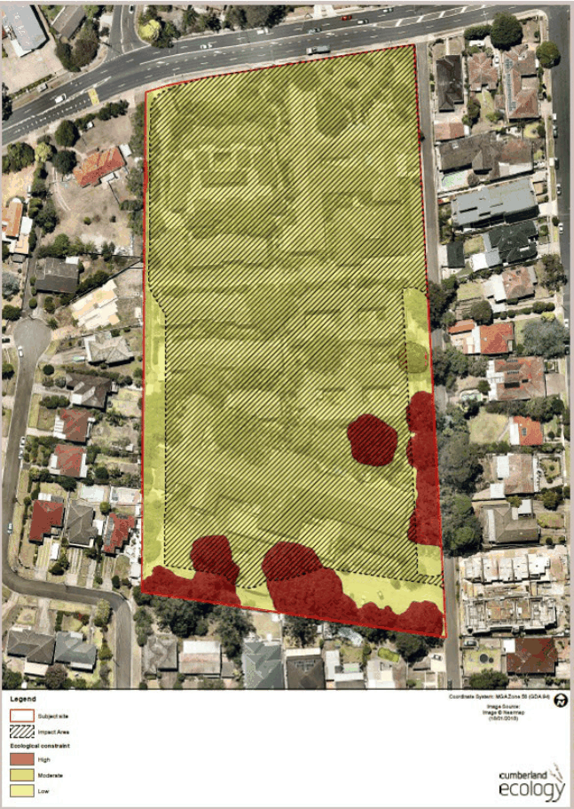

#### 8.5.8.6 LANDSCAPED SPACES AND AREAS OF ECOLOGICAL VALUE

Objectives

O.01 Enhance the existing natural features of the site including topography, geology; vegetation/vegetation communities; micro climate; hydrology (surface and sub-surface).

O.02 Enhance the natural environmental performance of the site by coordinating water and soil management, solar access, micro-climate, tree canopy and habitat values.

O.03 Retain existing trees where possible and use landscaping to make a positive contribution to the streetscape and neighbourhood.

O.04 Provide water sensitive urban design for the management of stormwater drainage. O.05 Ese open space areas, new roads and pedestrian links to assist with stormwater management, provide deep soil zones and maximise rainfall infiltration.

O.06 Design all public spaces and landscaping to a high-quality with a demonstrated consistent design.

O.07 Retain, protect and enhance areas identified as having high or moderate ecological significance area.

Controls

Site Coverage

C.01 Site coverage should provide for adequate deep soil, communal spaces, streets and separation between buildings.

Landscape Generally C.02 Existing high ecological significance trees must be retained where possible. C.03 The setback to Pennant Hills Road must be densely landscaped with species endemic to the

area. This setback shall be provided as a deep soil zone with no basement or sub-floor structures.

C.04 Landscaping must use predominantly indigenous species that reflect the region’s character of the Sydney Blue Gum High Forest and Sydney Turpentine-Ironbark Forest vegetation communities. Opportunities to plant species representative of the communities and the existing areas of moderate and high ecological significance located on the site are to be explored provided planting of these species does not present a danger to residents and the public.

C.05 Selected plant species must provide form, enclosure, texture and colour. The planting should also take on a further role in providing biodiversity, shade and protection.

C.06 A mix of local trees, shrubs and grasses must be used to create attractive, colourful and low maintenance landscaped areas.

C.07 All building setbacks are to be landscaped.

264-268 PENNANT HILLS ROAD, CARLINGFORD

C.08 Any Development Application must include a detailed landscape plan and landscape design report prepared by a qualified landscape architect. The landscape plans are to include details of plant species, pot sizes, mature height, tree protection measures and a detailed maintenance program.

C.09 Deep soil zones must be provided for the first 3 metres of all property boundaries other than Pennant Hills Road which requires a 6 metre deep soil zone (Refer Control C.03).

C.10 Landscaping and buildings should operate as an integrated and sustainable system, resulting in greater aesthetic quality and amenity for both future and existing, surrounding residents and the adjoining public domain.

C.11 Landscape design should optimise usability, privacy and social opportunity, equitable access and respect for neighbours’ amenity, and provide for practical establishment and long-term management.

C.12 Landscaping should enhance the existing natural attributes of the site (including existing vegetation and topography) and seek to maintain and enhance those features as far as possible.

C.13 Deep landscaped setbacks should be provided to Pennant Hills Road to enhance amenity along this frontage.

C.14 Street trees and landscaping should be provided along footpaths to enhance the quality of the streetscape and maximise pedestrian amenity.

C.15 Tree and plant species endemic to the area should be used. Communal Open Space Areas C.16 All communal open space areas must include the following:

• sub-surface drip irrigation systems controlled by timers using soil moisture or rainfall sensors;

• drought tolerant plants and grasses;

• water retaining media mixed into soil; and

• tree planting and landscaping using elements such as indigenous plant species, interesting sculptural elements and pavement design. Details of these elements are to be shown on landscape plans submitted with Development Applications.

C.17 Communal Open Space on both Site A and Site B is to reflect the rectangular shape and approximate area size illustrated in the Public Domain Plan Figure at 8.5.8.2.1.

C.18 Communal open space areas should be sized to allow opportunities for passive and active recreation.

Pedestrian Links

C.19 Well-defined paths should be provided to allow access to Pennant Hills Road and other public domain areas.

C.20 A safe pedestrian environment should be provided.

264-268 PENNANT HILLS ROAD, CARLINGFORD

C.21 Pedestrian links should be designed and located to assist in in providing increased casual surveillance.

Water Sensitive Urban Design (WSUD) C.22 Post-development peak flows from the development site must not exceed pre- development peak flows.

C.23 Landscape works must be undertaken in collaboration with the hydraulic and civil works to develop an integrated stormwater design.

C.24 Open space and green links should be provided to assist with stormwater management, provide deep soil zones and maximise rainfall infiltration.

C.25 All development including landscape designs must incorporate WSUD measures including rain gardens, bioswales, biosinks, and water polishing ponds, wetlands and other constructed ecologies which can detain, retain and reuse water.

Areas of High and Moderate Ecological Significance C.26 Areas identified as being of high or moderate ecological significance are shown on Figure 8.5.8.5.1.

C.27 Any development on land containing or immediately adjoining areas of high or moderate ecological significance must confirm the boundaries of the area of ecological significance with detailed analysis to ensure no adverse impacts to those areas occurs as a result of the development.

C.28 A flora and fauna assessment must be submitted with any Development Application on land identified as containing areas of high or moderate ecological significance.

264-268 PENNANT HILLS ROAD, CARLINGFORD

> [Picture on page 635: a picture, saved as a picture (images/part-08-centres-precincts-special-character-areas-specific-page-635-2.gif, 150 dpi).]

Figure 8.5.8.5.1 - Areas of High and Moderate Ecological Significance
