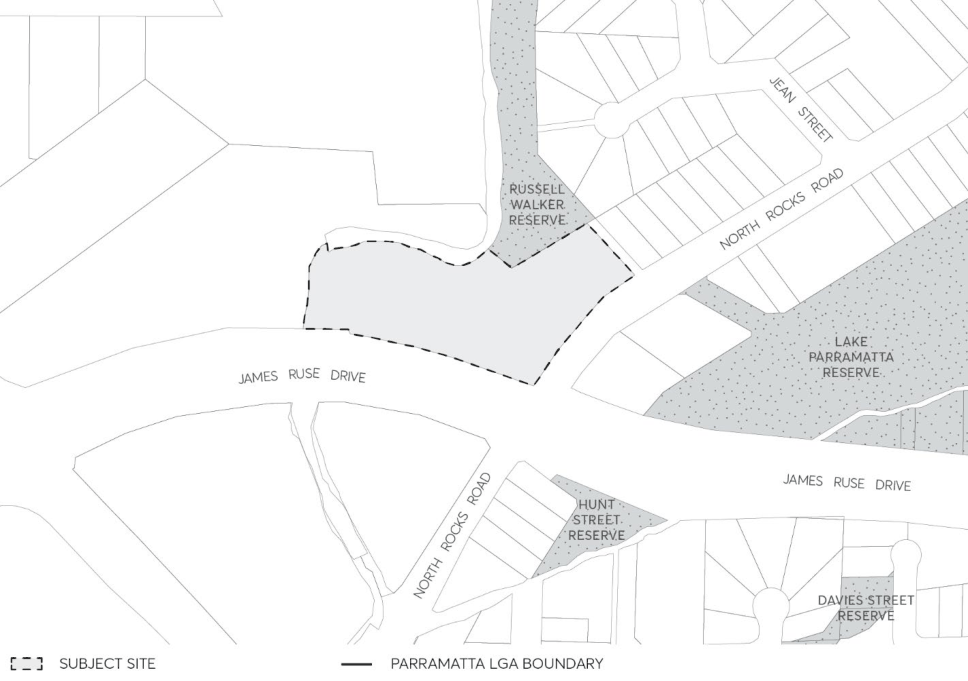

#### 8.5.9 27-33 NORTH ROCKS ROAD, NORTH ROCKS

This Section of this DCP must be read in conjunction with Parramatta DCP 2023.

This Section applies to all land commonly referred to as the “Target Site" within this Section, comprising of those lots identified in Figure 8.5.9.1 below and legally identified as:

• Lot 1 DP 127003;

• Lots 2 and 3 in DP 22931;

• Lot 2 DP 721567;

• Lot 101 DP 617754; and

• Lots 2 DP 1158967.

This site has a total area of 13,139.6m².

> [Picture on page 638: a picture, saved as a picture (images/part-08-centres-precincts-special-character-areas-specific-page-638-13.gif, 150 dpi).]

Figure 8.5.9.1 – Land application map

The indicative master plan (Figure 8.5.9.1.1) and design principles (Figure 8.5.9.1.2) underpin the controls in this DCP.

27-33 NORTH ROCKS ROAD, NORTH ROCKS

Where there is any inconsistency between this Section of this DCP and any applicable Section of this DCP, the provisions of this Section of this DCP shall prevail. This plan should be read in conjunction with relevant maps from Parramatta LEP 2023 that demonstrate bushfire prone land and vegetation.
