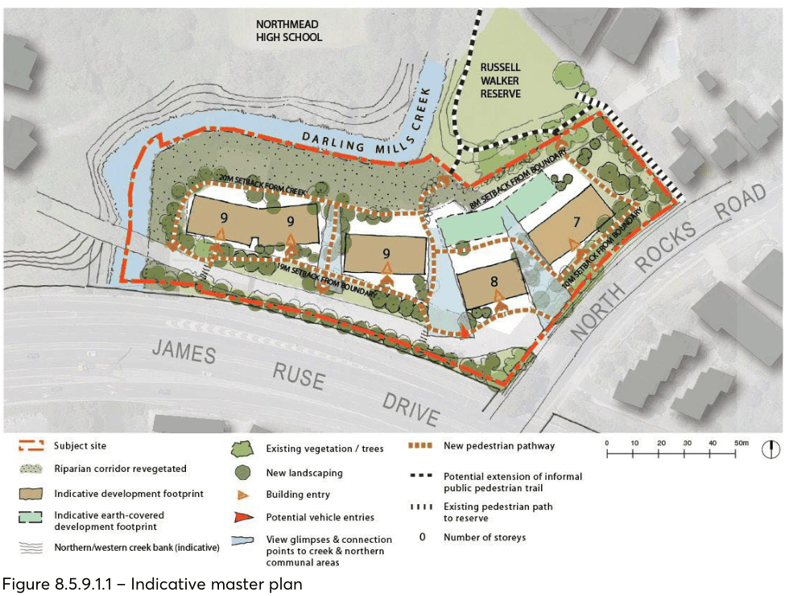
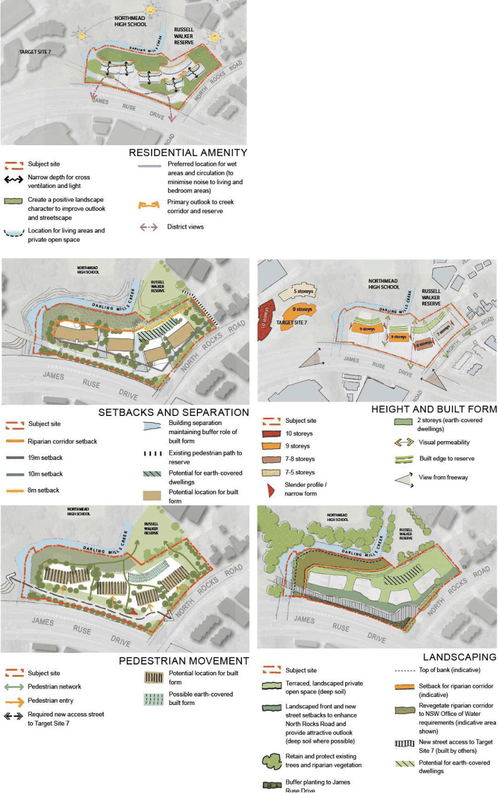

#### 8.5.9.1 DESIRED FUTURE CHARACTER

A sustainable development that is the new benchmark in architectural excellence in the North Rocks

area. The development enhances the amenity and visual quality of the North Rocks Road streetscape, the southern and eastern edge of Russell Walker Reserve and the natural character of the riparian corridor along Darling Mills Creek.

It provides a built form landmark at the approach to North Rocks Road. Development buffers the creek corridor and reserve from the noise and visual impacts of James Ruse Drive whilst allowing generous view corridors to the reserve beyond. The development provides greater diversity in dwelling types and housing choice close to public transport.

The development improves the interface to North Rocks Road, the creek, and reserve through additional landscaping.

> [Picture on page 639: a picture, saved as a picture (images/part-08-centres-precincts-special-character-areas-specific-page-639-17.gif, 150 dpi).]

Figure 8.5.9.1.1 – Indicative master plan

27-33 NORTH ROCKS ROAD, NORTH ROCKS

> [Picture on page 640: a picture, saved as a picture (images/part-08-centres-precincts-special-character-areas-specific-page-640-2.gif, 150 dpi).]

Figure 8.5.9.1.2 – Design Principles

27-33 NORTH ROCKS ROAD, NORTH ROCKS

General objectives

O.01 Repair and enhance the riparian corridor of Darling Mills Creek and buffer to Russell Walker Reserve.

O.02 (Provide a transition in scale to the low-scale residential development to the east by providing a generous landscaped setback along the eastern boundary.

O.03 Connect the new site access road for the Target Site 7 to the west with the existing informal walking track by the creek.

O.04 Create a strong sense of address for the development to North Rocks Road and the new access street to the adjacent target site through the use and placement of a taller built form.

O.05 Minimise vehicle entry impacts to North Rocks Road. O.06 Provide affordable housing choices for the local community close to services and facilities. Views O.07 Maximise opportunities for high-quality creek and reserve outlooks and northern solar access to dwellings.

O.08 Respond to the view from James Ruse Drive towards the site through architectural excellence and a more dominant and stronger form.

O.09 Maintain some visual connection from North Rocks Road footpath through the site to Russell Walker Reserve and the creek corridor.

O.10 Achieve generous view corridors to the creek and reserve between built form. O.11 Minimise the visual and amenity impacts of James Ruse Drive through orientation, design and built form.

Built form O.12 Provide a built form that responds to adjoining development and accentuates the corner of James Ruse Drive and North Rocks Road.

O.13 Provide an appropriate built form envelope and Development Controls for the subject site that realise its potential for greater density.

O.14 Achieve a high-quality development that is responsive to the existing natural and built form environment around the site.

O.15 Achieve a design solution that demonstrates best practice urban design and architecture. O.16 Require a design that responds to the amenity impacts created by James Ruse Drive and North Rocks Road.

Landscaping O.17 Improve the amenity and outlook towards the wall to James Ruse Drive through landscape and maximising opportunities for spaces.

O.18 Extend and enhance the existing landscape character of North Rocks Road. O.19 Maximise the landscape setting between the creek and any new development. O.20 Achieve a well-considered and attractive landscape and built form interface to the Darling Mills Creek.

27-33 NORTH ROCKS ROAD, NORTH ROCKS
