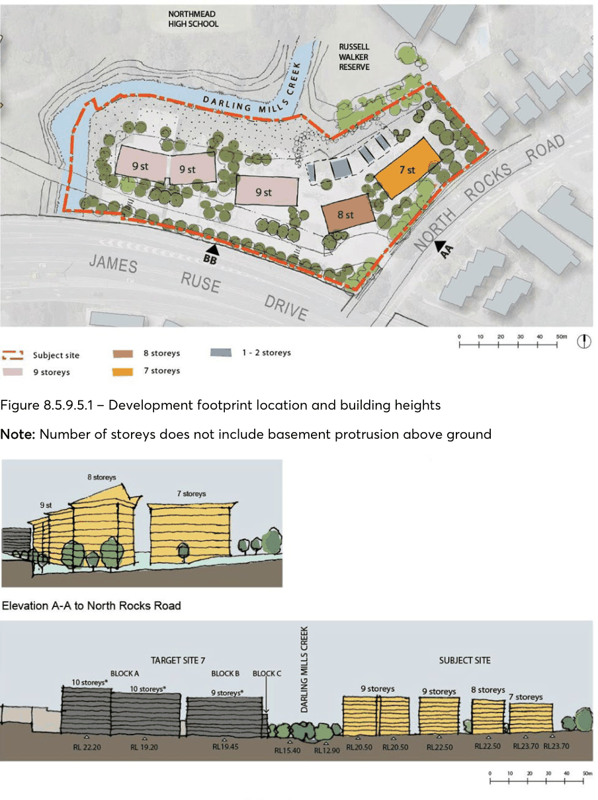
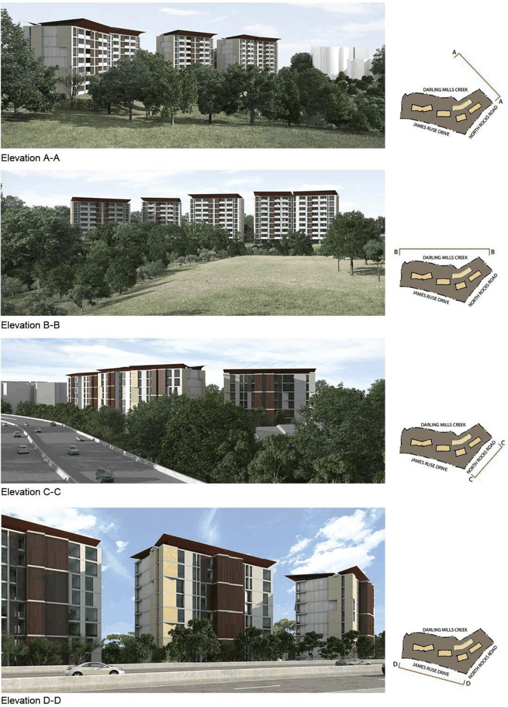
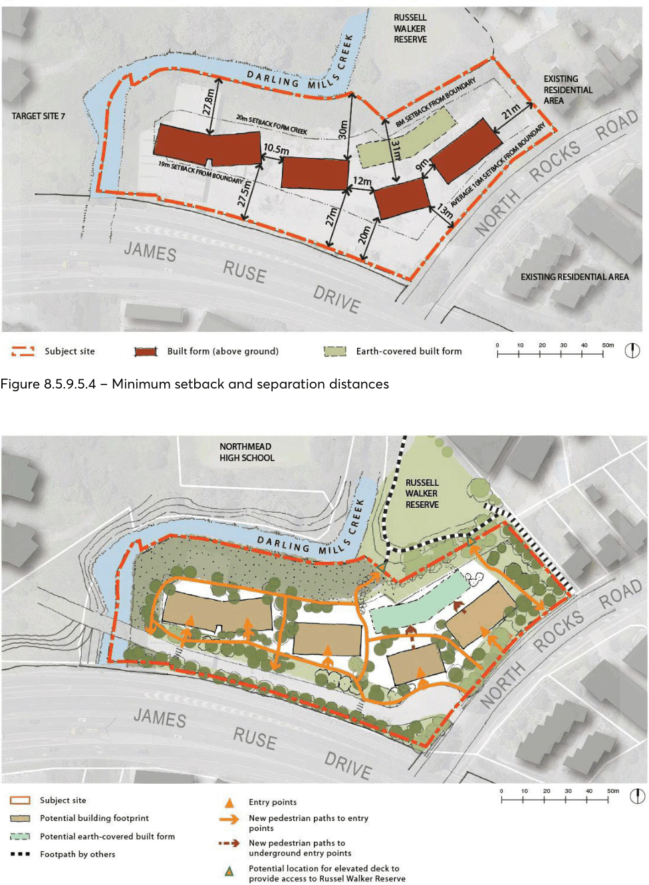
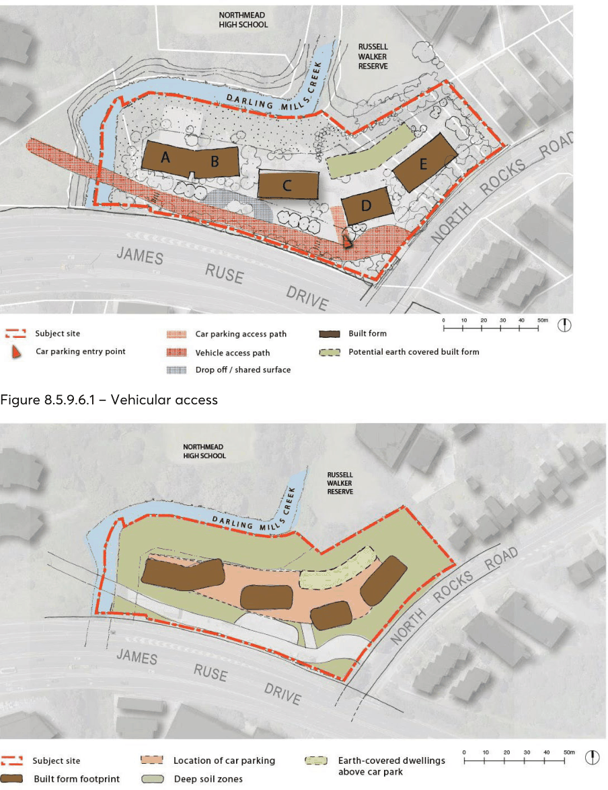

#### 8.5.9.5 DESIGN EXCELLENCE

Objectives

O.01 Achieve design excellence in the architecture and landscape design of any new development. O.02 Ensure high-quality materials and detailing is provided which are sustainable and minimise on-going maintenance costs to the development.

Controls

C.01 New development is to provide a high-quality architectural response to the site in terms of:

• Articulation and visual interest within the massing and height required.

• Use of high-quality, low maintenance materials.

• Interesting roof forms and silhouettes to the buildings.

• Treatment of side walls using high-quality materials and visual interest, if fenestration is not provided.

• High-quality landscape design solutions maximising the use of native vegetation.

• Presentation to James Ruse Drive in terms of facade treatment, materials and colours and articulation.

C.02 Elevation treatment is to be generally consistent with Figure 8.5.9.5.3.

27-33 NORTH ROCKS ROAD, NORTH ROCKS

> [Picture on page 647: a picture, saved as a picture (images/part-08-centres-precincts-special-character-areas-specific-page-647-2.gif, 150 dpi).]

Figure 8.5.9.5.1 – Development footprint location and building heights Note: Number of storeys does not include basement protrusion above ground

Figure 8.5.9.5.2 – Indicative Built Form

27-33 NORTH ROCKS ROAD, NORTH ROCKS

> [Picture on page 648: a picture, saved as a picture (images/part-08-centres-precincts-special-character-areas-specific-page-648-2.gif, 150 dpi).]

Figure 8.5.9.5.3 – Indicative elevations and building materials

27-33 NORTH ROCKS ROAD, NORTH ROCKS

> [Picture on page 649: a picture, saved as a picture (images/part-08-centres-precincts-special-character-areas-specific-page-649-2.gif, 150 dpi).]

Figure 8.5.9.5.4 – Minimum setback and separation distances

Figure 8.5.9.5.5 – Pedestrian access

27-33 NORTH ROCKS ROAD, NORTH ROCKS

Objectives

Pedestrian access O.01 Achieve legible way-finding through the site and convenient access into building for residents and visitors.

O.02 Ensure access to building entries is direct and clearly visible and a strong sense of address is provided to North Rocks Road.

O.03 Provide a range of pedestrian routes through the development to the creek corridor and opportunities to link the site to Russell Walker Reserve.

Vehicle access O.04 Minimise the visual impact of vehicle access areas to pedestrian areas, North Rocks Road and the development as a whole.

O.05 Achieve a single access point for vehicles from North Rocks Road, if possible. O.06 Ensure vehicle access meets with sound traffic management principles. O.07 Ensure that vehicle movement occurs in a safe and efficient manner. O.08 Ensure that access for waste collection vehicles meets Council’s waste collection requirements. Car parking O.09 Ensure that all car-parking demands generated by the development are accommodated on the development site.

O.10 Protect the free flow of traffic into and out of residential flat building developments and the surrounding street network.

Controls

Pedestrian access C.01 Pedestrian links and entry points are to be provided generally in accordance with Figure

8.5.9.5.5 Pedestrian access.

C.02 Resident pedestrian paths through the site are to be located outside the core riparian corridor and protected waters.

C.03 A new public pathway is to be provided within the riparian corridor as an elevated walkway connecting the existing reserve to the new road access for Target Site 7.

C.04 Access points for pedestrians are to be separated from vehicle access driveways to ensure safety.

C.05 Pathway locations must ensure natural surveillance from primary living areas of adjoining units. C.06 Design buildings to the north eastern boundary of the site to overlook the adjacent pedestrian pathway. A visually permeable, low fence to allow dwellings to address the pathway is preferred.

27-33 NORTH ROCKS ROAD, NORTH ROCKS

C.07 Bicycle lock-up facilities are to be provided adjacent to the main entries of the buildings and bicycle storage is to be provided as part of the parking space for each unit.

C.08 Building entrances are to be fully accessible. Entries are to be clearly visible to public areas and are to be located either directly from North Rocks Road or the access street to Target Site 7.

C.09 Identification signage is to be located at the entry to the site along North Rocks Road displaying clearly the property’s name and address.

Vehicle access C.10 Vehicle entry points are to be provided generally in accordance with Figure 8.5.9.6.1. C.11 The preferred location for vehicle and service access is by the new access road for Target Site 7 along the site’s southern boundary avoiding multiple entry points along North Rocks Road.

C.12 The design and configuration of driveways shall be in accordance with Part 6 – Traffic and Transport of this DCP.

C.13 Potential pedestrian/vehicle conflicts are to be minimised by:

• Limiting the width of vehicle access points Ensuring clear sight lines at the pedestrian and vehicle crossing.

• Vehicle driveways and entry points into buildings are to ensure that:

• Garbage collection areas and servicing areas are accessible directly from the access road for Target Site 7, well screened and not visible to the street.

• Driveways are recessed into the main façade line of the building.

• Exposed car parking ramps are not permitted.

• Continue the façade material into the car park entry recess for the extent visible from the street as a minimum to achieve a high-quality outcome.

C.14 All vehicles, including waste and removalist trucks must be able to manoeuvre on-site without relying on access to Target Site 7.

C.15 The Roads and Maritime Services will be consulted in relation to any Development Application on the site. Road and traffic management improvements to North Rocks Road are to be undertaken as specified by and to the satisfaction of the Roads and Maritime Services and Council.

Car parking C.16 Car parking is to be provided in the locations shown in Figure 8.5.9.6.2. C.17 Car parking shall be in accordance with Part 6 – Traffic and Transport of this DCP. C.18 Car parking is to be located within the basement of any new development. The line of the basement car park shall fit generally within the building footprint as shown in Figure 8.5.9.6.2 with considerations given to optimising consolidated areas of deep soil.

C.19 The basement car park shall be designed to mitigate flood impacts. C.20 No car parking is to be exposed to the creek riparian corridor or to the reserve. C.21 Any car parking above natural ground due to the slope of the land is to be sleeved behind residential uses or landscaped terraces.

27-33 NORTH ROCKS ROAD, NORTH ROCKS

> [Picture on page 652: a picture, saved as a picture (images/part-08-centres-precincts-special-character-areas-specific-page-652-2.gif, 150 dpi).]

Figure 8.5.9.6.1 – Vehicular access

Figure 8.5.9.6.2 – Location of parking, built form and deep soil planting
