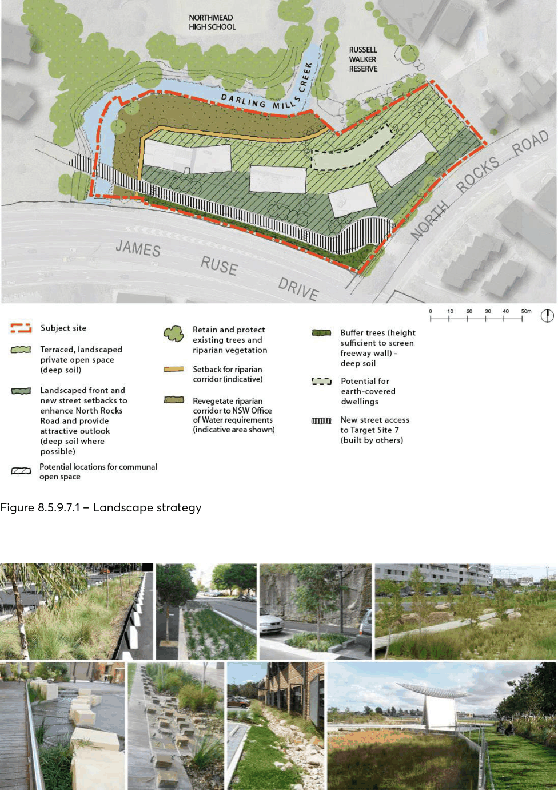
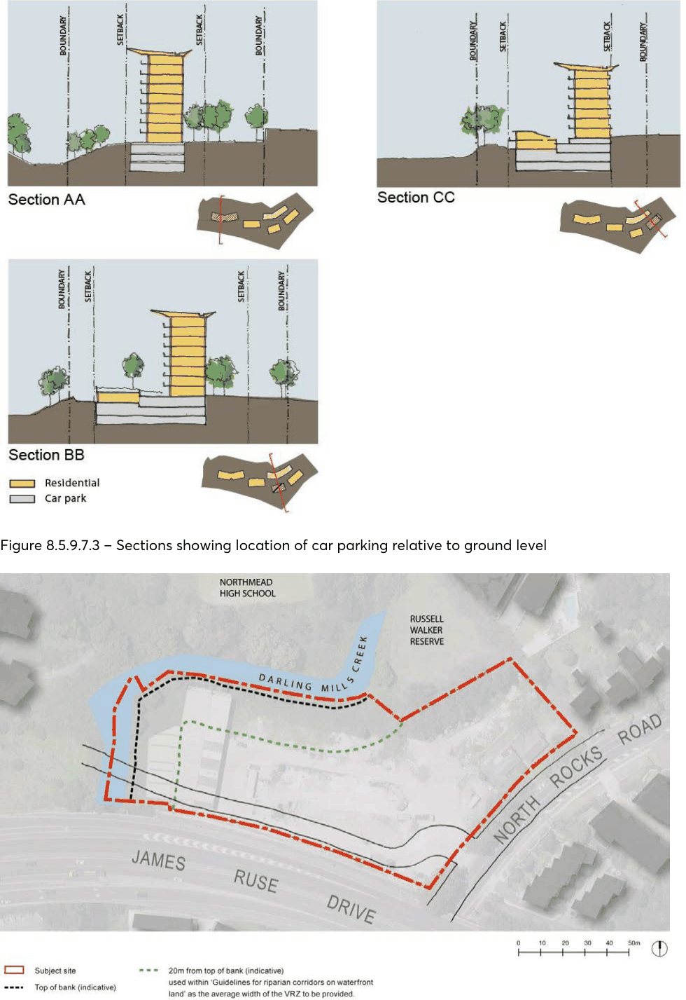

#### 8.5.9.7 LANDSCAPE AND OPEN SPACE

Objectives

O.01 Maintain and enhance the natural vegetation along Darling Mills Creek and Russell Walker Reserve.

27-33 NORTH ROCKS ROAD, NORTH ROCKS

O.02 Maximise landscaping and provide opportunities for the planting of native species. O.03 Provide high-quality landscaping along the Target Site 7 access road and frontage to North Rocks Road.

O.04 Provide a high-quality landscaped outlook and private open space for residents. O.05 Retain the existing tree planting within the site where possible. O.06 Minimise visual privacy impacts to the dwellings to the north east. O.07 Maximise deep soil zones within the site. O.08 Minimise the visual impact of the existing retaining wall to James Ruse Drive. O.09 Provide high-quality communal open space for residents including a range of recreational opportunities for residents

Deep soil O.10 Maximise opportunities for deep soil particularly adjacent to Darling Mills Creek, James Ruse Drive and North Rocks Road to contribute to the landscape character of these areas.

O.11 Assist with the management of water quality and the water table on the site. O.12 Improve the amenity of the site and its surroundings by retaining existing trees or replacing them with the same or similar species

Planting on structures O.13 Contribute to the quality and amenity of communal open space over car parking areas.

Controls

C.01 Landscaping is to be provided in the locations shown in Figure 8.5.9.7.1. C.02 Additional street trees of an appropriate species are to be provided along the North Rocks Road boundary.

C.03 Landscaped area is to comprise a minimum of 60% of the site area. C.04 Areas less than 2 metres in width will be excluded from the landscape calculation. C.05 A minimum of 2,300m² of common open space is to be provided. C.06 The new access street to Target Site 7 is to be landscaped with semi mature street trees and landscaped frontages to reduce the visual impact of James Ruse Drive.

C.07 Consultation is required with Caltex to consider landscaping opportunities on and adjacent to the Hunter Pipeline easement prior to the lodgement of any Development Application.

C.08 A Vegetated Riparian Zone is to be provided along Darling Mills Creek in accordance with NSW Office of Water requirements (See Figure 8.5.9.7.4). It is to function as an ecological system and therefore cannot contain any access routes or recreational areas unless detailed as part of a Development Application for the land prior to issue of the Controlled Activity Approval.

C.09 Existing trees and vegetation in the riparian corridor and in the 1 in 100 year flood zone (refer to Flood Impact Report by HKMA dated 15/12/2011) are to be retained and the corridor re-

27-33 NORTH ROCKS ROAD, NORTH ROCKS

vegetated, using native species appropriate to the flood affected location in accordance with NSW Office of Water requirements.

C.10 Erosion and sediment control works and water diversion structures are to be provided in accordance with the NSW Office of Water requirements.

C.11 A vegetation management plan must be prepared for approval by the NSW Office of Water as part of any development. It is to follow the Office of Water’s Guidelines for Vegetation Management Plans on Waterfront Land.

C.12 Endemic riparian species that overhang the creek should also be used and emergent aquatic vegetation restored where possible.

C.13 Existing trees on-site are to be retained. If it is not possible to retain existing trees then a replacement mature specimen of the same or similar species is to be provided.

C.14 Open spaces are to be concentrated on the northern side of the development. C.15 Landscaping shall be designed to positively contribute to the site’s existing characteristics by:

• using plant species that are endemic to the area where appropriate; and

• retaining and incorporating changes of level in the landscape design.

C.16 The energy and solar efficiency of dwellings and the micro-climate of private open spaces are to be improved by:

• Incorporating deciduous trees and landscaping which allow shading in summer and low angle sun penetration in winter;

• varying heights of different species of trees and shrubs to shade walls and windows; and

• locating pergolas on balconies and within courtyards to create shaded areas in summer and private areas for outdoor living.

C.17 Landscape design is to contribute to water and stormwater efficiency by:

• using plants with low water demand to reduce mains consumption;

• using plants with low fertiliser requirements; and

• utilising permeable surfaces.

C.18 Private and common spaces are to be clearly defined through landscape. C.19 Communal open space is to be provided to the northern area of the site adjacent to the creek corridor and existing reserve.

C.20 The design of this area is to ensure privacy for ground floor units adjacent to it. C.21 Communal open space is to be accessible to all residents. C.22 Provision of a gym or pool must be restricted to indoors to minimise noise impacts to adjoining residents.

Deep soil C.23 Deep soil is to be provided generally in the locations shown in Figures 8.5.9.6.2 and 8.5.9.6.3. C.24 Deep soil is to comprise a minimum of 30% of the landscape area. (Note: the landscape area excludes the riparian corridor zone and the riparian recovery zone).

27-33 NORTH ROCKS ROAD, NORTH ROCKS

> [Picture on page 655: a picture, saved as a picture (images/part-08-centres-precincts-special-character-areas-specific-page-655-2.gif, 150 dpi).]

Figure 8.5.9.7.1 – Landscape strategy

Figure 8.5.9.7.2 – Landscape character images

27-33 NORTH ROCKS ROAD, NORTH ROCKS

> [Picture on page 656: a picture, saved as a picture (images/part-08-centres-precincts-special-character-areas-specific-page-656-2.gif, 150 dpi).]

Figure 8.5.9.7.3 – Sections showing location of car parking relative to ground level

Figure 8.5.9.7.4 – Riparian corridor zone

27-33 NORTH ROCKS ROAD, NORTH ROCKS
