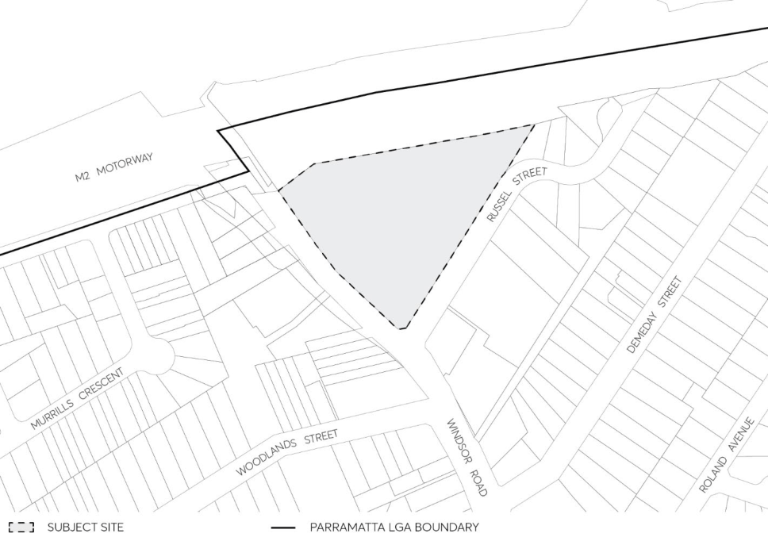

#### 8.5.10 257 WINDSOR ROAD AND RUSSELL STREET, BAULKHAM HILLS

This Section of this DCP applies to all land commonly referred to as “Russell Street Target Site”, and comprises those lots identified in Figure 8.5.10.1 and legally identified as:

• Lots 1 to 5, 20 to 22, DP 8214

• Lots 1, 3 to 6, DP 866897

> [Picture on page 660: a picture, saved as a picture (images/part-08-centres-precincts-special-character-areas-specific-page-660-7.gif, 150 dpi).]

Figure 8.5.10.1 – Land application map

This Section is to be read in conjunction with other relevant Sections including:

• Part 3 – Residential Development

• Part 5 – Environmental Management

• Part 7 – Heritage and Archaeology

Where any provision of this Section of this DCP is inconsistent with provisions in other Parts of this DCP, the provisions of this Section shall prevail.
