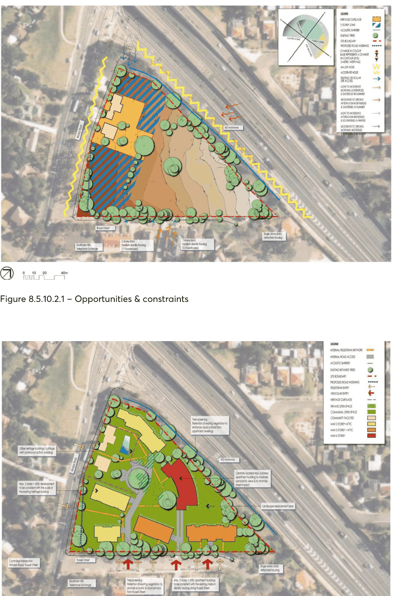

#### 8.5.10.3 GENERAL

Proposed development demonstrates that it represents a high-quality urban design solution and that adequate regard has been given to the following aspects of the design.

Objectives

Visual Impacts and Views O.01 Be compatible with the surrounding heights of the adjacent mixed height single dwellings and two storey multi dwelling housing.

O.02 Explore built form that minimises any negative impacts on the Russell Street streetscape/landscape.

O.03 Explore a range of building forms that represent a transition between the low scale residential forms to the east and the two storey multi dwelling housing developments to the west and higher building forms within the site.

O.04 Preserve the existing views of the historic school precinct from Windsor Road. Heritage O.05 Reflect and respect the significant heritage buildings and identified curtilage. Land Use and Density O.06 Achieve an appropriate relationship to the topography of the site and ensure the built form does not adversely impact on the solar access and privacy of adjoining owners.

O.07 Provide adequate communal open space. O.08 Respect the historic low density visual setting of the historic school curtilage. Access O.09 Provide comfortable and safe pedestrian access for future residents. O.10 Not adversely impact on the residential ambiance of Russell Street. O.11 Limit vehicular access into and out of site to three locations along Russell Street. Urban Structure O.12 Provide an appropriate transition between the low-rise, low-density housing skirting the east and west boundaries and higher density residential development within the site.

Landscape and Character

257 WINDSOR ROAD AND RUSSELL STREET, BAULKHAM HILLS

O.13 Where possible retain and protect any existing mature trees within the site that have been identified for retention.

O.14 Provide appropriate communal streetscape character of Russell Street with sympathetic landscaping treatment.

O.15 Have regard to the physical setting of the site, including the fall from the north-east to the north- west.

O.16 Ensure the retention and ongoing maintenance of the identified historic plantings associated with the school through the provision of generous space for spread and protection of root zones.

Controls

The site analysis process has lead to the identification of a number of key design controls including: C.01 Retention/reinforcement of perimeter landscape. Augmentation of internal landscape to reinforce and reinstate the gardenesque characteristics of both the site and the area. This will also provide the basis for a series of active passive communal recreational places within the site.

C.02 Adaptive re-use of the heritage buildings and curtilage for communal active functions. C.03 10 metre building setback from historic school buildings. C.04 Low rise development (to maximum two storeys plus attic) within the zone contiguous with curtilage and heritage buildings and generally paralleling Windsor Road.

C.05 Primary vehicular access to the site from Russell Street located to take advantage of site slopes and thus giving vehicular entry to basements associated with individual building complexes.

C.06 Pedestrian entry zones identified to provide for a range of alternate access points from both Windsor Road and Russell Street.

C.07 Three storeys plus attic buildings located behind perimeter landscaping to Russell Street. Facades to be articulated.

C.08 Six storey residential flat building located in the centre of the site with a norther aspect. Siting designed to maximise panoramic views and minimise external impacts.

C.09 Maximum development capacity of 130 dwellings consistent with the recommendations in the Traffic Report.

C.10 Internal roads and vehicular access/visitor parking to be lightly incised into the site.

257 WINDSOR ROAD AND RUSSELL STREET, BAULKHAM HILLS

> [Picture on page 663: a picture, saved as a picture (images/part-08-centres-precincts-special-character-areas-specific-page-663-2.gif, 150 dpi).]

Figure 8.5.10.2.1 – Opportunities & constraints

Figure 8.5.10.2.2 – Design principles

257 WINDSOR ROAD AND RUSSELL STREET, BAULKHAM HILLS
