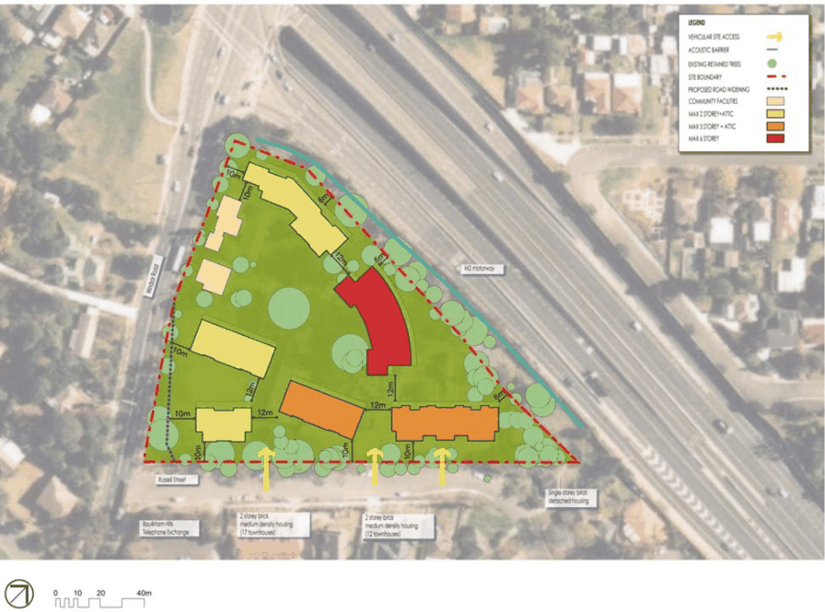
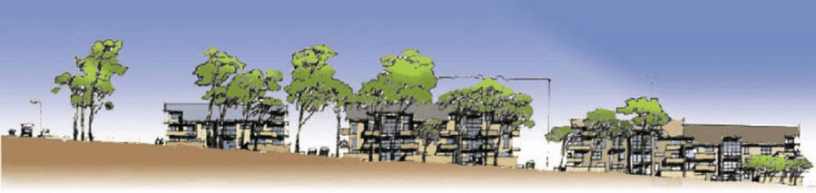
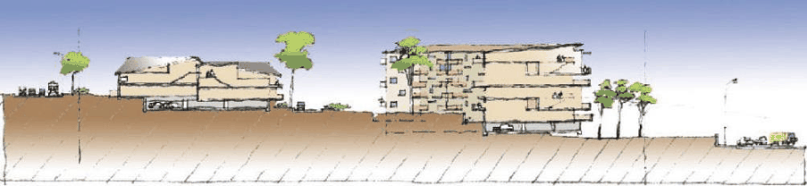

#### 8.5.10.4 BUILT FORM, HEIGHT OF BUILDINGS AND SITE PLANNING

Objectives

Site planning O.01 Achieve coherent site planning and development that relates to the natural contours of the site and contributes to the character of the area.

O.02 Protect, contribute and enhance the existing residential character and amenity. Setbacks O.03 Provide setbacks that compliment the surrounding setting and allow flexibility. O.04 Front setback to be provided to enhance the existing character and streetscape quality of Russell street and provide opportunity for visually significant as well as functional landscape.

Building height and form O.05 Ensure that the scale and bulk of new buildings have regard to the natural topography and retain vegetation within the site.

O.06 Ensure that new buildings are compatible in bulk and scale with the surrounding developments. O.07 Ensure that the new buildings have minimum impact on the neighbouring properties in terms of overshadowing, privacy and views.

O.08 Ensure that new buildings within the two storey zone are compatible in height, bulk and scale with the remaining heritage buildings.

Controls

Site planning C.01 Future development to be located generally in accordance with Figure 8.5.10.2.2. C.02 The site coverage shall be a maximum 50% of the site area. Setbacks C.03 Setbacks are to complement the existing and future desired streetscape of the area. C.04 Setbacks are to provide sufficient area for landscaping to compliment building form. C.05 Front setbacks for the proposed development are to minimise negative impact on the existing landscape.

C.06 Side and rear setbacks of the proposed development are to minimise any adverse impacts such as overshadowing and privacy between the proposed and existing developments.

C.07 Development setbacks shall be in accordance with Figure 8.5.10.3.1. Table 8.5.10.3.1 - Setbacks

| Residential flat buildings |  |
|---|---|
| Front Setback (Windsor Road) | 10m |

257 WINDSOR ROAD AND RUSSELL STREET, BAULKHAM HILLS

| Front Setback (Russell Street) | 10m |
|---|---|
| Read Setback (M2 Motorway) | 6 metres |
| Multi dwelling housing (two storeys + attic) |  |
| Front Setback (Windsor Road) | 10m |
| Front Setback (Russell Street) | 10m |
| Read Setback (M2 Motorway) – Single storey or more | 6 metres |

> [Picture on page 665: a picture, saved as a picture (images/part-08-centres-precincts-special-character-areas-specific-page-665-3.gif, 150 dpi).]

Figure 8.5.10.3.1 – Setbacks

Building height and form C.08 The height of new buildings shall be related to the topography of the site. C.09 The height of new building shall not exceed the bulk and scale of buildings on adjoining lands. C.10 Building height and bulk shall be located on the site to ensure that there is no significant loss of amenity to adjacent dwellings and the public domain.

C.11 The design of the units adjacent to Russell Street properties should provide for articulation of built form and fenestration to provide visual interest and diversity.

257 WINDSOR ROAD AND RUSSELL STREET, BAULKHAM HILLS

C.12 The maximum height of any two storey building and attic abutting the M2 Motorway, Windsor Road or Russell Street shall not exceed 7.2 metres (height to eaves).

C.13 The maximum height of any three storey building and attic or part of a building addressing Russell Street shall not exceed 12 metres to the eaves or 14 metres to the ridge.

C.14 The maximum height of any building abutting the M2 Motorway along the northern boundary shall not exceed more than six residential storeys (18 metres height to eaves or 20 metres maximum ridge height).

C.15 The attic level in any unit may contain a maximum of one bedroom (with associated wardrove and ensuite). The maximum total useable floor area permitted in the attic is 25m² (including the area of the ensuite and wardrobe). No additional floor space will be permitted in the attic area. Refer to Figure 8.5.10.2.2 for building storey heights and Figures 8.5.10.3.2 and 8.5.10.3.3 – Indicative sections and elevations.

> [Picture on page 666: a picture, saved as a picture (images/part-08-centres-precincts-special-character-areas-specific-page-666-14.gif, 150 dpi).]

Figure 8.5.10.3.2 – Indicative Russell Street elevation

> [Picture on page 666: a picture, saved as a picture (images/part-08-centres-precincts-special-character-areas-specific-page-666-16.gif, 150 dpi).]

Figure 8.5.10.3.3 – Indicative cross section
