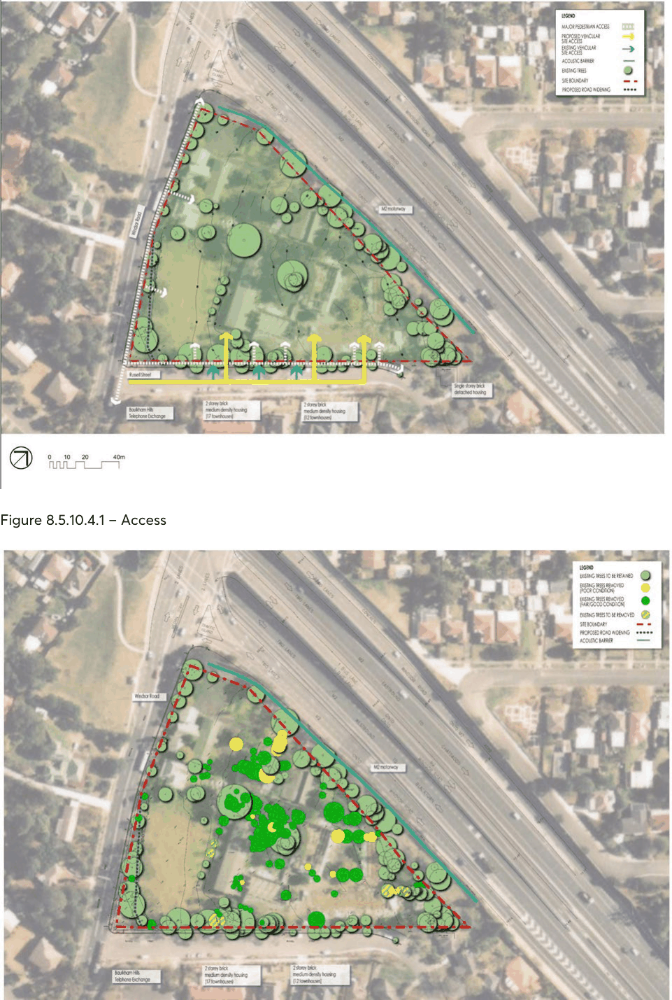

#### 8.5.10.5 LANDSCAPE AND VEGETATION

A vegetation report for the site was prepared in January 2000. The report noted that there were approximately 200 trees on-site of which a significant proportion were of good health and form. It was noted that very few were indigenous to the area and that none represented remnant tree species. The species range was dominated by native Australian and American trees.

The report noted that the trees were generally some 60 to 80 years old and of more recent origin than the heritage buildings. The older trees generally occurred on the south-western corner and along the western boundary. Significant numbers of planting within the site were consistent with the built

257 WINDSOR ROAD AND RUSSELL STREET, BAULKHAM HILLS

framework defined by the later school buildings [now demolished] which were in the order of 20 to 25 years old.

Landscaping within the historic school boundary consists of some mature native and exotic species. Of particularly high aesthetic and historic value are the two fig trees fronting Windsor Road on the northern section of the site.

The supporting drawing clearly indicates that the report identified significant groupings of trees within courtyards formed by the school buildings. It is evident that a substantial number of trees have now been removed from the site, even though they were identified in the January 2000 report as being in good condition and of a substantial scale. This is regrettable since their retention would have contributed to the gardenesque character of the area and would have also added significant value to any proposed residential development. There is no evidence that the removal of significant vegetation has been approved by Council.

The vegetation drawing, Figure 8.5.10.4.2, clearly shows the remaining vegetation on-site and those trees that may be impacted as a result of the proposed development outlined as part of this Section of this DCP. In addition, the drawing also shows those trees that were identified in the January 2000 report to be in good condition and which have subsequently been removed from the site, together with those trees that were identified to be in poor condition and scheduled for removal in the January 2000 report.

Opportunities

There is substantial perimeter planting which will help to mitigate the impact of development within the site. The landscape to the edges of the site represents an important element which will facilitate screening the residential development and provide a foil, particularly against the M2, Russel Street and Windsor Road frontages.

The loss of vegetation previously identified as being in fair/good/excellent condition, particularly within the previous ‘courtyards’, will need to be addressed as part of the detailed landscape proposals associated with the development of the site.

257 WINDSOR ROAD AND RUSSELL STREET, BAULKHAM HILLS

> [Picture on page 668: a picture, saved as a picture (images/part-08-centres-precincts-special-character-areas-specific-page-668-2.gif, 150 dpi).]

Figure 8.5.10.4.1 – Access

Figure 8.5.10.4.2 – Vegetation

257 WINDSOR ROAD AND RUSSELL STREET, BAULKHAM HILLS

Objectives

O.01 Integrate the landscape design with the design of the future residential development. O.02 Protect and enhance the gardenesque character of the City.

Controls

C.01 Landscaping is to be appropriately scaled and locate relative to both the building bulk, incorporating existing vegetation where possible.

C.02 The landscape area shall be a minimum 50% of the area of the site, exclusive of access driveways and parking.

C.03 Areas less than 2 metres in width will be excluded from the landscaped area calculation. C.04 A minimum of 25% of the landscaping area shall permit deep soil planting. C.05 Landscape plans shall clearly demonstrate that an additional quantum of mature landscaping will be provided and located in a form that reflects as loosely as possible the landscape that exists as at January 2000 (refer Figure 8.5.10.4.2).

C.06 A 7,500mm wide deep soil planting landscape medium island is to be provided at the entry to the central driveway off Russell Street which provides access to the six storey building basement.

C.07 Mature landscaping is to be provided on Russell Street to supplement existing trees and enhance screening of the future development from Russell Street
