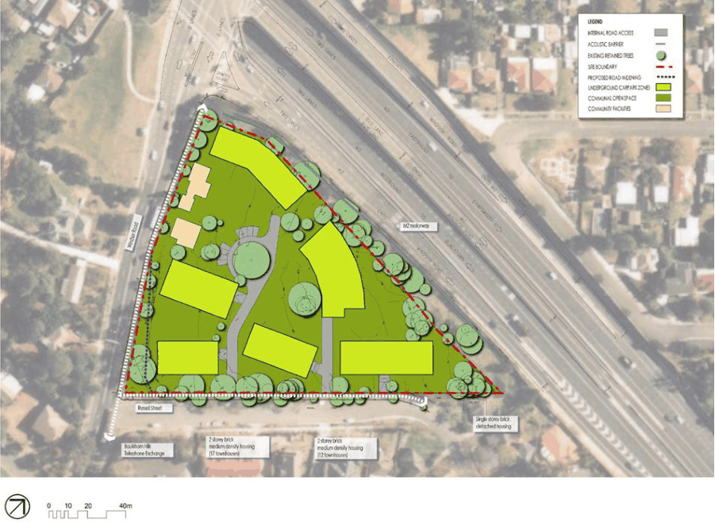

#### 8.5.10.6 TRAFFIC AND ACCESS

The triangular site is bounded by the M2 motorway along the northern boundary, Windsor Road on the west and Russell Street to the east.

A pedestrian footpath skirts the east and west boundary along Windsor Road and Russell Street.

Traffic Solutions Pty Ltd prepared a report on the potential traffic impact of the proposed re-zoning of the site to permit residential flat buildings. The statement addressed the following requirements of Council:

a) Existing traffic environment

“The intersection of Windsor Road and Russell Street and Oakland Avenue and Ventura Road currently operates at an unsatisfactory level of service due to the lengthy delays for right turn vehicles.

A previous Development Application proposed the installation of traffic signals at this intersection as part of the proposal, however the Roads and Traffic Authority strongly objected to the concept”

b) Proposed development - traffic generation

“The development proposal of 130 units is estimated to generate approximately 52 vehicle trips in the morning and evening peak hour.”

257 WINDSOR ROAD AND RUSSELL STREET, BAULKHAM HILLS

“Consequently, the proposed development with an estimated potential traffic generation of 52 vehicle trips in the peak hours will not increase the peak hour volumes beyond the RMS (300 max) or Council’s suggested maximum environmental goal for Russell Street, Baulkham Hills.”

c) Cumulative impact in locality and surrounding streets

The impacts on the surrounding network, including Oakland Avenue and Ventura Road were examined and found to be minimal.

d) Need for traffic improvements in the locality

The assessment explored the need for traffic improvements including the Windsor Road/Russell Street intersection.

e) Sight distance

“The proposed driveway locations along the Russell Street frontage of the site will provide satisfactory site lines in both directions along Russell Street.”

f) Conclusion

“The good Level of Service at the intersection of Windsor Road will continue with the estimated additional traffic generation of the proposed residential development and even if the right turns were prohibited at Russell Street.”

“The additional traffic demand on the intersections of Windsor Road with Oakland Avenue and Ventura Road, as a consequence of additional traffic utilizing these intersections to turn around (including the proposed development) will only alter the Degree of Saturation and Total Average Delays minutely.”

The following opportunities and constraints were identified:

Opportunities:

• Enhance level of service and minimise the number of accidents occurring at the Windsor Road and Russell Street intersection by controlled left turn entry and egress during peak hours only.

• Take advantage of the Russell Street pavement width and sight lines.

Constraints:

• Single point of access to Windsor Road.

Objectives

O.01 Provide sufficient and convenient on-site parking for residents and visitors and hence maintain the amenity of adjoining properties and the efficiency of the road network.

O.02 Ensure that vehicular access to and from the development is simple, safe and direct.

257 WINDSOR ROAD AND RUSSELL STREET, BAULKHAM HILLS

Controls

C.02 Car parking shall be located underground where practicable, to minimise the height of buildings above the natural ground level.

C.03 Driveway design shall provide safe and efficient ingress/egress to the site. C.04 The design of driveways and parking areas shall minimise the visual impact of hard paved areas C.05 The driveway design shall make provision for service vehicles where practicable. Public Roads C.06 Line marking and curb treatment to delineate left and right turns for vehicles exiting Russell Street is to be provided to council’s requirements.

Car parking C.07 All car parking areas and spaces shall be designed in accordance with Part 6 – Traffic and Transport.

C.08 Tandem car parking may be considered depending upon the merits of the proposal having regard to overall car parking provision.

> [Picture on page 671: a picture, saved as a picture (images/part-08-centres-precincts-special-character-areas-specific-page-671-16.gif, 150 dpi).]

Figure 8.5.10.5.1 – Car parking & vehicular access

C.09 A carwash bay must be provided in accordance with the following:

a) The carwash bay can be either a designated car space separate to that of total car spaces as calculated, or can be a visitor space when not utilised by visitors.

257 WINDSOR ROAD AND RUSSELL STREET, BAULKHAM HILLS

b) A minimum provision of one designated carwash bay space per residential multi-unit development.

c) Car wash bays are not to be used to carry out engine degreasing or mechanical repairs and must be signposted to reflect this prohibition.

d) Wastewater must be treated so as to remove grease, oil and silt and must be either reused for car washing or used for irrigation of landscaped areas on-site. To treat wastewater in this way application for a licence must be applied for from the Office of Environment and Heritage. Approval can be sought from www.environment.nsw.gov.au/licensing/.

e) Alternatively wastewater can be discharged to the sewer, This is only where (b) is not feasible according to a report provided by a hydraulic engineer, the Council or the Office of Environment and Heritage. Approval from Sydney Water must be sought by applying for Permission to Discharge Trade Wastewater. Refer to the fact sheet on Sydney Water’s web site www.sydneywater.nsw.gov.au. - Disposal of Trade Wastewater from Residential Car Wash Bays.

f) Wastewater option (e) requires the construction of a roof over the designated car wash space and must be bunded to exclude rainwater as per Sydney Water’s requirements.

g) Approval must be obtained either from the Office of Environment and Heritage or Sydney Water prior to construction of the development.

C.10 Car parking design to be generally in accordance with Figure 8.5.10.5.1. Pedestrian Access C.11 Separate pedestrian access shall be provided from the street independent of vehicular access. C.12 Pedestrian access shall be legible, inviting, safe and provide visible interest. C.13 Pedestrian access to be in accordance with Figure 8.5.10.2.2. C.14 Given the existing width of Russell Street the opportunity to establish perpendicular to the kerb car parking zones for visitors, together with associated landscaping should be explored with the Council during the DA design phase. The introduced landscape should be no less than one mature street tree for every four car parking spaces.

Driveways C.15 Vehicular access to the site should reflect the principles shown in Figure 8.5.10.5.1. C.16 The design and configuration of access ways and driveways shall be in accordance with Part 6 of this DCP.
