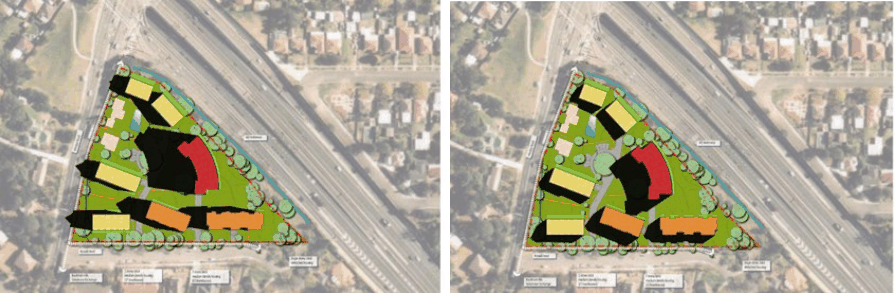
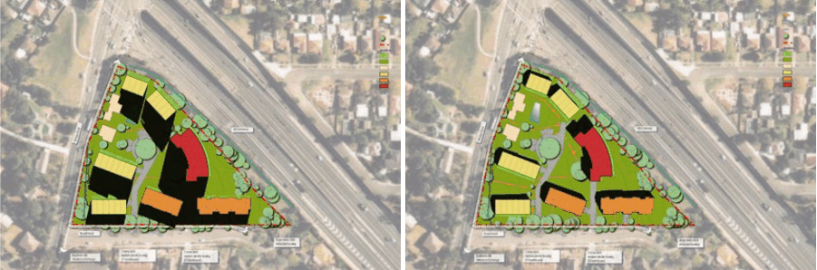
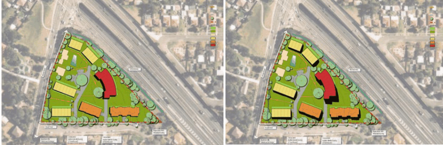

#### 8.5.10.8 SOLAR ACCESS AND OVERSHADOWING

Objectives

O.01 Ensure reasonable access of sunlight to living areas within buildings and open space areas around buildings in winter and minimise the need for artificial heating.

O.02 Ensure adjacent open space/areas, living areas of adjacent dwellings, and communal areas are not deprived of reasonable solar access.

O.03 Minimise the need for artificial lighting in dwellings during the day.

257 WINDSOR ROAD AND RUSSELL STREET, BAULKHAM HILLS

O.04 Provide adequate shading to internal areas and private open space in summer to minimise the need for artificial cooling.

Controls

C.01 Sunlight is to be available to the majority of living areas and private and communal open space areas of the proposed dwellings, and to any adjoining dwellings having regard but not limited to:

• Preferred living area orientation between 20 degrees east and 30 degrees west.

• Larger windows to the north and smaller to east, west and north.

• Pergolas, eaves and fencing. Building height.

• Window shading devices.

C.02 Locate the private open space areas to achieve 4 hours sunlight between 9:00am and 3:00pm on 21 June.

C.03 A target of 70% of units to achieve solar access to living areas.

> [Picture on page 674: a picture, saved as a picture (images/part-08-centres-precincts-special-character-areas-specific-page-674-15.gif, 150 dpi).]

Figure 8.5.10.7.1 – June 21, 09:00

Figure 8.5.10.7.2 – June 21, 1200

> [Picture on page 674: a picture, saved as a picture (images/part-08-centres-precincts-special-character-areas-specific-page-674-18.gif, 150 dpi).]

Figure 8.5.10.7.3 – June 21, 15:00

Figure 8.5.10.7.4 – December 21, 09:00

257 WINDSOR ROAD AND RUSSELL STREET, BAULKHAM HILLS

> [Picture on page 675: a picture, saved as a picture (images/part-08-centres-precincts-special-character-areas-specific-page-675-2.gif, 150 dpi).]

Figure 8.5.10.7.5 – December 21, 12:00

Figure 8.5.10.7.6 – December 21, 15:00
