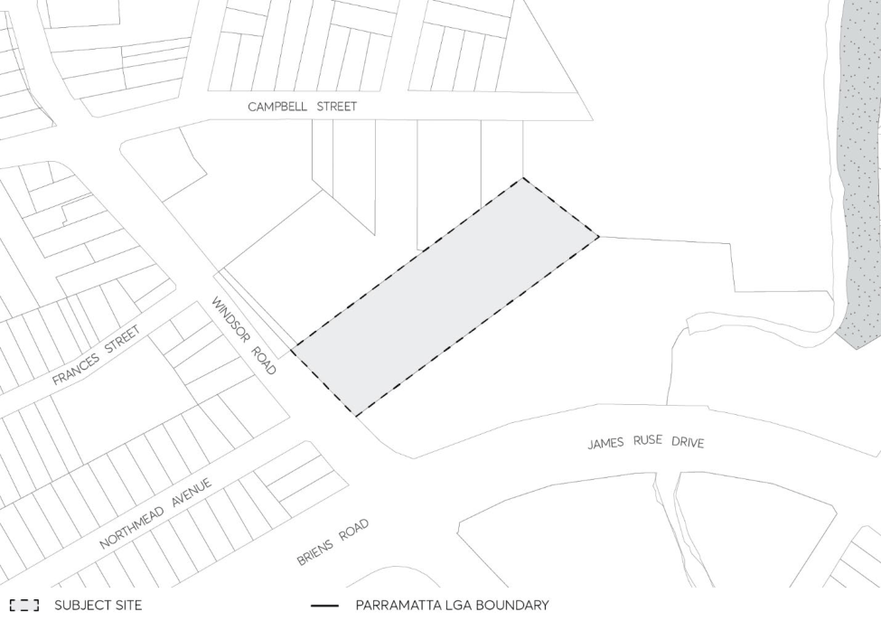

#### 8.5.11 23-25 WINDSOR ROAD, NORTHMEAD

> [Picture on page 680: a picture, saved as a picture (images/part-08-centres-precincts-special-character-areas-specific-page-680-3.gif, 150 dpi).]

Figure 8.5.11.1 – Land application map
