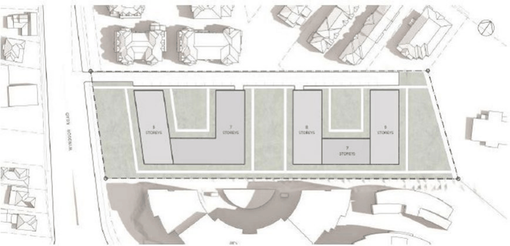
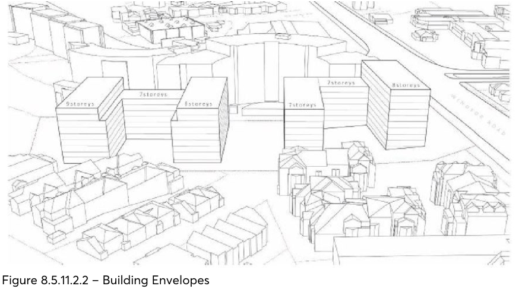
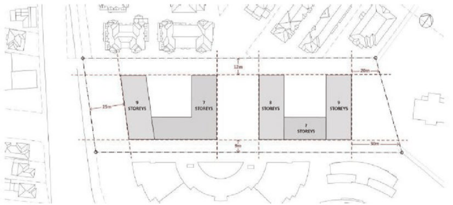
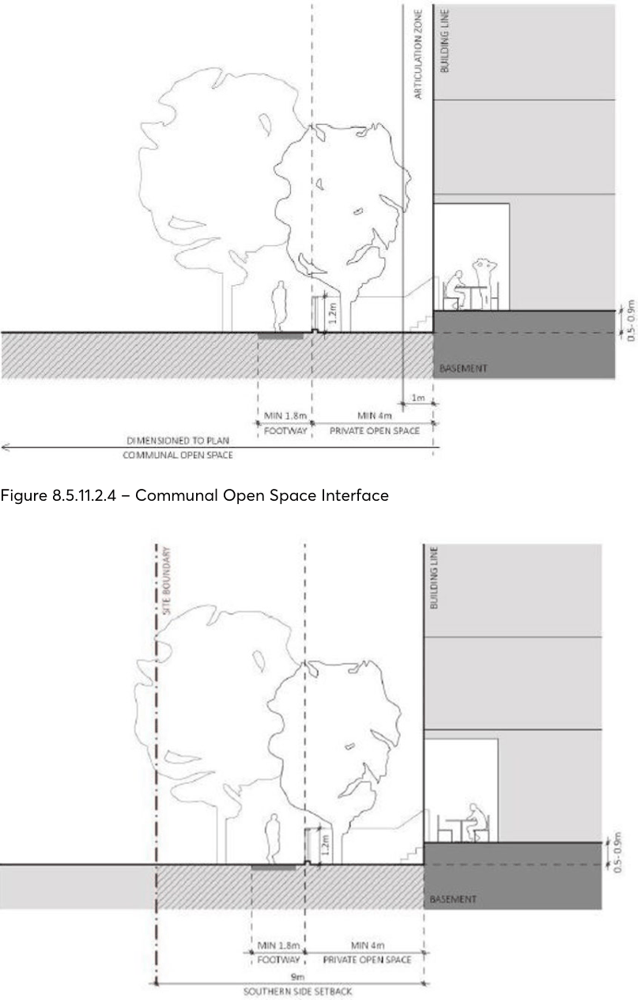
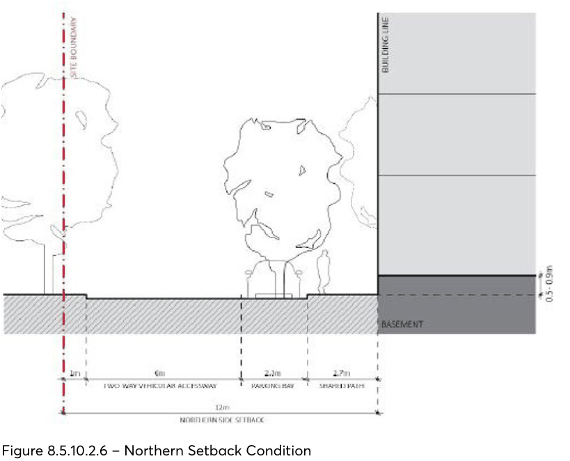
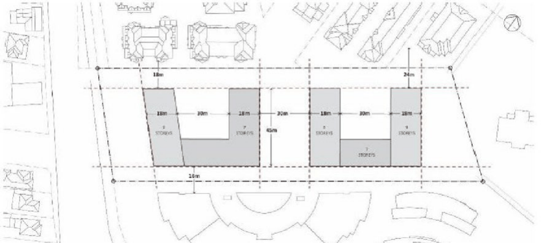
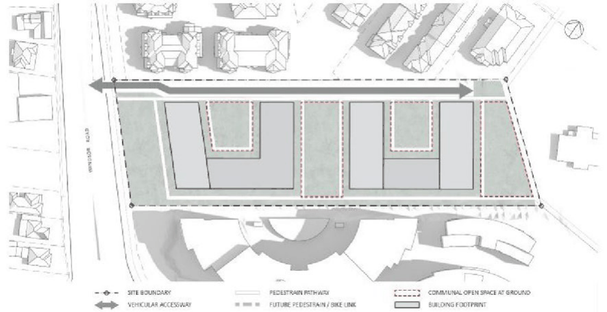
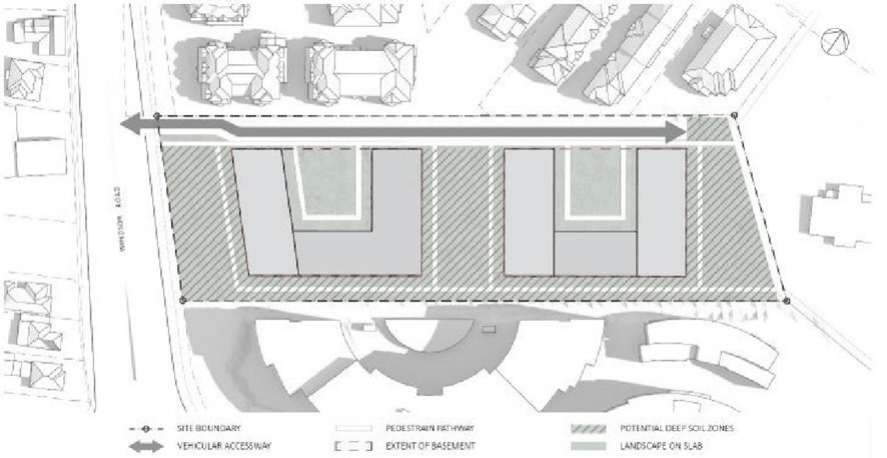
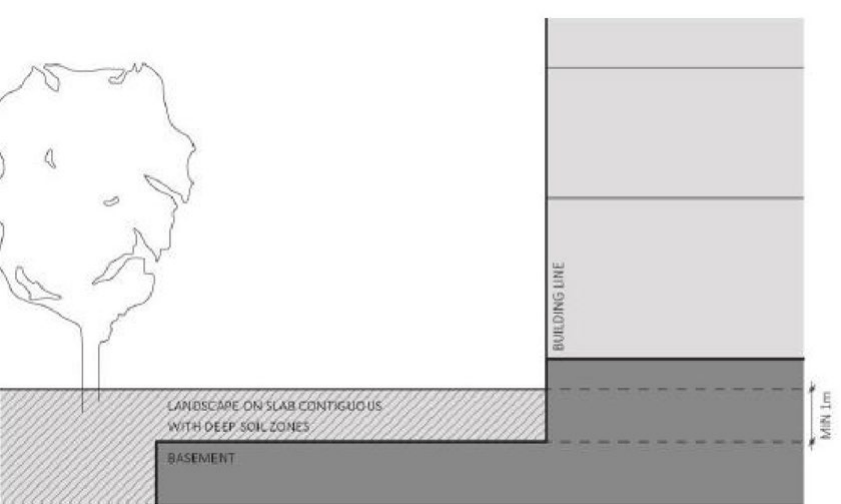
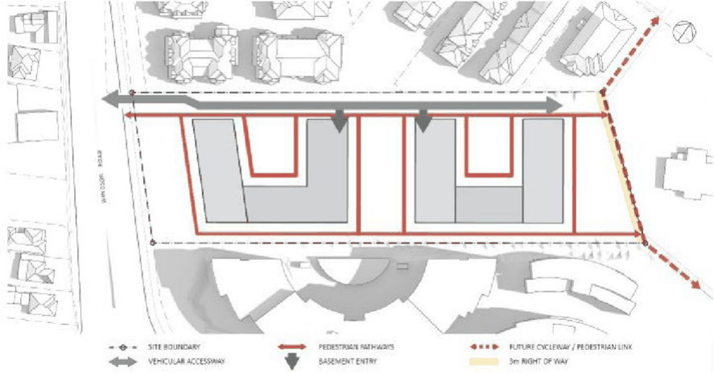

#### 8.5.11.2 BUILT FORM

The priority for this precinct is to deliver a built form that supports and rationalises the predominant subdivision pattern of this location, while providing a comfortable and amenable environment for both existing and future residents. The site’s spatial context is to be reinforced through an orthogonal arrangement of built form and centrally located open space. Building outcomes on-site should relate to a street wall typology, with appropriate upper levels setbacks.

As per the reference scheme below, regular U-shaped and north-west facing courtyards are to be maintained throughout the design development. All built form is to be designed perpendicular to the lot with the exception of the western wing, which is to be aligned with Windsor Road to create a legible continuation of the street wall as defined by the development to the south.

> [Picture on page 682: a picture, saved as a picture (images/part-08-centres-precincts-special-character-areas-specific-page-682-20.gif, 150 dpi).]

Figure 8.5.11.2.1 – 23 - 25 Windsor Road Reference Scheme

Objectives

Specific objectives for this site in relation to the built form are detailed below: O.01 Prioritise the spatial definition of streets (public and private) and open spaces through the organisation of taller buildings, creating a continuation of the existing street wall.

23-25 WINDSOR ROAD, NORTHMEAD

O.02 Respond to and reinforce the existing urban form through a centrally located open space and minimising building height to the centre of site.

O.03 Ensure new development responds to the sloping topography, the context of surrounding development and the visual setting of the site between various residential buildings.

O.04 Ensure that new development responds to the constraints imposed by neighbouring sites and maximises positive visual outlook within the development and adjoining sites.

O.05 Ensure built form is organised in an orthogonal manner that supports the predominant subdivision pattern in this location.

O.06 Create a clear delineation between public, communal and private spaces. O.07 Define and design the street alignment and setback area to achieve amenity and privacy for residents, as well as engagement with and passive surveillance of communal spaces.

O.08 Ensure the presentation of buildings to the internal streets provides clearly defined edges and corners, and an architectural resolution that relates to the ground plane with legible entries.

Controls

Building envelope The building envelope, resulting from the setbacks and heights outlined in this DCP constitute a three dimensional volume within which, together will all other applicable controls, a coherent built form is to be designed. Future built form should provide a high-quality design solution and correlate with the indicative building envelopes shown at Figure 8.5.11.2.2.

> [Picture on page 683: a picture, saved as a picture (images/part-08-centres-precincts-special-character-areas-specific-page-683-21.gif, 150 dpi).]

Figure 8.5.11.2.2 – Building Envelopes

C.01 Maximum building heights shall be in accordance with Figure 8.5.11.2.2, utilising regular building forms that utilise the sloping topography and minimise the perceived density of development.

C.02 Height of new buildings are to ensure positive and cohesive relationships with other buildings, both on the site and off the site, and are to respond to the desired scale and character of the local area.

23-25 WINDSOR ROAD, NORTHMEAD

C.03 Floor to ceiling and floor to floor heights are to be in accordance with the NSW Apartment Design Guide.

C.04 Setbacks are to be measured perpendicular to the boundary to the outer faces of the building including balconies, winter gardens, screening and the like. A 1 metre articulation zone may be provided where primary private open spaces face communal open space.

C.05 Building setbacks are to be in accordance with Figures 8.5.11.2.3 to 8.5.11.2.6 and Table 8.5.11.2.1.

> [Picture on page 684: a picture, saved as a picture (images/part-08-centres-precincts-special-character-areas-specific-page-684-8.gif, 150 dpi).]

Figure 8.5.11.2.3 – Building Heights and Setbacks

Table 8.5.11.2.1 – Building setbacks

| Front setback | 25 metres | The front setback is to be parallel to Windsor Road, providing a continuation of the existing street wall. The area within the front setback is to allow space for a generous tree canopy, providing amenity for the street and residents. |
|---|---|---|
| Rear setback | 20 metres at northern edge and 30 metres at southern edge | The rear setback is to maintain a large curtilage to significant trees to the rear of the site, providing opportunity for additional large canopy planting. |
| Northern setback | 12 metres | The northern setback is to allow for the maximum retention of trees on the shared boundary and provide the primary vehicular access, one lane of parallel parking and pedestrian thoroughfare on-site |
| Southern setback | 9 metres | The southern setback provides for a separation distance that may be less than ADG requirements. Therefore, detailed schemes are to minimise the number of habitable rooms on this boundary. The southern setback at ground may be used for private open space opportunities for south facing ground floor units. |

23-25 WINDSOR ROAD, NORTHMEAD

> [Picture on page 685: a picture, saved as a picture (images/part-08-centres-precincts-special-character-areas-specific-page-685-2.gif, 150 dpi).]

Figure 8.5.11.2.4 – Communal Open Space Interface

Figure 8.5.11.2.5 – Southern Setback Condition

23-25 WINDSOR ROAD, NORTHMEAD

> [Picture on page 686: a picture, saved as a picture (images/part-08-centres-precincts-special-character-areas-specific-page-686-2.gif, 150 dpi).]

Figure 8.5.10.2.6 – Northern Setback Condition

Building separation To protect and manage the impact of new development on the public domain, neighbouring sites and between buildings on-site, the following buildings separations requirements are to be met: C.06 Minimum separation between buildings should be in accordance with Figure 8.5.11.2.7 and the NSW ADG requirements.

C.07 Habitable spaces are to be carefully positioned within each unit to ensure that visual and acoustic privacy is maximised.

C.08 Setbacks and separation must be measured perpendicular to the building face, inclusive of balconies, wintergardens, vertical and horizontal circulation, internal voids and external walls.

23-25 WINDSOR ROAD, NORTHMEAD

> [Picture on page 687: a picture, saved as a picture (images/part-08-centres-precincts-special-character-areas-specific-page-687-2.gif, 150 dpi).]

Figure 8.5.10.2.7 – Building Separation

Private and communal open spaces C.09 Communal open space and landscaped areas should be provided between buildings as shown in Figure 09 to promote opportunities for community interaction within the development.

C.10 Areas between buildings should allow for pedestrians to comfortably move between the buildings, and promote the principles of passive surveillance. These communal areas should provide a safe and unobstructed path of travel, as opposed to private space.

C.11 Communal open spaces are to be designed to maximise solar access in mid-winter and canopy cover in mid-summer.

C.12 Opportunities for seating and gathering spaces for passive recreation, play and informal activities such as outdoor dining are to be provided within the internal circulation system of the development is to be provided where appropriate.

C.13 Water Sensitive Urban Design principles shall be implemented in communal open space areas. C.14 Fencing fronting the communal open spaces must not exceed 1.2 metres in height, are to be of solid masonry construction and integrated with any dividing walls for private open spaces at ground. Higher fencing may be considered on Windsor Road, subject to context analysis. Fencing on side boundaries is to be provided to a maximum height of 1.8 metres.

C.15 All balconies are to meet the minimum dimensions required in the NSW ADG. Wintergardens may be permitted on Windsor Road to improve the amenity of apartments fronting this arterial

road. The floor space of the wintergarden will be excluded from the FSR calculations provided that it complies with and does not exceed the ADG.

C.16 Council may consider allowing greater building depths where this will not unnecessarily add to the bulk of any building and where high-quality building design, massing and articulation is achieved.

23-25 WINDSOR ROAD, NORTHMEAD

> [Picture on page 688: a picture, saved as a picture (images/part-08-centres-precincts-special-character-areas-specific-page-688-2.gif, 150 dpi).]

Figure 8.5.10.2.8 – Communal Open Space

Landscaping and deep soil C.17 Landscaping and deep soil shall be provided in accordance with Part 2 – Design in Context of this DCP, Figure 8.5.11.2.9 and Figure 8.5.11.2.10.

C.18 A detailed landscape plan is to be prepared demonstrating the location of all contiguous deep soil areas with proposed landscaping, including retained and new canopy trees, submitted to the satisfaction of Council.

C.19 Deep soil is provided in a contiguous manner to facilitate healthy soils, uninterrupted flows of groundwater, and opportunity for existing and new trees to thrive and reach mature height.

C.20 Existing trees on the site are to be retained, as possible. Future development must not impinge on TPZ requirements of all trees in the neighbouring property must be protected and retained.

C.21 Landscaping should include endemic species suitable to the environmental constraints and orientation of communal open spaces shall be utilised throughout the site.

C.22 The front setback is to be planted with large shady trees capable of reaching a mature height of more than 13 metres to provide a visual buffer and shading of the public footpath along Windsor road.

C.23 The rear setback should be planted with large trees, capable of reaching a mature height of more than 13 metre to enable Council’s vision of providing mature trees and natural shade in the City. Any new trees are to be planted more than 3 m away from any built structure.

C.24 Dual basements contained within the building envelope are to be provided, ensuring substantial and contiguous deep soil zones to the front, centre and rear.

C.25 Future redevelopment of the site is to meet the requirements of Parramatta LEP 2023, Parramatta DCP 2023, State Environmental Planning Policy No. 55 (Remediation of Land) and any other relevant legislation and guidelines.

C.26 Detailed design development must have regard to the sensitivity to flooding impacts, not impede overland storm water flows and able to meet the requirements of Council’s Flood Plain

23-25 WINDSOR ROAD, NORTHMEAD

Risk Management Plan, Parramatta LEP 2023 and Part 5 – Environmental Management of the Parramatta DCP 2023.

C.27 A report is to be submitted by a suitably qualified ecologist at Development Application stage demonstrating that there are no adverse impacts from the development.

C.28 A minimum setback of 1 metre is required between the northern boundary and the driveway to allow for landscaping while still maintaining site access at the northern most point of the site off Windsor Road.

> [Picture on page 689: a picture, saved as a picture (images/part-08-centres-precincts-special-character-areas-specific-page-689-9.gif, 150 dpi).]

Figure 8.5.10.2.9 – Potential Deep Soil Zones

23-25 WINDSOR ROAD, NORTHMEAD

> [Picture on page 690: a picture, saved as a picture (images/part-08-centres-precincts-special-character-areas-specific-page-690-2.gif, 150 dpi).]

Figure 8.5.10.2.10 – Landscaping on Slab Contiguous with Deep Soil Zones

Wintergardens C.29 Wintergardens must improve amenity of balconies in high rise apartments and apartments fronting noisy environments such as busy roads or railway lines.

C.30 Wintergardens are to be designed and constructed as a private external balcony with drainage, natural ventilation and finishes acceptable to an outdoor space and must not be treated as a conditioned space or weatherproof space.

C.31 Approximately 80% of vertical surface area of wintergardens are to be fully operable louvres or sliding glass panels.

C.32 A generous opening must be provided between the wintergarden and any adjacent living area to allow connection of the spaces when ambient conditions are suitable.

C.33 Acoustic control for living areas and bedrooms must be provided on the internal façade line between the wintergarden and the living area or bedroom.

C.34 Glazing in the external façade of a wintergarden must have a solar absorption of less than 35%glass to have solar heat absorption not greater than a clear float glass of the same composition.

C.35 The flooring of the wintergarden must be an impervious finish and provide exposed thermal mass.

C.36 Air conditioning units must not be located on wintergarden balconies. Solar access, ventilation & acoustic amelioration C.37 Buildings are to be designed to ensure that solar access and cross ventilation requirements detailed in SEPP 65, the NSW Apartment Design Guide and Part 3 – Residential Development of this DCP are achieved for residential development both on and off the site.

23-25 WINDSOR ROAD, NORTHMEAD

C.38 Solar access must also be reasonably provided/retained within the existing and future public domain areas and on adjoining sites to maximise solar access in mid- winter and canopy cover and shading in mid-summer.

C.39 The design of buildings must take account of the need for adequate acoustic amelioration measures for new development, particularly where buildings have an interface with major roads, including Windsor Road and James Ruse Drive or other non-residential uses in proximity to the site.

Pedestrian connections and vehicular access way C.40 New pedestrian and vehicular connections are to be provided in accordance with Figure 8.5.11.2.11.

C.41 The vehicular access way is to be designed to have a fully public nature equivalent to the surrounding public domain and suitably designed to integrate with adjoining road and pedestrian networks.

C.42 New pedestrian connections are to be provided between the buildings, to enable linkages to recreated to both Windsor Road and the future pedestrian/bike link to the east and improve the development interface and amenity with all adjacent properties and frontages.

C.43 All site circulation must be provided as 24hr publicly accessible circulation - designed to provide building entries that are easily identifiable, with a clear sense of building address for residents and their visitors.

C.44 Main building entry points must be clearly visible and signalled appropriately with building address, lighting and high-quality articulation. Steps, handrails or TGSIs must not protrude into or interfere with any vehicular or pedestrian access way.

C.45 The pedestrian link along the eastern boundary must be publicly accessible by 24/7 access easement in favour of Council in accordance with the Voluntary Planning Agreement prior to the first Occupation Certificate and is to be clearly delineated as public space.

C.46 New development is to be sited to appropriately integrate with and address pedestrian links ensuring activation and casual surveillance. Tall fencing is not to be provided adjacent to the pedestrian links.

C.47 All internal pedestrian systems shall incorporate access in accordance with AS 1428 and any other relevant standard. These pathways are to enable a future connection to the school from the development to the south to the external pedestrian system surrounding the site.

C.48 Public domain alignment drawings are to be submitted to the satisfaction of Council. All levels are to be resolved and proposed public domain treatments shown in accordance with the requirements outlined in the Parramatta Public Domain Guidelines 2017 (Chapter 2).

C.49 A minimum width of 9 metres is to be provided to the vehicular access way, inclusive of two-way vehicular access and at least one lane of parallel parking.

C.50 A minimum width of 1.8 metres is to be provided for all pedestrian pathways. C.51 A minimum width of 2.8 metres is to be dedicated for the future pedestrian and cycleway shared path along the new vehicle access way and eastern boundary. It should be publicly accessible by a 24/7 access easement in favour of Council in accordance with the Voluntary Planning Agreement prior to first Occupation Certificate.

23-25 WINDSOR ROAD, NORTHMEAD

> [Picture on page 692: a picture, saved as a picture (images/part-08-centres-precincts-special-character-areas-specific-page-692-2.gif, 150 dpi).]

Figure 8.5.11.2.11 – Pedestrian Connections and Vehicular Access way

Traffic, access, parking & services C.52 All car parking is to be provided at basement level to ensure that the visual appearance of car parking structures does not dominate the building design. Basement structures may not protrude any greater than 1 metre above natural ground.

C.53 Building services and access to car parking areas are to be minimised to the internal street frontages to ensure that a high level of design excellence is achieved and opportunities for passive surveillance are maximised. Pedestrian and vehicle conflict are to be minimised with limited vehicle crossings to the public domain and internal access way.

C.54 Vehicle crossings are to be provided in accordance with Figure 8.5.11.2.11 (above), or as otherwise agreed by Council.

C.55 Vehicle crossings must not provide conflict with pedestrian through site links or any pedestrian crossing.

C.56 The width and surface area of driveways and other hard surfaces associated with the movement and parking of vehicles is to enable 2 vehicles plus one lane of parallel parking.

C.57 Provision of loading bays or service vehicle areas, building service/plant areas, and building services (such as substation) must be adequately screened from any public domain areas, including the street, through site links.

C.58 The vehicular access way must maintain its potential to connect through the adjacent school to Campbell Street in the future. This access way is to terminate in a hammer head, rather than a cul-de-sac configuration, so as to maintain the visual continuity of this link and kerb lines.

263-281 PENNANT HILLS ROAD, CARLINGFORD
