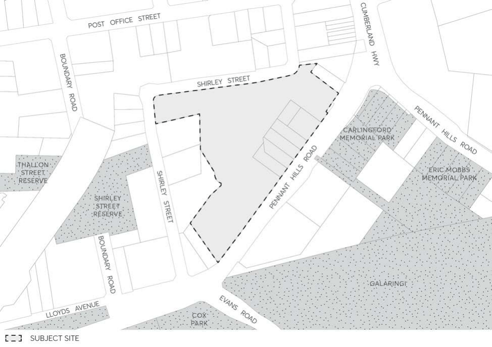

#### 8.5.12 263-281 PENNANT HILLS ROAD, CARLINGFORD

This Section applies to 263-281 Pennant Hills Road, Carlingford as shown in Figure 8.5.12.1 – Land Application Map and must be read in conjunction with any relevant Parts of the Parramatta DCP 2023. Where there are inconsistencies between the controls contained within this Section and any other controls within this DCP, the 263–281 Pennant Hills Road provisions will prevail to the extent of the inconsistency. This site is situated within the Carlingford Local Centre identified in Council’s Local Strategic Planning Statement City Plan 2036.

> [Picture on page 693: a picture, saved as a picture (images/part-08-centres-precincts-special-character-areas-specific-page-693-9.gif, 150 dpi).]

Figure 8.5.12.1 - Land Application Map
