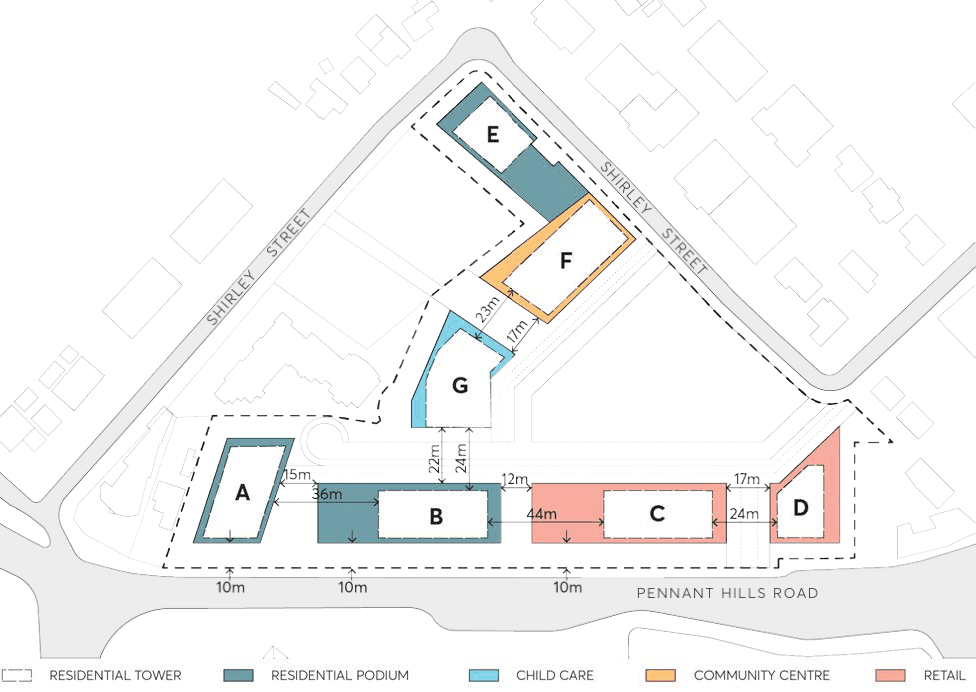

#### 8.5.12.3 INDICATIVE SITE STRUCTURE

The indicative structure plan and arrangement of building lots and open space seek to shape the way the site is experienced. This will be achieved through the definition and spatial relationship of streets, public spaces and built form. These elements should operate in harmony to create a rich experience for public and private spaces.

The building envelopes should be located to reinforce view corridors, create a layered spatial network, and manage private and public uses. Taller towers are to be located strategically with generous separation. The building envelopes are to be designed to respond to the topography and tested for separation distances and amenity of the public domain and neighbouring properties, both existing and future.

Objectives

O.01 Ensure development occurs in a coordinated manner, consistent with the Indicative Layout Plan.

O.02 Appropriately define and design the alignment of built forms, improving the pedestrianised and urban character of the public domain.

O.03 Ensure buildings are organised to define the streets and open spaces, provide deep soil and create a legible public domain.

O.04 Ensure key elements, such as public open spaces, through-site links are provided. O.05 Provide for community facilities, non-residential uses and higher density living. O.06 Ensure the built form outcomes respond to the topography of the site. O.07 Integrate the new development with the existing street network and provide for new roadways that represent an extension of the existing network.

O.08 Prioritise pedestrian and cyclist movement. O.09 Facilitate safe and efficient movement of vehicles, pedestrian and cyclists. O.10 Create attractive, comfortable and inviting streetscapes for the local community.

Controls

C.01 The street layout, through-site links, open space, setbacks, and development sites are to be consistent with the Plan shown in Figure 8.5.12.2.

C.02 Privately-owned pedestrian connections and internal streets are to be publicly accessible 24/7.

263-281 PENNANT HILLS ROAD, CARLINGFORD

> [Picture on page 697: a picture, saved as a picture (images/part-08-centres-precincts-special-character-areas-specific-page-697-2.gif, 150 dpi).]

Figure 8.5.12.2 - Indicative site layout and tower separation
