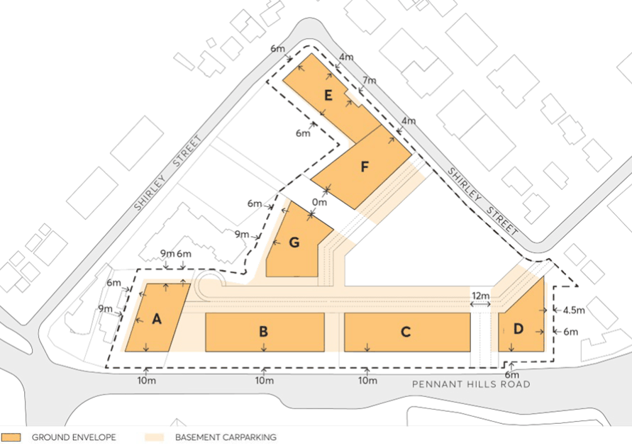
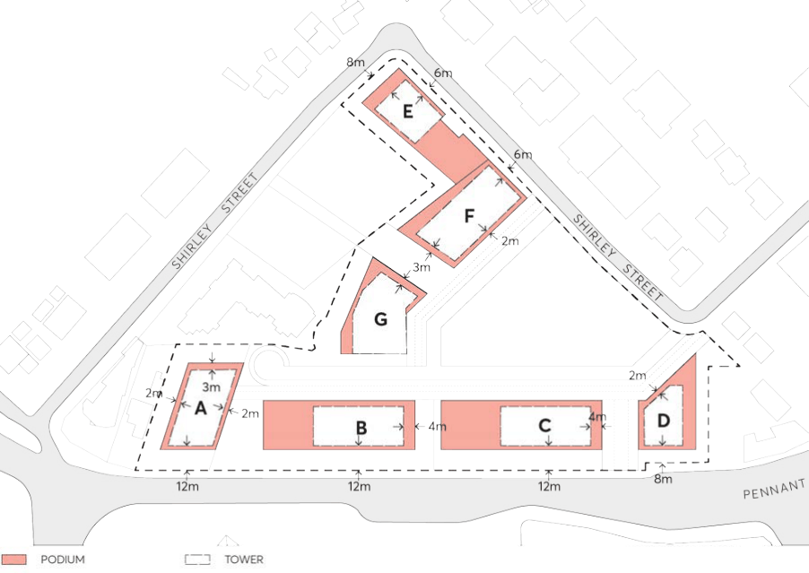

#### 8.5.12.4 SETBACKS

Street Setbacks - The purpose of establishing street setbacks is to provide a landscape setting for new buildings, ensuring an appropriate interface with the street and relationship to adjoining development. Setbacks also ensure good amenity and solar access, ground floor usage, building separation, landscaping, deep soil and public domain requirements. The setbacks should also provide necessary space for deep soil and landscaping, and amenity, both for residents and the street.

Tower Setbacks - Towers are set back above podiums to reinforce the scale of the streets, mitigate wind and urban heat impacts, enable views to the sky, visually delineate towers as free-standing buildings and protect amenity in streets and public places.

Objectives

O.01 Reinforce the appropriate spatial definition of streets and public spaces. O.02 Emphasise the importance of the streets as a distinct spatial entity and design the street interface and street wall with an appropriate human scale and sense of enclosure for the street.

O.03 Ensure consistent street frontages with buildings having common setbacks and alignments.

263-281 PENNANT HILLS ROAD, CARLINGFORD

O.04 Provide building forms that achieve comfortable public domain conditions for pedestrians, with adequate daylight, appropriate scale, and adequate mitigation of wind effects on tower buildings.

O.05 Create a clear delineation between public and private space. O.06 Provide a landscape interface between buildings and streets, to enable deep soil and street tree planting.

O.07 Reinforce important elements of the local context, namely public open spaces, key attractions and landscape elements.

O.08 Protect daylight access at street level and permit views of sky from the street by providing setbacks above street frontage height that promote separation between buildings.

O.09 Tower forms should be designed so that they are visually and physically separated from the podium. Separation should be achieved by a combination of architectural expression and design, materiality and setbacks.

Controls

C.01 Building Setbacks (Podium) The building setbacks at ground level are to be in accordance with Figure 8.5.12.3 as provided below:

a) Pennant Hills Road: The front façade of all buildings is to be setback 10 metres from the front boundary of the site for the entire Pennant Hills Road frontage.

b) Shirley Street, Northern frontage: 4m setback

c) Shirley Street, Western frontage: 6m setback

d) Internal Roadways: 4m setback

e) Through-site links: Nil setback is permitted

f) Buildings adjacent to boundaries shared with adjoining properties: to satisfy the Apartment Design Guideline (ADG) habitable room/balconies separation controls

C.02 Podium setbacks are to include deep soil landscaping to encourage the provision of vegetation softening the built forms.

C.03 Awnings are permitted to encroach the podium setbacks on active frontages interfacing with the public domain, where necessary, to improve the useability and amenity of the site.

C.04 Podium setbacks may include the encroachment of architectural elements and features to a depth of 600mm where they provide visual interest. This can include elements such as balconies, fins and the like.

C.05 Vehicle access and basement entries are to be wholly located within the building footprint and not encroach on the 10m Pennant Hill Road landscape setback.

263-281 PENNANT HILLS ROAD, CARLINGFORD

> [Picture on page 699: a picture, saved as a picture (images/part-08-centres-precincts-special-character-areas-specific-page-699-2.gif, 150 dpi).]

Figure 8.5.12.3 – Minimum required basement and ground level building setbacks

C.06 Upper-Level Setbacks Minimum upper-level building setbacks above the podium are provided below and shown in Figure 8.5.12.4.

a) Buildings fronting Pennant Hills Road, internal streets and the Central Park (buildings A-F) 2m.

b) The North-Eastern edge of buildings B & C: 4m setback.

c) The community link between buildings G & F: 3m setback.

d) The Southern edge of building D: 2m.

e) Buildings fronting Shirley Street (buildings E-F): 2m setback.

f) Buildings adjacent to boundaries shared with adjoining properties: to satisfy ADG habitable room/balconies separation controls.

263-281 PENNANT HILLS ROAD, CARLINGFORD

> [Picture on page 700: a picture, saved as a picture (images/part-08-centres-precincts-special-character-areas-specific-page-700-2.gif, 150 dpi).]

Figure 8.5.12.4 - Minimum Required Upper-Level Building Setbacks and Tower Location
